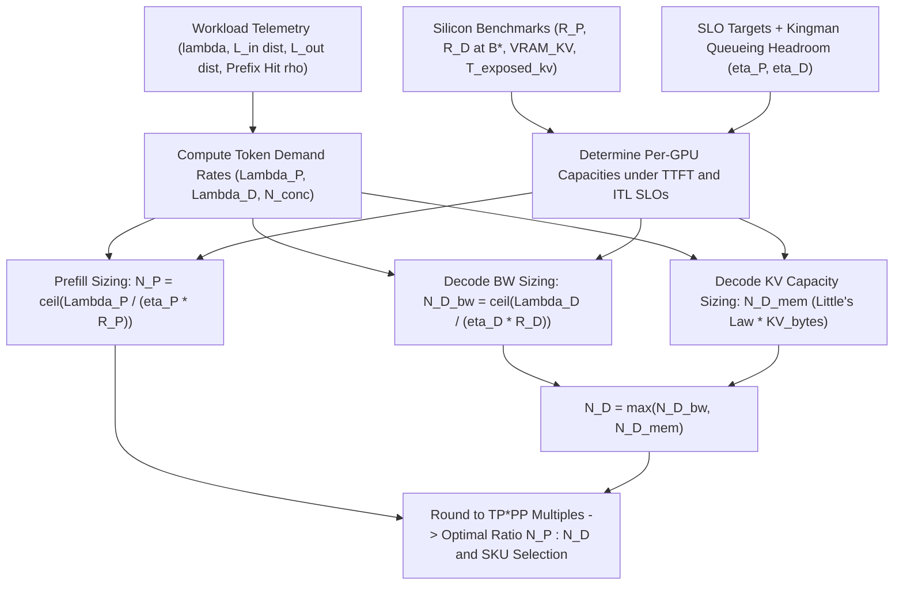
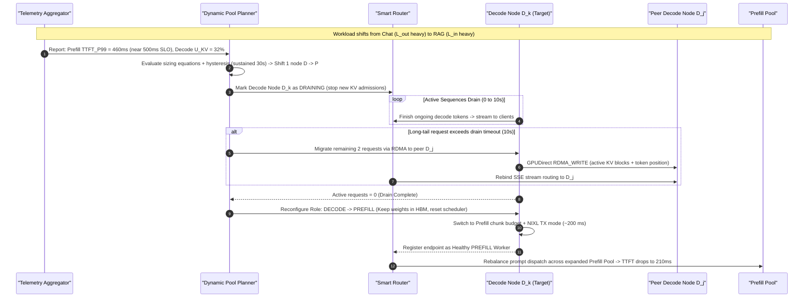

# 05 — Cluster Sizing & Prefill-to-Decode Ratio

> **Navigation:** [Prev: 04 — Distributed MoE Systems Engineering](./04-distributed-moe-systems-engineering.md) | [Stage 9 Index](./README.md)

When prompt processing and token generation run on separate GPU pools, cluster operators must decide how many GPUs to assign to each pool as traffic changes. This document derives the exact sizing formulas, queueing rules, and dynamic rebalancing protocols used to match hardware capacity to shifting workloads.

---

## Core Concepts & Terminology

Every workload metric, queueing formula, and cluster-orchestration term used in this document is defined below in dependency order:

### 1. Disaggregated Pools & Latency SLOs
* **Prefill Pool ($N_P$), Decode Pool ($N_D$), & $N_P : N_D$ Ratio:** In a disaggregated cluster, $N_P$ GPUs handle prompt processing (**Prefill**) and $N_D$ GPUs handle token-by-token generation (**Decode**).
* **SLO, TTFT, ITL, & P95/P99:** A **Service Level Objective (SLO)** is a strict latency target, usually enforced at the 95th or 99th percentile (**P95/P99**). **TTFT** (Time to First Token) measures prompt-to-first-token latency; **ITL** (Inter-Token Latency) measures the delay between consecutive output tokens.
* **Exposed KV Transfer Latency ($T_{\text{exposed\_kv}}$):** Any unhidden network time spent transferring the KV Cache from Prefill to Decode that adds directly to TTFT.

### 2. Workload & Hardware Capacity Metrics
* **Arrival Rate ($\lambda$), $L_{\text{in}}$, $L_{\text{out}}$, & Prefix Cache Hit Rate ($\rho$):** $\lambda$ is incoming requests per second. $L_{\text{in}}$ and $L_{\text{out}}$ are prompt and output token lengths (with means $\bar{L}_{\text{in}}, \bar{L}_{\text{out}}$). $\rho \in [0, 1)$ is the fraction of prompt tokens already stored in a warm **Prefix Cache**, skipping Prefill compute.
* **Workload Regimes (Chat, RAG, Agentic Coding):** *Interactive chat* has short prompts and long replies; **RAG (Retrieval-Augmented Generation)** and *agentic coding* inject huge documents or codebases into prompts ($L_{\text{in}} \gg L_{\text{out}}$).
* **Prefill & Decode Goodput ($R_P$, $R_D(B^*)$) & Optimal Batch Size ($B^*$):** **Goodput** is sustained token throughput per GPU while meeting SLOs. $R_P$ is prefill tokens/s/GPU within $\text{SLO}_{\text{TTFT}}$. $R_D(B^*)$ is decode output tokens/s/GPU at the largest batch size $B^*$ whose step time $T_{\text{step}}(B^*)$ still satisfies $\text{SLO}_{\text{ITL}}$.
* **HBM, $\text{VRAM}_{\text{KV\_per\_GPU}}$, PagedAttention, GQA, & FP8:** **HBM** is high-speed GPU memory. $\text{VRAM}_{\text{KV\_per\_GPU}}$ is the HBM left for **PagedAttention** KV Cache blocks after subtracting model weights, activation workspace, and **CUDA context** overhead. **GQA** (Grouped-Query Attention) and **FP8** (1-byte floats) shrink KV bytes per token.
* **Parallelism Multiples ($TP_P, PP_P, TP_D, PP_D$):** Each Prefill or Decode instance spans $TP \cdot PP$ GPUs (Tensor Parallelism $\times$ Pipeline Parallelism), so $N_P$ and $N_D$ must be rounded up to multiples of their instance sizes.

### 3. Queueing Theory & Memory Concurrency
* **Utilization Headroom ($\eta_P, \eta_D$) & Stochastic Arrivals:** Real traffic arrives randomly (**Poisson/bursty arrivals**). Running any queue at 100% utilization ($\eta = 1$) drives wait times to infinity, so clusters target headroom $\eta < 1$.
* **Little's Law:** A fundamental queueing law stating that average concurrent active requests equal arrival rate times average residence time: $N_{\text{conc}} = \lambda \cdot \bar{T}_{\text{decode}}$.
* **Kingman's M/G/1 Queueing Approximation ($W_q, C_a^2, C_s^2$):** Estimates average queue wait time $W_q$ from utilization $\eta$, arrival variance $C_a^2$, and service-time variance $C_s^2 = \sigma^2 / \mu^2$ (squared coefficient of variation). High-variance Prefill ($C_s^2 \gg 1$) needs lower utilization ($\eta_P$) than smooth Continuous-Batching Decode ($C_s^2 \ll 1$).

### 4. Elastic Role-Switching & Rebalancing
* **Cold Start vs. Zero-Cold-Start Role-Switching:** Loading a 70B–671B model from S3/NVMe into HBM takes 30–180 s (**cold start**). Because Prefill and Decode hold the exact same model weights, planners (**NVIDIA Dynamo Planner**, **Splitwise**, **SGLang Router**) can switch a node's role in ~50–500 ms without reloading weights.
* **CUDA Graphs, `max_num_batched_tokens`, & Chunked Prefill:** **CUDA Graphs** capture fixed GPU kernel sequences for fast Decode; switching to Prefill mode reconfigures the scheduler to allow larger token batches (`max_num_batched_tokens`) and **Chunked Prefill**.
* **Hysteresis (*Flapping*), `DRAINING`, `EOS`, GPUDirect RDMA, NIXL, & SSE:** **Hysteresis** waits for a sustained imbalance before switching roles so the cluster does not oscillate (*flap*). Placing a node in **`DRAINING`** stops new admissions until active requests hit **`EOS`** (End of Sequence) or migrate over **GPUDirect RDMA / NIXL** without dropping the client's **SSE** (Server-Sent Events) token stream.

---

## 1. Analytical Foundations & Input Variables

Disaggregating a serving cluster into separate Prefill and Decode pools unlocks independent scaling—but immediately raises the central capacity-planning question: **Given a target workload and strict SLOs, how many Prefill GPUs ($N_P$) and how many Decode GPUs ($N_D$) must be provisioned, and what is the optimal $N_P : N_D$ ratio?** Over-provisioning $N_P$ leaves expensive Tensor Cores idle waiting on prompts while Decode queues overflow KV VRAM; under-provisioning $N_P$ creates queueing backlogs that blow up TTFT, and real-world shifts from chat to RAG or agentic coding can flip the optimal $N_P : N_D$ ratio by **nearly two orders of magnitude**.

To size a disaggregated cluster rigorously, separate **workload demand parameters**, **empirically benchmarked hardware capacities**, and **SLO constraints**:

### A. Workload Parameters
* $\lambda$: Target peak request arrival rate ($\text{requests/s}$).
* $L_{\text{in}}, L_{\text{out}}$: Random variables for prompt input length and generated output length (with means $\bar{L}_{\text{in}}, \bar{L}_{\text{out}}$ and squared coefficients of variation $C_{\text{in}}^2 = \sigma_{\text{in}}^2 / \bar{L}_{\text{in}}^2$).
* $\rho \in [0, 1)$: Effective **prefix cache hit rate** (fraction of input tokens whose KV states are already warm in cache and bypass Prefill computation).
  * Effective uncached prefill length: $\bar{L}_{\text{eff}} = (1 - \rho)\,\bar{L}_{\text{in}}$.

### B. Empirically Benchmarked Hardware Capacities (Under SLOs)
* $R_P$: Sustained **Prefill goodput** per Prefill GPU ($\text{prefill tokens/s/GPU}$) measured at the configured Prefill parallelism $(TP_P, PP_P)$ such that a median/P95 prompt completes within the compute budget of $\text{SLO}_{\text{TTFT}}$ (after subtracting exposed KV transfer latency $T_{\text{exposed\_kv}}$).
* $R_D(B^*)$: Sustained **Decode goodput** per Decode GPU ($\text{output tokens/s/GPU}$) at the **maximum batch size $B^*$ whose step time satisfies $\text{SLO}_{\text{ITL}}$**:
  $$T_{\text{step}}(B^*) \le \text{SLO}_{\text{ITL}} \implies R_D(B^*) = \frac{B^*}{T_{\text{step}}(B^*)}$$
  *Critical Physical Constraint:* As batch size $B$ increases, per-request ITL rises slowly at first (weight reads amortized across $B$), then climbs linearly once KV cache reads dominate HBM bandwidth. $B^*$ is the knee/boundary where $T_{\text{step}}(B^*)$ hits $\text{SLO}_{\text{ITL}}$ (e.g., 25–30 ms).
* $\text{VRAM}_{\text{KV\_per\_GPU}}$: Usable HBM per Decode GPU dedicated to PagedAttention KV blocks (total HBM minus model weights, activation workspace, and CUDA context overhead).

### C. Target Utilization Headroom ($\eta_P, \eta_D$)
In stochastic arrivals (Poisson/bursty traffic), running any queueing system at $\eta = 100\%$ utilization drives queueing wait time $W_q \to \infty$. Therefore, provision headroom factors $\eta_P, \eta_D \in (0, 1)$.

---

## 2. Deriving the Prefill-to-Decode Ratio ($N_P : N_D$)

### Step 1: Steady-State Token Conservation

Every arriving request generates two distinct token streams that must be drained at rate $\ge \lambda$:

$$\text{Prefill Demand Rate:} \quad \Lambda_P = \lambda \cdot (1 - \rho) \cdot \bar{L}_{\text{in}} \quad [\text{tokens/s}]$$

$$\text{Decode Demand Rate:} \quad \Lambda_D = \lambda \cdot \bar{L}_{\text{out}} \quad [\text{tokens/s}]$$

### Step 2: Compute / Bandwidth Bound on $N_P$ and $N_D$

To sustain $\Lambda_P$ and $\Lambda_D$ within utilization targets $\eta_P$ and $\eta_D$:

$$N_P = \left\lceil \frac{\lambda \cdot (1 - \rho) \cdot \bar{L}_{\text{in}}}{\eta_P \cdot R_P} \right\rceil$$

$$N_D^{\text{bw}} = \left\lceil \frac{\lambda \cdot \bar{L}_{\text{out}}}{\eta_D \cdot R_D(B^*)} \right\rceil$$

*(Note: $N_P$ and $N_D$ must subsequently be rounded up to integer multiples of their respective instance parallelism degrees $TP_P \cdot PP_P$ and $TP_D \cdot PP_D$.)*

### Step 3: Decode KV Memory Capacity Bound ($N_D^{\text{mem}}$)

Decode GPUs are frequently **HBM capacity-bound** before they are HBM bandwidth-bound—especially on long-context workloads ($L_{\text{in}} = 32\text{k}$) where each active decode sequence holds a multi-gigabyte KV cache for seconds!

By **Little's Law**, the average number of concurrent active requests in the Decode Pool is:

$$N_{\text{conc}} = \lambda \cdot \bar{T}_{\text{decode}} = \lambda \cdot \left(\bar{L}_{\text{out}} \cdot \text{ITL}_{\text{avg}}\right)$$

During its lifetime in Decode, an average request occupies KV memory for all prompt tokens plus half of its generated tokens ($\bar{L}_{\text{in}} + \frac{1}{2}\bar{L}_{\text{out}}$), plus any prefix cache retention buffer factor $\gamma_{\text{cache}} \ge 1$ (e.g., $\gamma_{\text{cache}} = 1.25$ to retain warm prefixes):

$$N_D^{\text{mem}} = \left\lceil \frac{\gamma_{\text{cache}} \cdot \lambda \cdot \bar{L}_{\text{out}} \cdot \text{ITL}_{\text{avg}} \cdot \left(\bar{L}_{\text{in}} + \frac{1}{2}\bar{L}_{\text{out}}\right) \cdot \text{KV}_{\text{bytes/tok}}}{\text{VRAM}_{\text{KV\_per\_GPU}}} \right\rceil$$

Therefore, the true required Decode GPU count is the maximum of the bandwidth bound and memory-capacity bound:

$$N_D = \max\!\Big(N_D^{\text{bw}},\; N_D^{\text{mem}}\Big)$$

### Step 4: The Optimal Prefill-to-Decode Ratio

When Decode is bandwidth-bound ($N_D = N_D^{\text{bw}}$), $\lambda$ cancels cleanly, revealing the fundamental **P/D Ratio Equation**:

$$\frac{N_P}{N_D} = \underbrace{\frac{(1 - \rho) \cdot \bar{L}_{\text{in}}}{\bar{L}_{\text{out}}}}_{\text{Workload Ratio}} \times \underbrace{\frac{\eta_D \cdot R_D(B^*)}{\eta_P \cdot R_P}}_{\text{Hardware Efficiency Ratio}}$$

And when Decode is memory-capacity-bound ($N_D = N_D^{\text{mem}}$), $\lambda$ also cancels, showing that long-context KV retention pushes $N_D$ up and pulls $N_P / N_D$ back down!

### Step 5: Queueing & Tail-Latency Correction ($\eta_P$ vs. $\eta_D$)

Why can't we simply set $\eta_P = \eta_D = 0.95$? By **Kingman's M/G/1 Queueing Approximation**, expected waiting time in queue $W_q$ scales as:

$$W_q \approx \left(\frac{\eta}{1 - \eta}\right) \cdot \left(\frac{C_a^2 + C_s^2}{2}\right) \cdot \bar{S}_{\text{service}}$$

* **Prefill has extreme service-time variance ($C_s^2 \gg 1$):** Prompts vary from 100 tokens (~8 ms) to 64,000 tokens (~5,000 ms). A single 64k prompt blocks a Prefill instance for seconds, creating massive queueing spikes for small prompts behind it unless $\eta_P$ is kept conservative (**$\eta_P \approx 0.60\text{–}0.75$**) or long prompts are routed to a dedicated long-context prefill lane.
* **Decode has low per-step variance ($C_s^2 \ll 1$):** Continuous Batching smooths iteration steps to ~20–30 ms each, allowing higher sustainable utilization (**$\eta_D \approx 0.80\text{–}0.85$**) without blowing P99 ITL.

---

## 3. Workload Regime Comparisons: How Traffic Flips the P/D Ratio

Let us apply the derived equations to a concrete production benchmark: **Llama-3.1-70B (FP8)** running on a homogeneous or matched **H100-SXM (80 GB)** / **H200 (141 GB)** reference point:
* Model weights (FP8): ~70 GB total $\implies$ at $TP=4$ on H100 (320 GB total HBM), ~17.5 GB/GPU weights + ~5 GB workspace $\implies \text{VRAM}_{\text{KV\_per\_GPU}} \approx 57.5\text{ GB/GPU}$.
* KV Cache size (GQA $n_{\text{kv}}=8$, FP8 KV): $160\text{ KB/token}$ (`0.00016 GB/token`).
* Benchmarked Prefill capacity: $R_P = 12,000\text{ prefill tok/s/GPU}$ (under $\text{TTFT} \le 500\text{ ms}$ for typical prompts).
* Benchmarked Decode capacity (at $B^* = 48$/GPU, $\text{ITL}_{\text{avg}} = 25\text{ ms} \le 30\text{ ms SLO}$): $R_D = \frac{48}{0.025} = 1,920\text{ output tok/s/GPU}$.
* Target headrooms: $\eta_P = 0.70$, $\eta_D = 0.80$.
* Hardware Efficiency Ratio: $\frac{\eta_D \cdot R_D}{\eta_P \cdot R_P} = \frac{0.80 \times 1920}{0.70 \times 12000} = \frac{1536}{8400} \approx \mathbf{0.183}$.
* Target traffic: $\lambda = 20\text{ req/s}$.

| Workload Regime | $\bar{L}_{\text{in}}$ | $\bar{L}_{\text{out}}$ | Prefix Hit ($\rho$) | Effective $\bar{L}_{\text{eff}}$ | $\Lambda_P$ (tok/s) | $\Lambda_D$ (tok/s) | $N_P$ (GPUs) | $N_D^{\text{bw}}$ / $N_D^{\text{mem}}$ | Optimal $N_P : N_D$ | Dominant Bottleneck |
| :--- | :---: | :---: | :---: | :---: | :---: | :---: | :---: | :---: | :---: | :--- |
| **A. Interactive Chat** | 400 | 800 | 0.10 | 360 | 7,200 | 16,000 | **1** *(min 1 instance)* | **11** / 1 | **~1 : 12** *(0.08 : 1)* | **Decode Bandwidth** ($L_{\text{in}} \ll L_{\text{out}}$) |
| **B. RAG / Doc Summarization** | 16,000 | 300 | 0.25 | 12,000 | 240,000 | 6,000 | **29** | **4** / 1 | **~7 : 1** | **Prefill Compute** ($L_{\text{in}} \gg L_{\text{out}}$) |
| **C1. Agentic Coding (No Prefix Cache)** | 24,000 | 400 | 0.00 | 24,000 | 480,000 | 8,000 | **58** | **6** / 2 | **~10 : 1** | **Extreme Prefill Compute** |
| **C2. Agentic Coding (With Prefix Cache)** | 24,000 | 400 | **0.80** | **4,800** | **96,000** | 8,000 | **12** | **6** / 2 | **~2 : 1** | **Balanced** (Prefix cache cut $N_P$ by $5\times$!) |
| **D. Long-Context Multi-Turn Reasoning** | 64,000 | 4,000 | 0.75 | 16,000 | 320,000 | 80,000 | **39** | 53 / **63** | **~1 : 1.6** | **Decode KV VRAM** ($N_D^{\text{mem}} > N_D^{\text{bw}}$!) |

### Critical Engineering Insights from the Table

1. **The 80x Ratio Swing (Chat vs. RAG):** Moving from Interactive Chat ($1:12$) to RAG ($7:1$) shifts the required $N_P : N_D$ ratio by **~84x**. A static co-located or rigidly partitioned cluster cannot serve both workloads without catastrophic under-utilization.
2. **Prefix Caching Is a Cluster-Sizing Multiplier:** In Agentic Coding (C1 vs. C2), raising prefix cache hit rate $\rho$ from $0\%$ to $80\%$ reduces required Prefill GPUs from **58 down to 12**, saving 46 H100 GPUs at identical throughput!
3. **Long-Context Reasoning Hits the Memory Wall (Regime D):** At $\bar{L}_{\text{in}} = 64\text{k}, \bar{L}_{\text{out}} = 4\text{k}$, Decode requires $N_D^{\text{bw}} = 53$ GPUs for bandwidth, *but* holding $20 \times (4000 \times 0.025) = 2,000$ concurrent requests at $\sim 10.5\text{ GB}$ KV each requires $\sim 21\text{ TB}$ of KV VRAM—forcing **$N_D^{\text{mem}} = 63$ H100 GPUs** (or switching the Decode Pool to **H200 141 GB** GPUs, which more than doubles $\text{VRAM}_{\text{KV\_per\_GPU}}$ from $57.5\text{ GB}$ to $118.5\text{ GB}$ and cuts $N_D^{\text{mem}}$ in half to **31 H200 GPUs**!).

---

## 4. Analytical Capacity-Planning Pipeline

---

## 5. Dynamic Role-Switching & Elastic Pool Rebalancing

Real production clusters face **diurnal and bursty regime shifts**: batch RAG pipelines dominate overnight, while interactive chat and agentic coding spike during work hours. Provisioning separate peak capacity for both $N_P$ and $N_D$ wastes 30–50% of cluster spend.

Modern disaggregated control planes (NVIDIA Dynamo Planner, Splitwise Mixed/Elastic Pools, SGLang Router) solve this with **Zero-Cold-Start Dynamic Role-Switching**:

### Why Role-Switching Is Fast (Seconds vs. Minutes)

Loading a 70B–671B model checkpoint from S3/NVMe into GPU HBM takes **30–180 seconds** (cold start). However, Prefill and Decode instances hold the **exact same model weights** in GPU HBM! Converting a Decode worker into a Prefill worker (or vice versa) requires **zero weight reloading**—only reconfiguring the scheduler mode, CUDA Graph batch shapes, and KV block allocator reservation.

### Step-by-Step Elastic Rebalancing Protocol

1. **Continuous Telemetry Collection (1–5 s window):**
   The Planner monitors:
   * Prefill pressure: Pending uncached prefill tokens ($Q_P$), P95/P99 TTFT vs. $\text{SLO}_{\text{TTFT}}$.
   * Decode pressure: Active KV block utilization ($U_{\text{KV}}$), active batch size $B / B^*$, P95/P99 ITL vs. $\text{SLO}_{\text{ITL}}$.
2. **Imbalance Detection & Hysteresis:**
   Suppose morning RAG traffic pushes Prefill queue $Q_P$ upward and $\text{TTFT}_{P99} > 0.85 \cdot \text{SLO}_{\text{TTFT}}$, while Decode Pool reports $U_{\text{KV}} = 35\%$ and $\text{ITL}_{P99} = 14\text{ ms} \ll 30\text{ ms}$. To prevent oscillation (*flapping*), hysteresis requires sustained imbalance for e.g. $30\text{ s}$ and checks that removing $k$ Decode instances keeps remaining Decode $U_{\text{KV}} < 75\%$.
3. **Graceful Drain of Target Decode Instance ($D_k$):**
   * Control Plane places $D_k$ in `DRAINING` state; Smart Router immediately stops assigning new KV reservations to $D_k$.
   * $D_k$ finishes active decode requests until `EOS` (typically 2–10 seconds).
   * **Long-Tail Sequence Migration (Optional):** If 1–2 ultra-long sequences linger on $D_k$ past a drain timeout (e.g., 10 s), $D_k$ transfers their active KV blocks via GPUDirect RDMA to a peer Decode node $D_j$, seamlessly migrating the live SSE stream without dropping the client!
4. **In-Place Role Reconfiguration ($D_k \to P_{\text{new}}$):**
   * $D_k$ clears its Decode KV arena, updates its local scheduler policy to `PREFILL_MODE` (high `max_num_batched_tokens`, chunked prefill enabled, transient KV ring buffer), and registers its NIXL/RDMA sender endpoint.
   * **Switching latency:** ~50–500 ms (no model reload!).
5. **Heterogeneous Caveat & Overflow Pool Pattern:**
   If the Decode Pool uses low-FLOP GPUs (e.g., `L40S`) and Prefill uses `H100`, an `L40S` cannot match `H100` TTFT on 32k prompts. In heterogeneous clusters, operators either:
   * Keep a small **Elastic Homogeneous Pool** (e.g., 15–20% `H100`/`H200` nodes) that role-switches freely between P and D, while specialized base capacity remains fixed; or
   * Route only **short prompts** ($L_{\text{in}} \le 1024$) to overflow `L40S` workers during prefill spikes while reserving `H100`s for long prompts.

---

> **Navigation:** [Prev: 04 — Distributed MoE Systems Engineering](./04-distributed-moe-systems-engineering.md) | [Stage 9 Index](./README.md) | [Docs Root](../../README.md)
