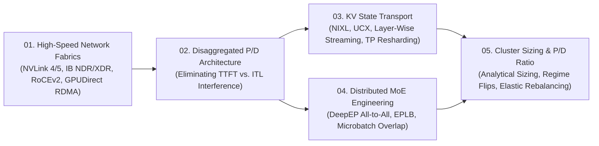

# Stage 9: Distributed & Disaggregated Inference

> **Navigation:** [Docs Root](../../README.md) | [Complete Syllabus](../../syllabus.md)

**Phase 3 — Kernels, Advanced Parallelism & Distributed Systems**

Single-node inference eventually collides with two physical walls: aggregate HBM capacity/bandwidth limits for frontier models, and fundamental resource contention when compute-bound **Prefill** and bandwidth-bound **Decode** share the same silicon. Stage 9 moves from single-node kernels to **datacenter-scale distributed inference architecture**. It establishes the physics of high-speed interconnects, the mechanics of physical Prefill/Decode disaggregation, zero-copy KV cache transport, sparse Mixture-of-Experts (MoE) Expert Parallelism at scale, and the analytical mathematics required to size and dynamically rebalance heterogeneous serving clusters.

---

## Architectural Progression

---

## Stage 9 Curriculum Index

| Order | Document | Core Engineering Focus |
| :--- | :--- | :--- |
| **01** | [**High-Speed Network Fabrics**](./01-high-speed-network-fabrics.md) | NVLink 4.0 (900 GB/s) vs. NVLink 5.0 (1,800 GB/s), NVSwitch coherent domains, InfiniBand NDR (400G) / XDR (800G) credit-based flow control, RoCEv2 PFC/ECN/DCQCN tuning, `libibverbs` zero-copy kernel-bypass, and GPUDirect RDMA over PCIe switches. |
| **02** | [**Disaggregated Prefill/Decode Architecture**](./02-disaggregated-prefill-decode-architecture.md) | Why co-located Prefill and Decode degrade TTFT and ITL; heterogeneous GPU selection; DistServe, Splitwise, Mooncake, and NVIDIA Dynamo/NIXL architectures; end-to-end request lifecycle; backpressure and failure modes. |
| **03** | [**KV State Transport**](./03-kv-state-transport.md) | KV byte-volume math; NIXL, UCX, and Mooncake Transfer Engine; push vs. pull semantics; layer-wise pipelined KV streaming; PagedAttention scatter-gather vs. contiguous staging; asymmetric TP/GQA head resharding; `ibv_reg_mr` pre-registration. |
| **04** | [**Distributed MoE Systems Engineering**](./04-distributed-moe-systems-engineering.md) | Expert Parallelism (EP) `All-to-All` dispatch/combine; DeepEP `IBGDA` kernels; heavy-tailed load imbalance and stragglers; capacity factor vs. dropless MegaBlocks Grouped GEMM; EPLB hot-expert replication; dual-microbatch ping-pong overlap. |
| **05** | [**Cluster Sizing & P/D Ratio**](./05-cluster-sizing-and-pd-ratio.md) | Analytical derivation of $N_P : N_D$ from $\lambda$, $L_{\text{in}}$, $L_{\text{out}}$, prefix cache hit rate $\rho$, hardware throughput $R_P, R_D$, KV VRAM capacity bounds, and queueing headroom; Chat vs. RAG vs. Agentic Coding regime flips; dynamic role-switching. |

---

## Cross-Stage Dependencies

* **Upstream Foundations:** Stage 9 builds directly on **Roofline physics & KV Cache arithmetic** (Phase 1), **PagedAttention & Continuous Batching** (Phase 2), **Tensor/Pipeline/Expert Parallelism primitives** ([Stage 7](../../syllabus.md#stage-7-speculative-decoding--advanced-parallelism)), and **Hardware-aware kernels** ([Stage 8](../../syllabus.md#stage-8-kernel-level-optimization)).
* **Downstream Integration:** The telemetry signals, MFU profiles, and dynamic P/D pool ratios established here directly drive **KEDA queue-based autoscaling, Spot draining, and inference unit economics** in [Phase 4 (Stages 10–12)](../../syllabus.md#phase-4-finops-intelligent-routing-edge--portfolio).

---

## Navigation

* **Up:** [Docs Root](../../README.md) | [Complete Syllabus](../../syllabus.md)
* **Previous Stage:** [← Stage 8: Kernel-Level Optimization](../stage-08/README.md)
* **Start Reading:** [01 — High-Speed Network Fabrics](./01-high-speed-network-fabrics.md)
* **Next Stage:** [Stage 10: Autoscaling, FinOps & Economics →](../../phase-4/stage-10/README.md)
