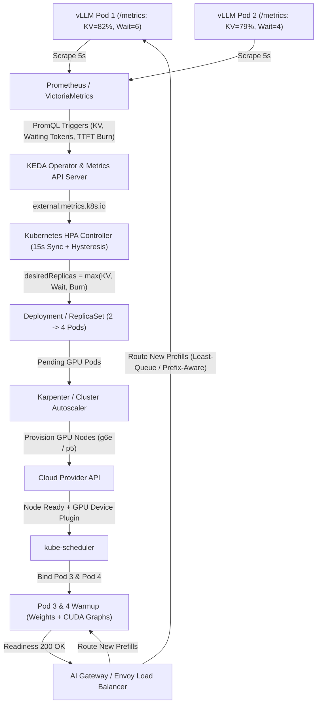
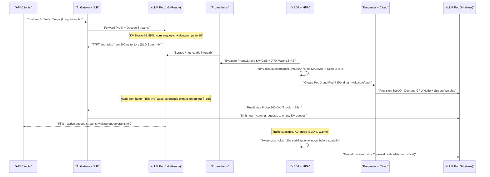

# 01. Inference-Metric-Driven Autoscaling

**Navigation:** [← Stage 10 Overview](./README.md) | **Topic 01 of 05** | [Next: Cold Start Mitigation →](./02-cold-start-mitigation.md)

---

Autoscaling automatically adds or removes computing servers as user demand rises and falls so applications stay fast without wasting money. Standard web-server scaling rules fail for Large Language Models (LLMs) because AI servers become overloaded in ways that traditional CPU and memory monitors cannot see—requiring specialized, AI-aware signals and careful timing controls.

## Core Concepts & Terminology

Every technical term, metric, and system component used in this document is defined below in dependency order so that each concept builds only on plain English or previously defined terms:

### A. LLM Inference & GPU Hardware Foundations
* **Token:** The basic unit of text processed by an LLM (roughly 3–4 characters or 0.75 words in English). Text is converted into numeric token IDs (**tokenization**) before processing and converted back to readable text (**detokenization**) afterward.
* **Weights ($P$ parameters):** The learned numerical values that make up a trained AI model. A "70B" model has 70 billion parameters.
* **FP16 & FP8 (16-bit / 8-bit Floating Point):** Compact numerical formats used to store weights and perform math. FP16 uses 2 bytes per number; FP8 uses 1 byte per number, halving memory size and doubling math speed.
* **GPU (Graphics Processing Unit), SM (Streaming Multiprocessor), & Tensor Core:** A specialized processor built for massive parallel math. An SM is a single compute block inside the GPU (an H100 has 132 SMs), and **Tensor Cores** are dedicated hardware circuits inside each SM that multiply matrices at very high speed.
* **FLOP / GFLOPs / TFLOPS:** A **Floating-Point Operation** is one arithmetic step (such as multiplying or adding two decimal numbers). GFLOPs = billions ($10^9$) of operations; TFLOPS = trillions ($10^{12}$) of operations per second.
* **CUDA & CUDA Kernel:** NVIDIA's programming platform for GPUs. A **CUDA kernel** is a single parallel function executed on the GPU's SMs. **CUDA Graph capture** records a fixed sequence of kernel launches at startup so the CPU can replay them in one call with minimal overhead.
* **VRAM & HBM / HBM3 (High Bandwidth Memory):** **VRAM** (Video RAM) is the dedicated high-speed memory soldered onto the GPU package. **HBM3** is a high-speed stacked variant of VRAM (e.g., 80 GB at 3.35 TB/s on an H100 SXM).
* **PCIe (Peripheral Component Interconnect Express):** The high-speed expansion bus connecting the host CPU and system RAM to GPUs, storage drives, and network cards.
* **Prefill vs. Decode:** LLM generation happens in two distinct phases:
  * **Prefill:** Processing the entire user input prompt in parallel to produce the very first output token. This phase is **compute-bound** (limited by Tensor Core FLOPs).
  * **Decode:** Generating subsequent output tokens one at a time, sequentially. Each step reads all model weights from HBM, making decode **memory-bandwidth-bound** (limited by HBM transfer speed rather than math speed).
* **Batch Size ($B$) & GEMV:** **Batch size** is the number of user requests processed together in a single GPU step. At `batch = 1`, decode performs **GEMV (General Matrix-Vector Multiplication)**, reading the entire model from HBM just to produce one token.
* **MFU (Model FLOPs Utilization) & MBU (Model Bandwidth Utilization):** **MFU** is the percentage of the GPU's peak theoretical math speed (TFLOPS) actually used. **MBU** is the percentage of the GPU's peak HBM memory bandwidth (TB/s) actually used.
* **KV Cache (Key-Value Cache):** A memory buffer in VRAM that stores intermediate attention data from earlier tokens so the model does not have to recompute the entire conversation history at every decode step.
* **LLM Serving Engine (vLLM, SGLang, TensorRT-LLM):** Specialized server software that runs LLMs on GPUs. **Continuous Batching** is a scheduling technique inside these engines that adds new requests and removes finished ones at every single token step rather than waiting for an entire batch to finish.
* **PagedAttention, RadixAttention, & Automatic Prefix Caching (APC):** Memory-management techniques inside serving engines. **PagedAttention** (vLLM) divides the KV cache into small fixed-size blocks (e.g., 16 tokens/block) to eliminate wasted VRAM. **RadixAttention** (SGLang) and **APC** store shared prompt prefixes (like long system instructions) in a reusable block tree so repeated prefixes do not have to be recomputed.
* **Preemption, Recomputation, & Swapping:** When an engine runs out of free KV cache blocks mid-generation, **preemption** pauses active requests and frees their blocks—either discarding the KV data for later **recomputation** or **swapping** (copying) it over PCIe into slower host RAM.

### B. GPU Telemetry & Why Naive Metrics Mislead
* **NVML (`nvidia-smi`) & DCGM (Data Center GPU Manager):** NVIDIA tools that report GPU health and hardware counters.
  * **`GPU-Util` (`DCGM_FI_DEV_GPU_UTIL`):** Measures only the *percentage of time at least one CUDA kernel was running*—not how busy the Tensor Cores are. A stalled memory-bound kernel still reports ~100%.
  * **`DCGM_FI_DEV_SM_ACTIVE` & `DCGM_FI_DEV_PIPE_TENSOR_ACTIVE`:** Deeper hardware counters measuring the fraction of SMs active or Tensor Core pipe activity.
  * **`DCGM_FI_DEV_FB_USED`:** Total VRAM framebuffer memory allocated on the GPU. Because serving engines pre-allocate a static `gpu_memory_utilization` slab (e.g., 90% of VRAM) at startup for the KV cache, `FB_USED` stays flat at 90% whether the server is idle or overloaded.
* **ZMQ / Ray IPC:** Inter-Process Communication libraries used by Python/C++ serving engines to pass messages between the HTTP server and GPU worker processes.

### C. Inference Latency, Throughput & SLO Metrics
* **TTFT (Time to First Token):** The total time from when a request arrives until the first output token is produced.
* **ITL (Inter-Token Latency) / TPOT (Time Per Output Token):** The time delay between each consecutive output token during streaming.
* **SSE (Server-Sent Events):** An HTTP streaming protocol used to push output tokens to clients one by one as they are generated.
* **QPS & P99:** **QPS** (Queries Per Second) is request arrival rate; **P99** is the 99th-percentile latency (the threshold below which 99% of requests finish).
* **SLA / SLO, Error Budget, & Burn Rate:** An **SLA** (Service Level Agreement) or **SLO** (Service Level Objective) is a reliability target (e.g., "99% of requests have $\text{TTFT} \le 500\text{ ms}$"). The **error budget** is the allowed failure rate ($1 - 0.99 = 1\%$). **Burn rate** measures how fast that budget is being spent relative to the target (a burn rate of `6.0` means errors are occurring 6× faster than allowed).
* **Engine `/metrics` Signals:** Application-level counters exposed by vLLM/SGLang:
  * **`num_requests_waiting` (`vllm:num_requests_waiting` / `sglang:num_queue_reqs`):** Requests queued and waiting for KV cache blocks or prefill budget (`max_num_batched_tokens`).
  * **`num_requests_running`:** Requests currently active in the decode batch.
  * **`gpu_cache_usage_perc`:** Fraction of logical PagedAttention KV blocks currently occupied (unlike static `FB_USED`, this reflects true memory pressure).

### D. Kubernetes, Monitoring & Autoscaling Control Theory
* **Stateless Microservices (REST API, gRPC):** Traditional web services that do not retain per-request memory across calls and scale cleanly with CPU or RAM.
* **Kubernetes Primitives:**
  * **Pod, Deployment, & ReplicaSet:** A **Pod** is the smallest deployable unit in Kubernetes (one or more containers); a **ReplicaSet** maintains a target count of identical pods; a **Deployment** manages ReplicaSet updates.
  * **kubelet, kube-scheduler, & cAdvisor:** `kubelet` is the node agent that runs pods; `kube-scheduler` assigns pending pods to nodes; `cAdvisor` collects container CPU/RAM usage (`cpu_usage_seconds_total / cpu_quota`, `container_memory_working_set_bytes`).
  * **CRD (Custom Resource Definition):** An extension mechanism that adds new object types to the Kubernetes API.
  * **Karpenter / Cluster Autoscaler & `nvidia.com/gpu` Device Plugin:** Node-level autoscalers that provision new cloud GPU virtual machines (e.g., AWS `g6e` or `p5`) whenever pods are stuck `Pending` waiting for GPUs registered by the NVIDIA device plugin.
  * **AI Gateway / Envoy Load Balancer:** A smart reverse proxy that routes incoming requests to healthy pods using **least-queue** or **prefix-aware** strategies.
* **Prometheus, VictoriaMetrics, PromQL, & Recording Rules:** Time-series monitoring databases that **scrape** (poll) `/metrics` endpoints at a fixed `scrape_interval` (e.g., 5 seconds). **PromQL** is the query language used to aggregate those metrics, and **recording rules** pre-compute complex PromQL expressions.
* **Kubernetes HPA (Horizontal Pod Autoscaler):** The built-in controller that scales pod counts using native CPU/RAM (`metrics.k8s.io`) or external metrics (`external.metrics.k8s.io`).
* **KEDA (Kubernetes Event-Driven Autoscaling):** An add-on (`keda-operator` + `keda-metrics-apiserver`) configured via a `ScaledObject` CRD that feeds PromQL queries into HPA and adds **scale-to-zero** (`0 <-> 1` replicas, optionally triggered by the **KEDA HTTP Add-on**).
* **Control-Theory Safeguards:**
  * **Dilution Trap:** When a newly booted pod joins at `0%` load, an `avg()` metric across pods suddenly drops, tricking HPA into thinking load subsided and scaling back down prematurely.
  * **Stabilization Window (`stabilizationWindowSeconds`) & Hysteresis (Schmitt Trigger):** A waiting period and asymmetric threshold design (fast scale-out, slow scale-in) with a **deadband** (hold zone) to prevent rapid up/down **flapping** and KV-cache thrashing.
  * **`pod-deletion-cost` & `preStop`:** A Kubernetes annotation (`controller.kubernetes.io/pod-deletion-cost`) that tells ReplicaSet which pod to delete first during scale-in (lowest cost first), paired with a **`preStop`** lifecycle hook to drain active streams gracefully.

---

## 1. Why Traditional Infrastructure Metrics Fail Completely for LLMs


In conventional stateless microservices (REST APIs, gRPC workers), Kubernetes Horizontal Pod Autoscaler (HPA) relies on host/container **CPU utilization** (`cpu_usage_seconds_total / cpu_quota`) or **memory working set** (`container_memory_working_set_bytes`) to infer saturation. Applying these signals—or naive GPU telemetry from `nvidia-smi` / DCGM—to LLM serving engines (vLLM, SGLang, TensorRT-LLM) causes catastrophic mis-scaling: pods either scale out permanently under trivial traffic or fail to scale out while requests time out in queues. For a data scientist used to seeing `100%` utilization in `nvidia-smi` during a PyTorch training run and assuming the GPU is doing maximum math, inference behaves completely differently because single-sequence generation is gated by memory bandwidth rather than arithmetic throughput.

### 1.1 The `GPU-Util` Illusion (`NVML utilization.gpu`)

The NVIDIA Management Library (NVML) metric `GPU-Util` (exported by DCGM as `DCGM_FI_DEV_GPU_UTIL`) does **not** measure compute saturation, Tensor Core occupancy, or FLOP efficiency. It measures a single binary sample: *the percentage of time over the past sampling window (typically 166 ms to 1 s) during which at least one CUDA kernel was executing on at least one Streaming Multiprocessor (SM)*.

Consider an **NVIDIA H100 SXM** (989 TFLOPS FP16 / 1,979 TFLOPS FP8, 3.35 TB/s HBM3 bandwidth) serving a **70B FP8** model (70 GB of weights) at **`batch = 1`** decode:

* **Per-token FLOPs:** $\approx 2 \times P = 140\text{ GFLOPs}$.
* **Per-token HBM traffic:** Reading 70 GB of weights (+ small KV cache) at 3.35 TB/s with ~75% MBU takes:
  $$t_{\text{step}} \approx \frac{70\text{ GB}}{3.35\text{ TB/s} \times 0.75} \approx 27.9\text{ ms}$$
* **Effective Compute Utilization (MFU):**
  $$\text{MFU} = \frac{140\text{ GFLOPs} / 0.0279\text{ s}}{1,979,000\text{ GFLOP/s}} = \frac{5.02\text{ TFLOP/s}}{1,979\text{ TFLOP/s}} \approx 0.25\%$$
* **Reported `GPU-Util`:** Because the matrix-vector multiplication (`GEMV`) kernels are continuously stalled waiting on HBM memory transactions for the entire 27.9 ms of every token iteration, a kernel is active on the GPU **98–100% of the time**.

Thus, **a single `batch=1` stream pegs `GPU-Util` at ~100% while 99.75% of the Tensor Core FLOP capacity sits idle**. Conversely, at `batch=64` decode, `GPU-Util` still reads ~100%, yet throughput increases nearly 60x! An HPA configured to scale at `GPU-Util > 70%` will scale to `maxReplicas` as soon as a single user sends one prompt, burning massive GPU budget while serving almost zero load.

```text
Batch = 1  Decode:  [Tensor Cores: 0.25% busy] [HBM Bus: 75% busy]  --->  NVML GPU-Util = 99%
Batch = 64 Decode:  [Tensor Cores:  16% busy]  [HBM Bus: 85% busy]  --->  NVML GPU-Util = 100%
Prefill (4K tok):   [Tensor Cores:  55% busy]  [HBM Bus: 30% busy]  --->  NVML GPU-Util = 100%
```

Even deeper DCGM metrics like `DCGM_FI_DEV_SM_ACTIVE` or `DCGM_FI_DEV_PIPE_TENSOR_ACTIVE` fail as standalone autoscaling triggers:
* `SM_ACTIVE` still saturates during memory-bound decode (`batch=1` launches blocks across all 132 H100 SMs for parallel reduction).
* `PIPE_TENSOR_ACTIVE` spikes during compute-bound prefill (`40–70%`) and drops near zero (`<5%`) during decode—meaning a pod completely out of KV cache memory running 100 concurrent decode streams reports *low* Tensor Core utilization!

### 1.2 Static VRAM Pre-Allocation Defeats Memory Metrics

Modern serving engines implement **PagedAttention** (vLLM) or **RadixAttention** (SGLang). At process startup, the engine measures free GPU VRAM after loading model weights and CUDA contexts, then **immediately allocates a single monolithic KV cache slab** covering `gpu_memory_utilization` (typically `0.90`, i.e., 90% of total VRAM).

For an 80 GB H100 running a 35 GB model with `gpu_memory_utilization = 0.90`:
* **At 0 concurrent requests (completely idle):** `DCGM_FI_DEV_FB_USED` = **72.0 GB (90%)**.
* **At 100 concurrent requests (KV cache 99% full, requests failing/preempting):** `DCGM_FI_DEV_FB_USED` = **72.0 GB (90%)**.

To the Kubernetes kubelet, cAdvisor, and DCGM exporter, GPU memory utilization is a flat line at 90% from birth to termination.

### 1.3 Host CPU Utilization Is Decoupled from GPU Saturation

The serving engine's Python/C++ scheduler and HTTP API server typically consume 1–3 host CPU cores for request parsing, tokenization, detokenization, and ZMQ/ray IPC. Whether the GPU is running 1 decode request or 150 concurrent decode requests, host CPU stays relatively low (e.g., 15–35% of an 8-core pod limit) unless tokenization itself bottlenecks on ultra-long prompts. Worse, if a request stalls waiting for KV blocks in the engine's internal queue, CPU utilization drops to near 0%—causing CPU-based HPA to **scale down** right when the system is overloaded!

| Metric Source | Reported Value at Idle | Reported Value at `batch=1` | Reported Value at KV Saturation (Overloaded) | Verdict for LLM HPA |
| :--- | :--- | :--- | :--- | :--- |
| **NVML `GPU-Util`** | 0% | 95–100% | 100% | **Useless** (saturates at `batch=1`) |
| **DCGM `FB_USED` (VRAM)** | 90% | 90% | 90% | **Useless** (static slab pre-allocation) |
| **DCGM `TENSOR_ACTIVE`** | 0% | < 2% | ~5% (decode) / 60% (prefill) | **Misleading** (blind to KV exhaustion) |
| **Pod CPU Utilization** | ~5% | ~12% | ~15–25% (drops when stalled) | **Dangerous** (scales in under queue stall) |

---

## 2. True Inference-Level Autoscaling Signals

Effective LLM autoscaling requires scraping **application-layer telemetry** directly from the serving engine's `/metrics` Prometheus endpoint, because only the engine's block manager and continuous batching scheduler know the true remaining capacity (just as `nvidia-smi` cannot see how full a Python `queue.Queue` or a PyTorch tensor pool is).

### 2.1 Request Queue Depth & Queued Prefill Tokens

The primary leading indicator of overload is the waiting queue:
* **`vllm:num_requests_waiting`** (or SGLang `sglang:num_queue_reqs`): Integer count of requests admitted via HTTP that have **not yet been scheduled** into the active `RUNNING` batch due to either insufficient KV cache blocks or prefill token budget limits (`max_num_batched_tokens`).
* **Why request count alone has a blind spot (Tokens Awaiting Prefill):** One queued request of 64,000 tokens requires roughly $500\times$ more prefill compute (and $>500\times$ more quadratic attention work) and $500\times$ more KV cache blocks than a 128-token chat turn.
  * Better signal: **Total queued prefill tokens** ($\sum_{r \in \text{WAITING}} L_{\text{prompt}}(r)$) exported via a custom gateway/sidecar gauge or engine queue-token metric.
  * When `num_requests_waiting > 0`, **every incoming request's TTFT is strictly increasing by the entire queue drain time**.

### 2.2 KV Cache Block Saturation (`gpu_cache_usage_perc`)

Unlike `FB_USED`, the engine tracks the logical occupancy of the pre-allocated PagedAttention block table:
$$\text{gpu\_cache\_usage\_perc} = \frac{N_{\text{blocks\_allocated\_or\_pinned}}}{N_{\text{blocks\_total}}}$$
*(Note: With Automatic Prefix Caching enabled, unreferenced cached prefix blocks are evictable and should not count as hard-allocated pressure; engines expose active/non-evictable block usage or distinguish cached vs. active blocks).*

**The KV Saturation Cliff (Why scaling at 95% is already too late):**
1. Suppose a replica has 10,000 KV blocks (16 tokens/block = 160,000 tokens capacity) and is at **85% utilization** (8,500 blocks in use across 40 active decode sequences).
2. Each sequence generates ~50 tokens/s, consuming $\sim 3.1\text{ blocks/s}$ per sequence $\implies 124\text{ blocks/s}$ aggregate KV growth across the active batch!
3. The remaining 1,500 blocks fill in **12 seconds**—even with zero new arrivals.
4. Once `free_blocks == 0`, the scheduler executes **preemption**: it evicts the most recently arrived `RUNNING` sequences, freeing their KV blocks (either dropping their KV cache for **recomputation** later or **swapping** blocks over PCIe to host RAM). Both responses spike tail TTFT and ITL by 5x–20x, and swapped requests consume PCIe bandwidth that stalls the rest of the batch.

Therefore, **`gpu_cache_usage_perc` target thresholds must sit around `0.65–0.75`** to leave a structural buffer for in-flight decode expansion and cold-start provisioning lag.

### 2.3 Active Batch Concurrency & Token Throughput

* **`vllm:num_requests_running`**: Number of sequences actively sharing the decode step. Useful as a secondary guard when prompts are short (so KV cache stays below 30%, yet `B = 256` starts degrading ITL due to compute/attention overhead).
* **Token Generation vs. Prefill Rate**: `rate(vllm:generation_tokens_total[1m])` and `rate(vllm:prompt_tokens_total[1m])`. Comparing arrival token rate against maximum sustainable replica throughput gives predictive capacity sizing.

### 2.4 SLO Error-Budget Burn Rates (TTFT & ITL)

Queue depth and KV usage are **proxy** metrics; the business contract is latency:
* **TTFT (Time to First Token):** `vllm:time_to_first_token_seconds_bucket`
* **ITL / TPOT (Inter-Token Latency):** `vllm:time_per_output_token_seconds_bucket`

Instead of scaling on raw P99 latency (which is noisy under low QPS—1 slow request out of 5 makes P99 spike), production FinOps systems compute the **multi-window SLO burn rate**:

$$\text{ErrorRate}(W) = 1 - \frac{\sum_{\text{pod}} \text{increase}(\text{ttft\_bucket}\{\text{le}="0.5"\}[W])}{\sum_{\text{pod}} \text{increase}(\text{ttft\_count}[W])}$$

$$\text{BurnRate}(W) = \frac{\text{ErrorRate}(W)}{1 - \text{SLO}_{\text{target}}}$$

For example, if the SLA guarantees **99.0% of requests achieve $\text{TTFT} \le 500\text{ ms}$** ($\text{error budget} = 1 - 0.99 = 0.01$), and over a 2-minute window 6% of requests exceed 500 ms, the burn rate is $\frac{0.06}{0.01} = 6.0$. Scaling when $\text{BurnRate}(2\text{m}) > 3.0$ catches scenarios where KV cache looks healthy (e.g., 55%) and queue depth is small, yet long-context prefills are violating TTFT SLOs due to compute saturation.

---

## 3. Autoscaling via KEDA (Kubernetes Event-Driven Autoscaling)

Native Kubernetes HPA only understands CPU/Memory (`metrics.k8s.io`) natively; custom/external metrics require deploying a metrics adapter. **KEDA** cleanly solves this by acting as both a metric collector/evaluator and an external metrics server (`external.metrics.k8s.io`) driving an underlying Kubernetes HPA—while adding **scale-to-zero (`0 -> N` and `N -> 0`)** support that raw HPA lacks (`minReplicas >= 1`).

### 3.1 KEDA Component Architecture & Control Loop

1. **Engine `/metrics` Endpoint:** Each vLLM/SGLang pod exposes Prometheus metrics on port `8000`.
2. **Prometheus / VictoriaMetrics:** Scrapes pods every 5–10 s (`scrape_interval: 5s`—standard 30–60 s scrape intervals are far too slow for bursty LLM traffic).
3. **KEDA Operator (`keda-operator`):** Watches `ScaledObject` CRDs. Every `pollingInterval` (e.g., `10s`), it decides activation (`0 <-> 1` replicas via HTTP add-on or gateway wake signal) and registers an HPA object for `1 <-> maxReplicas`.
4. **KEDA Metrics APIServer (`keda-metrics-apiserver`):** Serves PromQL query results from Prometheus to the Kubernetes `kube-controller-manager` HPA loop (which runs every `--horizontal-pod-autoscaler-sync-period`, default `15s`).
5. **Kube-Scheduler & Karpenter / Cluster Autoscaler:** When HPA increases `spec.replicas`, new `Pod` objects enter `Pending` (`Insufficient nvidia.com/gpu`), triggering Karpenter to provision GPU nodes.

### 3.2 Production KEDA `ScaledObject` Specification

Below is a multi-signal `ScaledObject` combining **KV cache pressure**, **queued prefill pressure**, and **TTFT SLO burn rate**:

```yaml
apiVersion: keda.sh/v1alpha1
kind: ScaledObject
metadata:
  name: llama3-70b-autoscaler
  namespace: inference
spec:
  scaleTargetRef:
    apiVersion: apps/v1
    kind: Deployment
    name: vllm-llama3-70b
  pollingInterval: 10          # KEDA checks activation & exposes metrics every 10s
  cooldownPeriod: 300          # Wait 5 min before 1 -> 0 scale-in
  minReplicaCount: 1           # Set to 0 only with KEDA HTTP Add-on / cold-start < 20s
  maxReplicaCount: 16
  fallback:
    failureThreshold: 3
    replicas: 4                # Fail-safe replica count if Prometheus is unreachable
  advanced:
    restoreToOriginalReplicaCount: false
    horizontalPodAutoscalerConfig:
      behavior:
        scaleUp:
          stabilizationWindowSeconds: 15
          policies:
            - type: Percent
              value: 100       # Allow doubling fleet rapidly during bursts
              periodSeconds: 30
            - type: Pods
              value: 4         # Or add up to 4 replicas per 30s
              periodSeconds: 30
          selectPolicy: Max
        scaleDown:
          stabilizationWindowSeconds: 420   # 7-minute hysteresis against flapping
          policies:
            - type: Pods
              value: 1         # Drain at most 1 replica every 120s
              periodSeconds: 120
          selectPolicy: Min
  triggers:
    # Signal 1: PagedAttention KV Cache Saturation (target <= 70% per pod)
    - type: prometheus
      metadata:
        serverAddress: http://prometheus-operated.monitoring.svc:9090
        metricName: vllm_kv_cache_usage_avg
        query: |
          avg(vllm:gpu_cache_usage_perc{namespace="inference", deployment="vllm-llama3-70b"})
        threshold: "0.70"
        activationThreshold: "0.05"
    # Signal 2: Waiting Request Queue Depth (target <= 2 waiting reqs per pod)
    - type: prometheus
      metadata:
        serverAddress: http://prometheus-operated.monitoring.svc:9090
        metricName: vllm_num_requests_waiting_avg
        query: |
          avg(vllm:num_requests_waiting{namespace="inference", deployment="vllm-llama3-70b"})
        threshold: "2"
    # Signal 3: TTFT 500ms SLO Burn Rate (99% SLO -> error budget 0.01)
    - type: prometheus
      metadata:
        serverAddress: http://prometheus-operated.monitoring.svc:9090
        metricName: vllm_ttft_slo_burn_rate
        query: |
          (
            1 - (
              sum(rate(vllm:time_to_first_token_seconds_bucket{deployment="vllm-llama3-70b",le="0.5"}[2m]))
              / clamp_min(sum(rate(vllm:time_to_first_token_seconds_count{deployment="vllm-llama3-70b"}[2m])), 0.001)
            )
          ) / 0.01
        threshold: "3.0"
```

### 3.3 HPA Scaling Math & The "Dilution Trap"

For each trigger, Kubernetes HPA calculates:
$$\text{desiredReplicas}_i = \left\lceil \text{currentReadyReplicas} \times \frac{\text{currentMetricValue}_i}{\text{desiredThreshold}_i} \right\rceil$$
And selects $\max_i(\text{desiredReplicas}_i)$ across all triggers.

**Edge Case — The Metric Dilution Oscillation Trap:**
Suppose `currentReadyReplicas = 2`, both pods have `gpu_cache_usage_perc = 0.85`, and `threshold = 0.70`:
$$\text{desiredReplicas} = \left\lceil 2 \times \frac{0.85}{0.70} \right\rceil = \lceil 2.43 \rceil = 3$$
Now Pod #3 boots, becomes `Ready`, and has `0.00` KV cache usage (because the load balancer hasn't routed enough long-lived decode sessions to it yet). Immediately:
* `avg(gpu_cache_usage_perc)` drops to $(0.85 + 0.85 + 0.00)/3 = 0.567$.
* HPA recalculates: $\lceil 3 \times \frac{0.567}{0.70} \rceil = \lceil 2.43 \rceil = 3$ (safe if 2 -> 3, **but** if traffic dipped slightly to `0.75` on pods 1–2, average becomes $(0.75 + 0.75 + 0)/3 = 0.50$, yielding $\lceil 3 \times 0.50 / 0.70 \rceil = \lceil 2.14 \rceil = 3$, and at `0.68` average becomes $0.453 \implies \lceil 1.94 \rceil = 2$, triggering premature scale-down!).
* Conversely, if one pod has `num_requests_waiting = 12` due to sticky/prefix routing while 3 other pods have `0`, `avg()` says `3`, under-provisioning the hotspot, whereas `max()` triggers scale-out even on localized imbalance. Using **`sum(metric)`** with `metricType: Value` (where HPA divides `sum / target_per_pod` directly rather than multiplying `ReadyPods * avg`) eliminates dilution when new pods join with zero warm load.

---

## 4. Control Theory: Stabilization Windows, Hysteresis & Queue-Drain Physics

Scaling GPU pods is fundamentally harder than scaling CPU pods because **actuation latency ($T_{\text{cold}}$) is 30 to 180 seconds**, whereas traffic bursts happen in **1 to 5 seconds**.

### 4.1 Provisioning Lag & Headroom Sizing (Queue Accumulation Math)

Let:
* $\lambda$: incoming token arrival rate (tokens/s).
* $\mu$: sustainable token service rate per replica (tokens/s).
* $N$: current active replicas.
* $T_{\text{cold}}$: end-to-end time from metric breach to new pod serving its first token (scrape lag + HPA sync + node boot + weight stream + CUDA graph capture).

During a step spike where $\lambda > N \cdot \mu$, the system accumulates a backlog $Q$ while waiting for scale-out:
$$Q_{\text{accumulated}} = (\lambda - N \cdot \mu) \cdot T_{\text{cold}}$$

Suppose $N = 2$ replicas ($\mu = 1,500$ tok/s each $\implies 3,000$ tok/s capacity), traffic jumps to $\lambda = 4,500$ tok/s, and $T_{\text{cold}} = 60\text{ s}$:
$$Q_{\text{accumulated}} = (4,500 - 3,000) \times 60 = 90,000\text{ tokens}$$
If the HPA scaled out only when KV cache hit `0.95` (leaving say 20,000 tokens of free KV space), the cluster suffers **70,000 tokens of preemption/rejection** during the 60-second boot! Conversely, by setting the scale-out threshold at `0.70` (or reducing $T_{\text{cold}}$ from 180s to 15s via Chapter 02 techniques), the cluster absorbs the surge without breaching TTFT SLOs.

### 4.2 Asymmetric Hysteresis (Schmitt Trigger Pattern)

Because KV cache sessions are stateful and long-lived (e.g., 10–60 s per generation, or multi-minute prefix caches), scaling down aggressively causes **KV-cache thrashing** and cold-start thrashing:
* **Fast Scale-Out:** `stabilizationWindowSeconds: 0–15s`. Use `max_over_time(...[30s])` in PromQL if scrape intervals fluctuate, so transient drops don't cancel a needed scale-out.
* **Slow Scale-In:** `stabilizationWindowSeconds: 300–600s` (5–10 minutes) + strict step-down (`1 pod / 2 min`). In addition, a replica must **only** be eligible for scale-down when **all** pressure signals are low—an HPA `max()` over multiple triggers naturally enforces this (as long as *either* KV cache > target *or* queue > target *or* burn rate > target, HPA refuses to scale down; Kubernetes HPA also enforces a default $\pm 10\%$ tolerance deadband around target values).
* **Dual-Threshold Hysteresis via Recording Rules:** For wider deadbands (scale up at `0.75`, hold steady between `0.40` and `0.75`, scale down only below `0.40`), wrap the PromQL query in a Prometheus recording rule implementing a dual-threshold clamp so HPA sees `>= 1.0` when scaling up is needed and `< 0.8` only when deep idle is sustained.

### 4.3 Scale-Down Target Selection & Pod Deletion Cost

By default, Kubernetes ReplicaSet downscaling prefers deleting pods that are not ready, then pods with fewest containers, then newest pods—which may accidentally terminate a pod holding 50 GB of hot Automatic Prefix Cache or 40 active 32K-token SSE streams!
* Set `controller.kubernetes.io/pod-deletion-cost` dynamically via a lightweight sidecar or metrics controller:
  $$\text{deletion\_cost} = (\text{active\_requests} \times 1000) + \text{round}(\text{prefix\_cache\_hit\_rate} \times 500)$$
  Kubernetes deletes the pod with the **lowest** deletion cost first (idle/coldest pods first), protecting active streams and warm prefix caches.

---

## 5. End-to-End Architecture & Scaling Timeline

### 5.1 KEDA Metric Scraping & Scaling Control Loop



### 5.2 Traffic Spike -> KV Saturation -> KEDA Scale-Out -> Queue Drain



---

## 6. Common Failure Modes & Operational Checklist

| Failure Mode | Root Cause | Fix |
| :--- | :--- | :--- |
| **Preemption Storm Before Scale-Out** | `gpu_cache_usage_perc` threshold set too high (`0.90+`) or `scrape_interval` too slow (`60s`). | Lower threshold to `0.65–0.70`, set Prometheus scrape to `5s`, HPA stabilization scale-up to `0–15s`. |
| **Flapping (Scale Up/Down Every 2 Min)** | `scaleDown.stabilizationWindowSeconds` too short; average metric diluted when new pod joins at `0%`. | Set scale-down stabilization to `300–600s`, step down max 1 pod per 120s, and use `sum(metric)` capacity queries. |
| **HPA Blind to Long-Context Prefill Storms** | Scaling only on `num_requests_waiting` (e.g., 2 requests of 100K tokens each look tiny). | Add **queued prefill tokens** trigger and **TTFT SLO burn-rate** trigger in `ScaledObject`. |
| **Scale-Down Kills Active 2-Minute SSE Streams** | Kubernetes deletes arbitrary newest/oldest pod without checking active load. | Dynamically update `pod-deletion-cost` and configure graceful drain (`preStop` + readiness drop). |

---

**Navigation:** [← Stage 10 Overview](./README.md) | **Topic 01 of 05** | [Next: Cold Start Mitigation →](./02-cold-start-mitigation.md)
