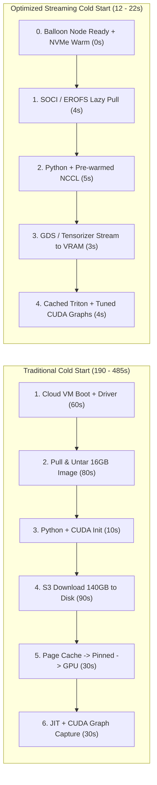
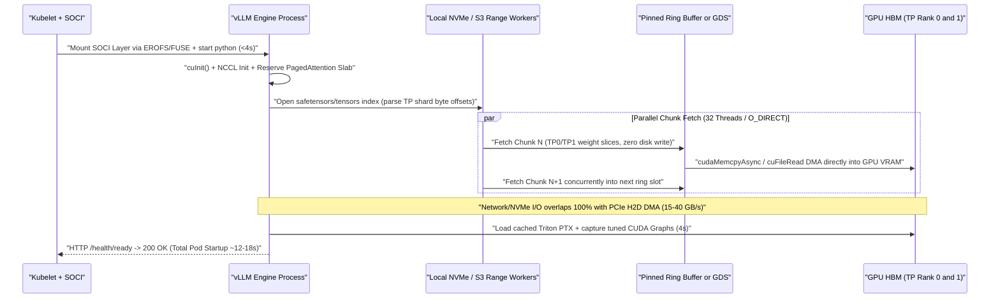

# 02. Cold Start Mitigation

**Navigation:** [← Stage 10 Overview](./README.md) | [← Previous: Inference-Metric-Driven Autoscaling](./01-inference-metric-driven-autoscaling.md) | **Topic 02 of 05** | [Next: Spot Orchestration & Resilience →](./03-spot-orchestration-and-resilience.md)

---

When traffic spikes, an autoscaler creates new AI server containers, but those servers cannot handle user requests until their software environment, multi-gigabyte model files, and GPU optimizations finish loading. This startup delay—called a **cold start**—can take 3 to 8 minutes by default, which is far too slow for real-time applications; this chapter explains how to compress cold starts down to 10–25 seconds.

## Core Concepts & Terminology

Every technical term, hardware mechanism, and software tool referenced in this document is defined below in dependency order:

### A. Cold Start, Hardware & GPU Runtime Basics
* **Cold Start / Time-to-Ready:** The total elapsed time from requesting a new inference pod until it passes its `/health/ready` check and can serve its first token.
* **BF16 (Brain Float 16):** A 16-bit (2-byte) floating-point number format widely used for LLM weights because it preserves a wide numerical range. A 70B-parameter model in BF16 occupies ~140 GB.
* **VM (Virtual Machine), BIOS, & PCIe BAR1:** A cloud server instance (**VM**), its low-level boot firmware (**BIOS**), and **PCIe BAR1 (Base Address Register 1)**—the memory-mapped address window through which the CPU and other PCIe devices can address GPU VRAM.
* **NVMe (Non-Volatile Memory Express) & RAID-0 (`mdadm`):** High-speed SSD storage connected directly over PCIe. **RAID-0** (configured via Linux `mdadm`) stripes data across multiple NVMe drives in parallel so their read speeds add together (e.g., 8 drives yielding >40 GB/s).
* **NIC (Network Interface Card):** The hardware network adapter connecting a server to the network (typically 100–400 Gbps in GPU nodes).
* **DaemonSet & `nvidia-device-plugin`:** A Kubernetes **DaemonSet** automatically runs one copy of a pod on every cluster node. The **`nvidia-device-plugin`** DaemonSet discovers physical GPUs and registers them with `kubelet` as allocatable `nvidia.com/gpu` resources.
* **CUDA Runtime (`cuInit()`, `cudaMalloc`, `cudaMemcpyAsync`), cuDNN, & NCCL:** Low-level NVIDIA libraries: `cuInit()` initializes the GPU driver, `cudaMalloc` allocates GPU VRAM, `cudaMemcpyAsync` copies data asynchronously, **cuDNN** accelerates neural-network primitives, and **NCCL** coordinates multi-GPU communication (e.g., **all-gather** handshakes over **NVLink**) for **Tensor Parallel (TP)** sharding across GPUs.

### B. Container Images, Lazy Pulling & Linux Filesystems
* **OCI Container Image (`.tar.gz`), `containerd`, `runc`, & `execve()`:** Standard container images (**OCI**) package files as **gzip-compressed tarballs (`.tar.gz`)**. `containerd` pulls and unpacks them, `runc` starts the container, and `execve()` is the Linux system call that launches the Python process.
* **Gzip / Zlib / LZ77 Sliding Window & HTTP `Range` Requests:** Standard `gzip`/`zlib` compression uses a continuous **LZ77 sliding dictionary** from byte 0 to the end, forcing sequential decompression from the start before reading any later byte. **HTTP `Range` requests** allow downloading specific byte slices of a remote file without downloading the whole file.
* **SHA-256 Digest & Cosign / Notary:** A cryptographic hash (**SHA-256**) uniquely identifying a container layer, used by signing tools (**Cosign**, **Notary**) to verify image authenticity.
* **`dlopen()`, `site-packages`, `stat` Syscalls, & IOPS:** `dlopen()` loads compiled C/CUDA shared libraries (`.so` files like `libtorch_cuda.so`) into Python; `site-packages` holds Python libraries; `stat` syscalls inspect file metadata; **IOPS** measures disk Input/Output Operations Per Second.
* **FUSE, `overlayfs`, VFS, & Page Fault:** **VFS** is the Linux kernel's Virtual File System layer. **FUSE (Filesystem in Userspace)** routes file reads (`/dev/fuse`) to a user-space daemon instead of kernel code. **`overlayfs`** stacks read-only image layers under a writable container layer. A **page fault** occurs when a program accesses a memory/file page not yet loaded in RAM, triggering the OS to fetch it.
* **eStargz (`stargz-snapshotter`, `stargzify`, `ctr-remote image optimize`):** Extended Seekable Tar.gz—rebuilds container layers so each file/4 MB chunk is an independent gzip stream with a **TOC (Table of Contents) JSON index** at the end, enabling lazy HTTP `Range` pulls via FUSE (at the cost of changing the layer's SHA-256 digest).
* **AWS SOCI (`soci-snapshotter`, OCI Referrers, `inflate()`):** Seekable OCI—creates an external **SOCI Index** (stored as an OCI Referrers artifact) recording **zlib checkpoints** every 1–4 MB so `inflate()` can resume decompression mid-stream without modifying the original `.tar.gz` or breaking SHA-256 signatures.
* **Nydus (RAFS v6), OverlayBD, EROFS, `fscache` / `cachefilesd`, & SquashFS (`.sqsh`):** Advanced image formats (**Nydus**, **OverlayBD**) and Linux kernel read-only filesystems (**EROFS**, **SquashFS**). Paired with kernel caching (`fscache`/`cachefilesd`), EROFS and SquashFS serve image blocks at native kernel speed with **zero FUSE user-space context switches**.

### C. Host Memory, Model Weight Streaming & GPUDirect Storage
* **`.safetensors`, `torch.load`, `pickle`, & `mmap`:** `.safetensors` is a fast, secure tensor file format with a JSON header mapping tensor byte offsets; `torch.load` relies on Python's slower `pickle` serialization; `mmap` maps a disk file directly into a process's virtual address space.
* **POSIX Filesystem, BIO Buffer, OS Page Cache, `kswapd`, & cgroup OOM-Kill:** Standard Linux file I/O copies data through kernel block (**BIO**) buffers and the **OS Page Cache** (RAM used by Linux to cache disk files). If a 140 GB model fills host RAM, the kernel's **`kswapd`** daemon thrashes reclaiming pages, or Linux **cgroup OOM-Kill** terminates the pod because `ContainerMemoryUsage` includes page cache.
* **Ephemeral Storage, `hostPath`, & LRU Cache:** **Ephemeral storage** is temporary local disk space erased when a pod dies. A **`hostPath`** volume mounts a persistent node directory (such as a local NVMe cache managed by an **LRU — Least Recently Used** eviction policy) directly into the pod.
* **Pinned Host Memory (`cudaHostAlloc`), DMA, H2D, & `O_DIRECT`:** **Pinned memory** is page-locked CPU RAM that the OS cannot swap to disk, required for **DMA (Direct Memory Access)**—hardware transfers from RAM/devices straight to GPU VRAM (**H2D**, Host-to-Device) without CPU copying. **`O_DIRECT`** is a file-open flag that bypasses the OS Page Cache completely.
* **GPUDirect Storage (GDS / `cuFile`, `nvidia-fs`, `libcufile`):** A direct DMA path from NVMe storage to GPU VRAM bypassing CPU and host RAM, enabled by the `nvidia-fs` kernel driver and `cuFileRead()` / `cuFileBufRegister()`. Also works over **NVMe-oF/RDMA** (NVMe over Fabrics).
  * **PRP/SGL & TLP:** NVMe scatter-gather memory lists (**PRP/SGL**) and PCIe **Transaction Layer Packets (TLPs)** carrying data across the bus.
  * **PCIe Switch, Root Complex, ACS, & IOMMU (`iommu=pt`):** A **PCIe switch** connects GPUs and NVMe drives locally on a motherboard; the **Root Complex** is the CPU's PCIe bridge. **ACS (Access Control Services)** forces peer-to-peer traffic through the Root Complex; disabling ACS and setting the **IOMMU** (I/O Memory Management Unit) to passthrough (`iommu=pt`) keeps NVMe-to-GPU DMA at full local switch speed.
* **Object Storage (S3 / GCS / MinIO), AWS CRT, Run:ai Model Streamer, & CoreWeave Tensorizer:** Cloud blob stores (**S3/GCS/MinIO**). **Run:ai Model Streamer** uses multi-threaded **AWS CRT** C++ workers to stream S3 byte ranges into a tiny fixed pinned-memory ring buffer and straight to GPU VRAM. **CoreWeave Tensorizer** converts weights into an aligned **`.tensors`** binary format that streams directly into GPU buffers (optionally compressed with **LZ4/Zstd** and decompressed on-GPU via **`nvCOMP`**).

### D. Warmup Caching & Standby Pools
* **JIT Compilation, Triton, `torch.compile` / `torch_inductor`, PTX, `sm_90`, & TensorRT-LLM `.engine`:** **JIT (Just-In-Time)** compilers (`Triton`, `torch.compile`/`torch_inductor`) translate Python/graph code into NVIDIA **PTX** GPU assembly for a target GPU architecture (e.g., `sm_90` for H100) on first run. **TensorRT-LLM `.engine`** files are compiled ahead-of-time. Bounding **`--cuda-graph-sizes`** limits how many batch-size CUDA graphs are captured at startup.
* **Balloon / Pause Pods (`PriorityClass`, `/pause`):** Ultra-low-priority dummy pods that hold a GPU idle (`0%` compute) on a warm, weight-cached node; when a real high-priority inference pod arrives, `kube-scheduler` evicts the balloon pod in <1 second.
* **`cuda-checkpoint`, CRIU, & vLLM `sleep(level=1/2)`:** Tools that snapshot or suspend a live GPU inference process—offloading CUDA state/weights to host RAM or freeing VRAM—and restore it in 2–4 seconds without re-initializing Python or CUDA.

---

## 1. Breaking Down the LLM Pod Cold-Start Timeline

An autoscaling policy with a 10-second reaction loop is functionally useless if a newly scheduled GPU replica requires 5 minutes to serve its first token. Unlike stateless Go/Rust binaries (50 MB container, < 500 ms startup), an LLM inference pod carries two massive artifacts—a **10–25 GB CUDA/PyTorch container image** and **15–400 GB of model weights**—plus stateful GPU runtime compilation.

For an unoptimized **Llama-3.1-70B-Instruct (BF16, ~140 GB weights)** running on a 2x H100 PCIe/SXM node, the sequential cold-start breakdown looks like this:

| Phase | Operations Performed | Unoptimized Latency | Primary Bottleneck |
| :--- | :--- | :--- | :--- |
| **1. Node Provisioning** | Cloud VM API boot, PCIe GPU enumeration, Linux boot, `nvidia-device-plugin` & kubelet registration | **45 – 120 s** | Cloud control plane, BIOS/PCIe BAR mapping, DaemonSet startup |
| **2. Container Image Pull** | Pulling 15–20 GB OCI `.tar.gz` layers (`cuda`, `cudnn`, `nccl`, `torch`, `vllm`) + single-threaded gzip decompression & disk untar | **40 – 120 s** | Sequential gzip format forces full download before `execve()`; disk IOPS |
| **3. Python / CUDA Init** | Python interpreter start, `dlopen()` of `libtorch_cuda.so` / `libcudnn.so` (thousands of symbols), `cuInit()`, NCCL ring/NVLink bootstrap | **5 – 15 s** | Metadata/stat syscalls across `site-packages`, NCCL all-gather handshake |
| **4. Model Weight Download** | Downloading 140 GB of `.safetensors` files from S3 / Hugging Face Hub to pod ephemeral storage / page cache | **70 – 140 s** | Single/low-concurrency HTTP streams, NAT gateway / S3 throttling, disk write amplification |
| **5. CPU-to-GPU Load** | `safetensors` open -> OS page cache read -> CPU RAM tensor shard slicing -> pinned memory copy -> PCIe H2D DMA (`cudaMemcpy`) | **15 – 45 s** | Page-cache thrashing (140 GB weights can OOM a 128 GB host!), redundant memory copies, PCIe H2D contention |
| **6. Warmup & Graph Capture** | Allocating PagedAttention KV slab, Triton / `torch.compile` JIT kernel compilation, capturing CUDA Graphs across batch sizes `[1..512]` | **15 – 45 s** | JIT compiler CPU latency + synchronous CUDA Graph replay verification |
| **Total Cold Start** | **End-to-End Time-to-Ready** | **190 – 485 s (3.2 – 8.1 min)** | **Pure sequential I/O + redundant copies** |

To make KEDA autoscaling and Spot recovery viable under real-time SLOs, cold start must be compressed from **~300 seconds down to 10–25 seconds** by attacking every single stage concurrently.

---

## 2. Optimized Container Images: Lazy Pulling & Read-Only Filesystems

In a typical PyTorch notebook, `import torch` and `AutoModelForCausalLM.from_pretrained(...)` feel like simple function calls, but inside a freshly provisioned Kubernetes GPU node, every container layer and every gigabyte of model weights must physically traverse the network, disk, and PCIe bus before the first token can be served.

### 2.1 Why Standard OCI `.tar.gz` Images Stall Container Startup

Standard OCI container images store filesystem layers as **gzip-compressed tarballs (`.tar.gz`)**. Because standard `gzip` uses a continuous LZ77 sliding compression window across the entire stream, **random access is impossible**: to read byte offset `5,000,000,000` (e.g., `vllm/_C.abi3.so`), `containerd` must download and sequentially decompress every preceding byte from offset `0`.

Yet empirical profiling of a typical 16 GB vLLM container (`nvidia/cuda:12.4-devel` + PyTorch + vLLM) shows that **only ~1.5 to 2.5 GB (~10–15%) of files are actually read during container startup and serving** (the rest are static headers, `.a` static libraries, unused CUDA samples, documentation, and localization files). Downloading and unpacking 16 GB to use 2 GB wastes 85% of network and disk time.

### 2.2 eStargz (Extended Seekable Tar.gz)

**eStargz** (used by `containerd` `stargz-snapshotter`) restructures the layer tarball at build time:
1. Each file (or chunk inside large files, typically **4 MB chunks**) is compressed as an **independent gzip stream** concatenated back-to-back (which remains 100% backward-compatible with standard `gunzip` and legacy OCI runtimes!).
2. A **TOC (Table of Contents) JSON index** is appended as the final entry, mapping every file path and chunk offset to its exact byte range in the compressed blob.
3. At pod startup, `stargz-snapshotter` downloads *only* the small TOC footer via an HTTP `Range` request, mounts the layer via FUSE (`overlayfs` over FUSE), and immediately invokes `runc` / `execve()`.
4. Whenever Python `import torch` issues `open()`/`read()` on a `.so` file, FUSE intercepts the page fault, fetches that exact 4 MB chunk over HTTP `Range`, decompresses it in memory, and optionally performs background prefetching using recorded workload access traces (`ctr-remote image optimize`).

**Trade-off:** eStargz requires rebuilding/re-converting images (`stargzify`), which changes the OCI layer SHA-256 digests and breaks signature chains unless re-signed.

### 2.3 AWS SOCI (Seekable OCI)

**SOCI** solves eStargz's digest-mutation problem by **decoupling the seek index from the container image**:
1. The original `.tar.gz` image remains completely untouched (preserving original SHA-256 digests and Cosign/Notary signatures).
2. An out-of-band builder (`soci create`) scans the `.tar.gz` layer and emits a **SOCI Index (OCI Referrers artifact)** containing **zlib checkpoints** at fixed span intervals (e.g., every 1–4 MB). Each checkpoint stores the exact 32 KB LZ77 sliding dictionary state needed to resume `inflate()` mid-stream without reading from byte 0.
3. The `soci-snapshotter` downloads the tiny SOCI index (~few MB), mounts the remote layer via FUSE, and decodes only the spans touched by `python3 -m vllm.entrypoints.openai.api_server`.
* **Measured Impact:** Container startup time for a 15 GB PyTorch/vLLM image drops from **60–110 s** down to **4–9 s**.

### 2.4 SquashFS, EROFS & Nydus (Eliminating FUSE Overhead)

FUSE-based lazy pulling introduces a user-space context switch (`kernel VFS -> /dev/fuse -> userspace daemon -> kernel`) on uncached 4 KB page reads. For `dlopen()` loading hundreds of `.so` files, this adds subtle CPU jitter:
* **Nydus (RAFS v6) / OverlayBD:** Stores image blobs in chunked, content-addressed blocks (supporting cross-image deduplication across versions of `libtorch`) and mounts via **Linux Kernel EROFS** (Enhanced Read-Only File System) over `fscache` / `cachefilesd` (Linux 5.19+). Once a block is paged in, reads execute at **native kernel page-cache speed with zero FUSE context switches**.
* **SquashFS Overlays on Node Boot:** Pre-packing the runtime environment into a single `.sqsh` file cached on local NVMe and loop-mounted (`mount -t squashfs`) reduces runtime extraction to **< 100 ms** with zero network dependency.

---

## 3. Bypassing the Host Page Cache: Direct-to-VRAM Parallel Streaming

Optimizing the container image still leaves the elephant in the room: **loading 70–140 GB of model weights**.

### 3.1 The Traditional 4-Copy Host Page-Cache Bottleneck

When a pod runs `huggingface-cli download` or `safetensors.safe_open()` over a standard POSIX filesystem:
1. **Copy 1 (Network/Disk -> Kernel Socket/BIO Buffer):** Bytes arrive from NIC or NVMe into kernel space.
2. **Copy 2 (Kernel -> Userspace -> Kernel Page Cache):** `python` writes weights to disk (`/tmp` or EBS), duplicating them into the Linux **OS Page Cache**. On a node with 128 GB host RAM loading a 140 GB model, the page cache fills 100% of host RAM, triggering aggressive `kswapd` page reclaim or even **cgroup OOM-Kills** (`ContainerMemoryUsage` counts page cache charged to the pod cgroup, even though your Python process itself only holds a small reference!).
3. **Copy 3 (Page Cache -> Pinned Staging Buffer):** PyTorch `safetensors` reads tensors into CPU memory, slices Tensor Parallel (TP) shards, and copies into CUDA pinned host memory (`cudaHostAlloc`).
4. **Copy 4 (Pinned Host RAM -> GPU HBM):** PCIe DMA engine executes `cudaMemcpyAsync` into GPU VRAM.

This sequential, host-RAM-polluting pipeline caps effective loading speed at **0.5–2.0 GB/s** even on nodes equipped with 100–400 Gbps NICs and Gen4/Gen5 NVMe arrays.

### 3.2 NVIDIA GPUDirect Storage (GDS / `cuFile`)

**GPUDirect Storage (GDS)** establishes a direct DMA path between **NVMe storage (local PCIe SSDs or NVMe-oF/RDMA storage)** and **GPU VRAM**, completely bypassing the CPU and Host DRAM page cache.

**Hardware & Kernel Mechanics:**
* Requires the `nvidia-fs` Linux kernel module and `libcufile` (`cuFileRead()`).
* The target GPU allocation (`cudaMalloc`) is registered via `cuFileBufRegister()`, pinning its physical pages and exposing them via the GPU's PCIe **BAR1 aperture** (or peer-to-peer DMA addresses).
* When `cuFileRead()` is called on a file opened with `O_DIRECT` (requiring 4 KB-aligned file offsets and transfer sizes):
  1. The NVMe driver programs the NVMe controller's **PRP/SGL scatter-gather list** directly with the GPU's physical BAR1 bus addresses.
  2. The NVMe drive pushes TLP (Transaction Layer Packets) directly across the PCIe switch (P2P) or CPU PCIe Root Complex straight into GPU HBM.
  3. **Zero host DRAM is consumed**, and CPU utilization during a 30 GB/s load stays under 5%.
* **Topology Caveat (ACS & Root Complex):** If the NVMe drive and GPU sit under the **same PCIe switch** (common in 8x H100 HGX baseboards with PCIe switches) and PCIe **ACS (Access Control Services)** is disabled (`setpci` or BIOS setting), traffic stays strictly on the local PCIe switch at full **P2P Gen5 speed (~50–64 GB/s per x16 link)**. If forced through the CPU Root Complex with strict IOMMU enabled, throughput can degrade by 30–50% (`iommu=pt` is recommended).

### 3.3 Run:ai Model Streamer & CoreWeave Tensorizer

When weights reside in **Object Storage (S3 / GCS / MinIO)** rather than local NVMe, GDS cannot talk HTTP/TLS directly to S3. **Run:ai Model Streamer** and **Tensorizer** solve this by streaming directly from S3 to GPU VRAM with zero disk writes:

#### Run:ai Model Streamer
* Written in high-performance C++ with multi-threaded AWS CRT / S3 Range-GET workers (e.g., 16–64 parallel HTTP connections per node).
* Allocates a **fixed-size ring of CUDA pinned host buffers** (e.g., 2 GB total—never 140 GB!) or GDS bounce buffers.
* As S3 byte ranges for `.safetensors` files arrive out-of-order into pinned ring slots, worker threads parse the safetensors JSON header once, extract exact TP-sharded tensor slices on the fly, and enqueue `cudaMemcpyAsync` on a dedicated non-blocking CUDA copy stream while simultaneously freeing the ring slot for the next S3 chunk.
* **Result:** Full saturation of a 100–200 Gbps cloud NIC (**10–22 GB/s sustained**) with **zero local disk usage** and **< 2 GB host RAM footprint**.

#### CoreWeave Tensorizer
* Pre-converts Hugging Face `.safetensors`/PyTorch checkpoints offline into a custom **`.tensors` flat binary format** aligned to GPU memory page boundaries, storing tensor metadata (dtype, shape, byte offset) in a tiny compact header.
* **Key Advantage:** No Python `pickle`, no per-tensor JSON parsing overhead, and supports **direct byte-stream deserialization into pre-allocated `torch.empty(..., device='cuda')` buffers** (or compressed LZ4/Zstd chunks decompressed directly on GPU via `nvCOMP`).
* **Throughput:** Saturates **25+ GB/s** from high-throughput S3/NVMe endpoints—loading a 70 GB FP8 model in **~3 seconds**.

| Loading Mechanism | Disk Write Required? | Host Page Cache Impact | Max Realistic Throughput (100GbE / Gen4 NVMe) | 70 GB Model Load Time |
| :--- | :--- | :--- | :--- | :--- |
| **Naive HF Download + `torch.load`** | Yes (70+ GB) | Severe (70–140 GB RAM) | ~0.8 – 1.5 GB/s | **45 – 90 s** |
| **Local `safetensors` `mmap`** | Yes (pre-downloaded) | High (faulted pages stay in RAM) | ~3 – 6 GB/s (H2D bound) | **12 – 23 s** |
| **Run:ai Model Streamer (S3 -> GPU)** | **No** | **Zero** (~2 GB fixed pinned ring) | **10 – 20 GB/s** (NIC bound) | **3.5 – 7 s** |
| **Tensorizer (NVMe/HTTP -> GPU)** | Optional | **Zero** (direct buffer stream) | **12 – 25 GB/s** | **2.8 – 6 s** |
| **GPUDirect Storage (`cuFile` + RAID-0 NVMe)** | Pre-cached on NVMe | **Zero** (DMA bypasses CPU/RAM) | **25 – 50 GB/s** | **1.5 – 3 s** |

---

## 4. Local NVMe DaemonSet Caches, JIT Caching & Standby Pools

### 4.1 Local Ephemeral NVMe DaemonSet Cache

High-end GPU instances come bundled with massive local NVMe scratch disks (e.g., AWS `p5.48xlarge` ships with **8 × 3.84 TB NVMe SSDs**; in RAID-0 via `mdadm`, this delivers **30+ TB at > 40 GB/s read throughput**). Pulling 140 GB from S3 every time a pod restarts or scales out wastes S3 GET costs, cross-AZ/NAT bandwidth, and 10+ seconds per boot.

**Architecture:**
1. Deploy a privileged **Node-Level Cache DaemonSet** (`model-cache-sync`) on every GPU node.
2. On node boot, the DaemonSet formats/mounts the local NVMe RAID-0 array at `/mnt/nvme-models` and maintains an **LRU content-addressed cache** (`sha256` or `model_id@revision`).
3. Inference pods mount `/mnt/nvme-models` via `hostPath` (`readOnly: true`).
4. When KEDA schedules a new pod onto an existing node (or a warm node), weights are already resident on local NVMe and streamed into VRAM via `cuFile`/GDS or `O_DIRECT` in **1.5–4 seconds**. If a cache miss occurs, the pod streams from S3 via Run:ai Model Streamer while optionally writing through asynchronously to NVMe for future pods.

### 4.2 Eliminating Warmup & JIT Stalls (CUDA Graphs + Triton Cache)

Even after weights hit VRAM, uncached engine warmup can add **15–45 seconds**:
* **Triton / `torch.compile` Cache Persistence:** Mount or bake `~/.triton/cache` and `/root/.cache/torch_inductor` (keyed by GPU architecture, e.g., `sm_90` for H100, and CUDA/Triton version) inside the container image or NVMe cache. Eliminates 10–30 s of PTX compilation on first inference.
* **TensorRT-LLM Plan Caching:** Ahead-of-time compiled `.engine` files include fused kernels tuned for exact TP/PP topology and GPU SKU—skipping JIT entirely.
* **Bounding CUDA Graph Capture:** By default, vLLM captures CUDA graphs for ~35–50 discrete batch sizes (`[1, 2, 4, 8, 16, ..., 512]`), consuming 10–20 s and ~1–2 GB of VRAM. Constraining `--cuda-graph-sizes` (or `compilation_config.cudagraph_capture_sizes`) to operational increments (e.g., `[1, 2, 4, 8, 16, 32, 64, 128]`) cuts capture time by >60% with negligible padding overhead.

### 4.3 Pre-Warmed Standby Pools (Balloon Pods & Memory Checkpointing)

When even 25 seconds of node provisioning is too slow (e.g., strict 500 ms P99 TTFT SLAs under sudden 10x bursts):

1. **Kubernetes Balloon / Pause Pods (`PriorityClass` Preemption):**
   * Run ultra-low-priority (`priorityClassName: gpu-standby-balloon`, priority `-10`) dummy pods holding `nvidia.com/gpu: 1` (running `/pause`, consuming 0% GPU compute) alongside the NVMe DaemonSet keeping model weights cached on disk.
   * When traffic spikes and KEDA creates a high-priority inference pod (`priority: 1000`), `kube-scheduler` **instantly evicts** the balloon pod (< 1 s) and binds the inference pod onto an **already booted, driver-ready, NVMe-warm node**! Meanwhile, Karpenter asynchronously provisions a replacement node for the evicted balloon pod.
   * *Cost trade-off:* You pay for the standby GPU capacity, so balloon pools are sized strictly to absorb **one scale-out wave** (e.g., 1–2 standby nodes) rather than peak traffic.

2. **GPU Memory Sleep / Checkpoint-Restore (`cuda-checkpoint` + CRIU):**
   * Recent engines (vLLM `sleep(level=1/2)`) and NVIDIA's `cuda-checkpoint` utility allow suspending a fully initialized inference pod—offloading CUDA driver state and weights from VRAM into Host DRAM (Level 1) or discarding weights while keeping Python/CUDA/NCCL/CUDA-Graphs alive (Level 2)—freeing the GPU for batch/training jobs, then **restoring the live GPU process in 2–4 seconds** without Python/CUDA/NCCL re-init.

---

## 5. Cold-Start Optimization Comparison & Streaming Timeline

### 5.1 Traditional Sequential Cold Start vs. Optimized Streaming Cold Start

### 5.2 Parallel S3 / NVMe -> GPU VRAM Checkpoint Streaming Sequence

---

## 6. Key Engineering Takeaways

* **Never build fat images without lazy pulling:** Convert inference containers with **AWS SOCI** (digest-preserving) or **Nydus/EROFS** so `kubelet` fetches only the ~15% of files needed to start Python and CUDA.
* **Never write model weights to container ephemeral storage:** Writing 140 GB through the Linux OS page cache causes cgroup OOMs, disk IOPS bottlenecks, and doubled latency. Use **Run:ai Model Streamer** or **Tensorizer** from S3, or **GPUDirect Storage (`cuFile`)** from local RAID-0 NVMe.
* **Cache both weights and compiled kernels:** Pair a **node-level NVMe DaemonSet** with persistent **Triton/Inductor caches** and bounded `--cuda-graph-sizes`.
* **Match cold-start time to SLO tolerance:** Use **Balloon Pods** when sub-15s scale-out is mandatory; rely on optimized streaming (~15–25 s) for elastic Spot burst pools.

---

**Navigation:** [← Stage 10 Overview](./README.md) | [← Previous: Inference-Metric-Driven Autoscaling](./01-inference-metric-driven-autoscaling.md) | **Topic 02 of 05** | [Next: Spot Orchestration & Resilience →](./03-spot-orchestration-and-resilience.md)
