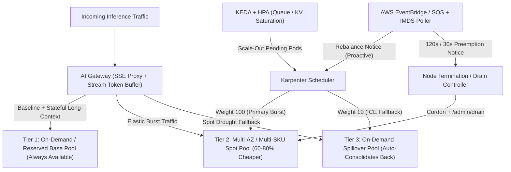
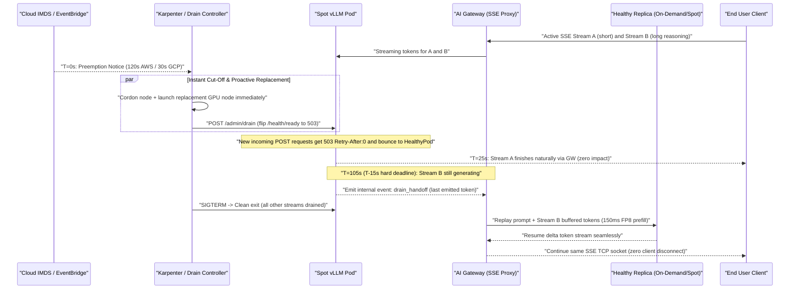

# 03. Spot Orchestration & Resilience

**Navigation:** [← Stage 10 Overview](./README.md) | [← Previous: Cold Start Mitigation](./02-cold-start-mitigation.md) | **Topic 03 of 05** | [Next: Inference Unit Economics →](./04-inference-unit-economics.md)

---

Cloud providers sell spare, unused GPU servers—called **Spot** or **Preemptible** instances—at 60% to 85% discounts, but they can take those servers back with only 30 to 120 seconds of warning. This chapter explains how to run AI inference on Spot GPUs reliably so that when a server is reclaimed, active user streams finish cleanly or continue seamlessly on another machine without dropped connections.

## Core Concepts & Terminology

Every cloud, networking, Kubernetes, and LLM mechanism referenced in this document is defined below in dependency order:

### A. Cloud GPU Capacity, Pricing & Regions
* **COGS (Cost of Goods Sold) & Gross Margin:** **COGS** is the direct infrastructure cost required to deliver AI tokens; **gross margin** is the profit remaining after subtracting COGS from revenue.
* **Hyperscalers & Neoclouds:** Major general-purpose cloud providers (**AWS**, **GCP**, **Azure**) and specialized GPU-focused cloud providers.
* **On-Demand, Reserved Instances / Savings Plans, & Spot / Preemptible GPUs:** **On-Demand** GPUs are rented at full price with no planned interruption. **Reserved Instances / Savings Plans** offer 30–45% discounts for 1–3 year commitments. **Spot Instances / Spot VMs** are spare capacity sold at 60–85% off that the provider can reclaim on short notice.
* **Region, Availability Zone (AZ), GPU SKU, & `InsufficientInstanceCapacity` (ICE):** A **Region** is a geographic area (e.g., `us-east-1`), split into isolated datacenters called **Availability Zones (AZs)** (`us-east-1a/b/c`). A **SKU** is a specific server/GPU model (e.g., AWS `g6e`, `p4d`, `p5`; GCP `a2`, `a3`, `g2`; Azure `ND`, `NC`). **ICE** is the error returned when a pool has no spare Spot GPUs available.

### B. Interruption Signals, OS Signals & Kubernetes Draining
* **IMDS / IMDSv2 (`169.254.169.254`), Metadata Server, & Scheduled Events:** Every cloud VM exposes a local **Instance Metadata Service (IMDS)** at the link-local IP `169.254.169.254` (or `metadata.google.internal` on GCP). Polling it detects reclamation notices 120 seconds early on AWS (**IMDSv2**), 30 seconds early on GCP (**Metadata Server** / **ACPI G2 Soft Off** power signal), or 30 seconds early on Azure (**Scheduled Events**).
* **AWS Rebalance Recommendation, EventBridge, & SQS:** An early AWS warning sent *before* the 120-second countdown when a Spot pool is at high risk of reclamation, routed via **EventBridge** (event bus) into an **SQS** message queue.
* **Karpenter, `NodePool`, & AWS Node Termination Handler (NTH):** **Karpenter** is a Kubernetes node autoscaler that provisions replacement GPUs and prioritizes pools by **`weight`** (e.g., Spot `weight: 100`, On-Demand fallback `weight: 10`), later **consolidating** workloads back onto Spot via a **descheduler** when Spot returns. **NTH** is a cluster controller/DaemonSet that listens to IMDS/SQS and initiates graceful draining.
* **`kubectl cordon` (`node.spec.unschedulable`), `SIGTERM`, `SIGKILL`, & `terminationGracePeriodSeconds`:** **Cordoning** marks a node unschedulable so no new pods land on it. **`SIGTERM`** is the polite Unix shutdown signal; **`SIGKILL`** forcefully terminates the process if it has not exited after **`terminationGracePeriodSeconds`** (must be `110s` on AWS or `25s` on GCP/Azure instead of Kubernetes's default `30s`).

### C. Networking, Proxies & Ingress Cut-Off
* **TCP Socket, TLS, & SSE (`text/event-stream`):** A **TCP socket** is a persistent network connection (encrypted with **TLS**). **SSE** is an HTTP streaming format that pushes generated tokens one by one over a single long-lived connection.
* **HTTP Status Codes (`200`, `502`, `503`), `EOF`, & `Retry-After`:** `200 OK` indicates success; `502 Bad Gateway` / `EOF` (End-of-File) indicate a broken mid-stream connection; `503 Service Unavailable` with `Retry-After: 0` tells the proxy to immediately retry an unstarted request on another server.
* **`readinessProbe`, `EndpointSlice`, `kube-proxy` (`iptables`/`IPVS`), & Envoy `xDS` / `ALB`:** Kubernetes checks pod health via **`readinessProbe`**. When a pod becomes `NotReady`, Kubernetes updates **`EndpointSlice`** records, which propagate to **`kube-proxy`** (kernel `iptables`/`IPVS` routing rules) and load balancers (**Envoy `xDS`** or AWS **ALB**) to stop sending new traffic.
* **Thundering-Herd Retry Storm:** A failure cascade where dozens of severed clients retry full prompts simultaneously on surviving pods, saturating their KV caches.

### D. Token Continuation & Live KV-State Migration
* **Autoregressive Decoding, `token_ids`, `max_tokens`, `temperature`, & RNG `seed`:** LLMs generate one token at a time based on all preceding tokens (`token_ids`), stopping at `max_tokens`, with randomness controlled by `temperature` and a Random Number Generator **`seed`**.
* **Token-State Continuation (`event: drain_handoff`):** A pattern where the **AI Gateway** buffers tokens already sent to the user; if a Spot pod must exit early, it sends `drain_handoff` and the gateway transparently re-prefills `prompt + emitted_tokens` on a healthy pod while keeping the client's SSE socket open.
* **GQA (Grouped-Query Attention), `KV heads`, & FP16:** An attention design where multiple query heads share fewer Key/Value heads (`n_kv = 8`), shrinking the FP16 (2 bytes/number) KV cache footprint.
* **GPUDirect RDMA, InfiniBand / RoCEv2, & Disaggregated KV Transfer (NIXL / Mooncake / LMCache):** **RDMA** (Remote Direct Memory Access) copies memory directly from one server's GPU VRAM to another's over ultra-fast **InfiniBand** or **RoCEv2** (RDMA over Converged Ethernet) networks (200 Gbps = 25 GB/s), orchestrated by KV transfer engines like **NIXL**, **Mooncake**, or **LMCache**.

---

## 1. Spot / Preemptible GPU Economics & Volatility

Cloud GPU infrastructure is the dominant COGS (Cost of Goods Sold) line item for any LLM inference platform. Hyperscalers and neoclouds sell spare, unreserved GPU capacity as **Spot Instances (AWS)**, **Spot VMs (GCP)**, or **Spot Virtual Machines (Azure)** at steep discounts in exchange for the right to reclaim the VM on short notice.

### 1.1 Discount Arbitrage vs. Interruption Windows

| Cloud Provider | Typical GPU Discount vs. On-Demand | Interruption Notice Window | Signal Mechanism |
| :--- | :--- | :--- | :--- |
| **AWS EC2 Spot** | **60% – 75%** (e.g., `g6e` / `p4d` / `p5`) | **120 seconds** hard notice (+ earlier *Rebalance Recommendation*) | IMDSv2 (`spot/instance-action`), EventBridge -> SQS |
| **GCP Spot VMs** | **60% – 85%** (e.g., `a2` / `a3` / `g2`) | **30 seconds** hard notice | Metadata (`instance/preempted`), ACPI G2 Soft Off, `SIGTERM` |
| **Azure Spot VMs** | **60% – 80%** (e.g., `ND` / `NC` series) | **30 seconds** hard notice | Azure Scheduled Events IMDS (`scheduledevents`) |

*Example Unit Impact:* If an 8× H100 node drops from **$32.00/hr On-Demand** to **$11.50/hr Spot** (64% discount), raw compute cost per 1M tokens drops by **2.78x**—frequently the entire difference between negative and positive gross margins.

### 1.2 Why Naive Spot Execution Destroys LLM Reliability

Running standard stateless microservice Spot patterns on an LLM inference engine causes four severe failure modes:
1. **Broken Long-Lived SSE Streams:** An active chat or agentic reasoning generation runs over a single stateful HTTP `text/event-stream` (SSE) TCP connection for 10–90 seconds. A default Kubernetes `SIGTERM` + 30 s `SIGKILL` severs 30–100 concurrent user streams mid-sentence.
2. **Wasted KV Cache & Prefill Compute:** Killing a pod holding 60 GB of warm KV state wastes all prefill FLOPs already executed for those requests.
3. **Thundering-Herd Retry Storms:** When 100 client streams fail simultaneously at HTTP `502/EOF`, clients/SDKs immediately retry full prompts onto the remaining replicas—spiking KV saturation on healthy pods and triggering cascading preemption!
4. **Slow Kubernetes Endpoint Deregistration:** Even after `SIGTERM`, `kube-proxy` iptables/IPVS rules and ingress load balancers (`Envoy`, `ALB`) continue routing *new* incoming requests to the dying pod for 2–15 seconds unless explicitly cut off.

---

## 2. Cloud Interruption Signal Detection & Control-Plane Hooks

Resilient Spot serving depends on detecting the provider's reclamation notice within **< 2 seconds** and immediately separating **admission cut-off** from **execution termination**. Conceptually, if a Spot GPU is reclaimed mid-generation, the remaining work can be resumed on a healthy GPU just like calling `model.generate(input_ids=torch.cat([prompt_ids, generated_ids]))`—either by re-prefilling the token IDs at the gateway or by copying the precomputed KV cache tensors directly over RDMA.

### 2.1 Instance Metadata Polling & EventBridge Queues

Every cloud provider exposes preemption notices inside the node's link-local Instance Metadata Service (`169.254.169.254`):

* **AWS IMDSv2:** Poll `GET http://169.254.169.254/latest/meta-data/spot/instance-action` every 2 seconds (with IMDSv2 session token). Returns HTTP `404` normally; returns HTTP `200` with JSON `{"action": "terminate", "time": "2026-11-24T21:10:00Z"}` exactly 120 seconds before forced termination.
  * **AWS Rebalance Recommendation:** Poll `spot/rebalance-recommendation` (or subscribe via **EventBridge -> SQS** consumed by **Karpenter** or **AWS Node Termination Handler (NTH)** in Queue-Processor mode). This fires *minutes before* an interruption notice when AWS detects elevated spot pool reclamation risk—giving the cluster time to launch a replacement GPU node **before** the 120-second drain countdown even begins!
* **GCP Metadata Server:** Poll `GET http://metadata.google.internal/computeMetadata/v1/instance/preempted` (`Metadata-Flavor: Google`) with `wait_for_change=true` (hanging GET returns instantaneously when flipped from `FALSE` to `TRUE`, giving the full 30 seconds).
* **Azure Scheduled Events:** Poll `GET http://169.254.169.254/metadata/scheduledevents?api-version=2020-07-01` (`Metadata: true`) looking for `EventType: "Preempt"`.

### 2.2 Kubernetes Control-Plane Actions on Notice

The moment **Karpenter** (native SQS interruption handler) or **Node Termination Handler (DaemonSet)** detects an interruption:
1. **Cordon Node (`kubectl cordon`):** Marks `node.spec.unschedulable = true` so `kube-scheduler` cannot place any new pods on the dying VM.
2. **Trigger Replacement Provisioning:** Karpenter immediately creates a replacement GPU node (choosing an alternative AZ or GPU SKU not currently reclaiming) so cold-start overlaps with the draining window!
3. **Notify Pod Drain Sidecar / Readiness Endpoint:** Rather than immediately sending `SIGTERM` (or if `SIGTERM` is sent, ensuring the engine traps it cleanly), the node agent calls a local drain hook on the inference pod (`POST http://pod-ip:8080/admin/drain`) and sets a **long `terminationGracePeriodSeconds`**:
   * AWS (120 s notice): set `terminationGracePeriodSeconds: 110`.
   * GCP / Azure (30 s notice): set `terminationGracePeriodSeconds: 25`.

---

## 3. Graceful Draining of Active SSE Connections & State Migration

Once a pod enters `DRAINING` state, two strict invariants govern the countdown window: **zero new requests admitted**, and **zero in-flight tokens lost**.

### 3.1 Instant Ingress Cut-Off (Readiness Drop + Engine Rejection)

Relying solely on Kubernetes `SIGTERM` to remove a pod from Service `EndpointSlice` objects introduces a dangerous **2–10 second race condition**:
* Kubelet runs `readinessProbe` periodically (default `periodSeconds: 10, failureThreshold: 3` $\implies$ **30 seconds** before Kubernetes even marks the pod `NotReady`!).
* Even after `NotReady`, `EndpointSlice` updates must propagate to `kube-proxy` or Envoy xDS endpoints.

**Production Fix — Defense in Depth:**
1. **Fast Readiness Probe:** Set `readinessProbe` to `periodSeconds: 1, failureThreshold: 1, timeoutSeconds: 1` hitting `/health/ready`. When `/admin/drain` is triggered (or `SIGTERM` arrives), `/health/ready` flips to `503 Service Unavailable` in **< 1 ms**, removing the pod from Envoy/Gateway routing within ~1–2 seconds.
2. **Engine-Level Admission Gate (`503` + `Retry-After: 0`):** Any request arriving at the dying pod during that 1–2 second propagation race is rejected *before* entering the waiting queue or executing prefill with HTTP `503` and header `X-Inference-Draining: true`. The AI Gateway immediately and transparently retries that unstarted request on a healthy replica with **zero wasted GPU work** and **< 5 ms retry latency**.
3. **Never Close Idle Keep-Alive Slowly, Never Kill Active SSE:** Ensure Envoy/Gateway distinguishes `503` pre-stream rejection (safe to retry) from mid-stream EOF.

### 3.2 Option A: Drain-to-Completion (AWS 120s Window)

For standard interactive chat/completion workloads (remaining generation typically 100–2,000 tokens at 40–80 tokens/s = **2 to 50 seconds**), **110 seconds is sufficient to finish ~98–99.9% of active SSE streams natively**:
* The engine freezes the `WAITING` queue (or rejects/reroutes waiting requests back to the gateway) and continues stepping the `RUNNING` continuous batch until `num_requests_running == 0`.
* Because no new prefills enter the pod, GPU batch size monotonically shrinks, **accelerating ITL** for the remaining draining requests so they finish even faster!
* As soon as `active_streams == 0`, the engine exits cleanly with status `0`, releasing the node early.

### 3.3 Option B: Seamless Client Continuation & KV-State Migration (30s Window / Long Reasoning)

On **GCP/Azure (30-second notice)**, or on **AWS** when an agentic/reasoning request still has 4,000+ tokens left to generate at $T - 10\text{ s}$ before `SIGKILL`:

#### Pattern 1: Gateway-Buffered Token-State Continuation (Zero Dropped Client Connections)
Because LLM autoregressive decoding is deterministic/stateless up to the exact prefix of `prompt + generated_tokens_so_far`:
1. The **AI Gateway / Orchestrator Proxy** (which terminates the client's public TLS/SSE TCP socket) buffers the sequence of `token_ids` (or text chunks) already streamed to the client for every active request.
2. At $T_{\text{deadline}}$ (e.g., 10 s before `SIGKILL` on AWS, or 5 s before `SIGKILL` on GCP), the draining pod emits a clean internal control frame (`event: drain_handoff`, including `last_token_id` and `finish_reason: "preempted"`) and closes the upstream backend connection.
3. The AI Gateway **keeps the client's downstream SSE socket open**, concatenates `original_prompt + tokens_emitted_so_far`, and dispatches a continuation request to a healthy replica (setting `max_tokens = original_max_tokens - emitted_count` and preserving `temperature=0` or RNG seed).
4. **Cost & Latency:** Re-prefilling a 4,000-token context on an H100 FP8 replica takes only **~100–200 ms**. To the end user, the stream pauses briefly for 150 ms and continues mid-sentence without a single dropped token or HTTP error!

#### Pattern 2: Live KV-Cache Block Migration over RDMA / Shared NVMe
When contexts are massive (**64K–128K tokens**), recomputing prefill on the target replica takes **5–15 seconds**, violating continuity on a 30-second GCP notice.
* Using disaggregated KV transfer engines (**NIXL / Mooncake / LMCache over GPUDirect RDMA**):
  * A 128K-token context on **Llama-3-70B (GQA with 8 KV heads, 80 layers, FP16)** occupies:
    $$2 \times 80 \times 8 \times 128 \times 2\text{ bytes} \times 128{,}000 = 41.94\text{ GB}$$
  * Over **200 Gbps InfiniBand / RoCEv2 RDMA (25 GB/s)**, migrating that entire 128K KV state directly from the dying Spot GPU's VRAM to a healthy replica's VRAM takes **~1.7 seconds**—comfortably inside even a 30-second GCP preemption window!
  * Over standard **10–25 Gbps Ethernet (1.2–3.0 GB/s)**, moving 42 GB takes **14–35 seconds**—too slow for 30s preemption, making Token-State Continuation (Pattern 1) or checkpointing to fast shared NVMe/Redis earlier on `Rebalance Recommendation` preferable.

---

## 4. Mixed On-Demand Base + Spot Burst Capacity Architecture

Production inference platforms never run 100% Spot for strict SLA tiers because cloud providers periodically experience **regional Spot capacity droughts (`InsufficientInstanceCapacity`)** where zero Spot GPUs are available across an entire region.

### 4.1 Three-Tier Capacity Pooling Strategy

1. **Tier 1 — On-Demand / Reserved Base Pool (20%–40% of Peak, 100% of Diurnal Trough):**
   * Sized to the predictable 24/7 baseline traffic floor (so baseline utilization stays >75%, maximizing Reserved Instance / Savings Plan discounts of 30–45%).
   * Never preempted; absorbs traffic instantaneously if Spot capacity temporarily disappears.
   * Ideal home for **ultra-long-context sessions** or **sticky prefix caches** where migration cost is highest.
2. **Tier 2 — Diversified Multi-AZ / Multi-SKU Spot Burst Pool (60%–80% of Peak):**
   * **Cross-AZ Diversification:** Spot capacity pools are isolated per `(Region, AvailabilityZone, InstanceType)`. Configuring Karpenter `NodePool` across all AZs (`us-east-1a/b/c/d`) and multiple compatible GPU families (e.g., `g6e.12xlarge` [4× L40S], `p4d.24xlarge` [8× A100], `p5.48xlarge` [8× H100], or single-GPU `g6e.xlarge` vs `g6e.2xlarge`) prevents single-pool exhaustion.
   * **Note on Cross-SKU Equivalence:** Different GPU SKUs require matching serving profiles (e.g., 70B FP8 fits on 1× H200 or 2× H100 or 4× L40S). Maintain separate Deployment/KEDA targets per SKU family behind a unified AI Gateway router weighted by latency/queue depth, rather than mixing heterogeneous GPUs in one Deployment.
3. **Tier 3 — Automatic On-Demand Spillover:**
   * Configure dual Karpenter `NodePool` priorities (or `capacity-type: ["spot", "on-demand"]` with Spot pool `weight: 100` and On-Demand fallback `weight: 10`).
   * If Spot provisioning returns `InsufficientInstanceCapacity`, Karpenter automatically falls back to On-Demand within seconds so KEDA scale-out never stalls on `Pending` pods. Once Spot capacity returns, a scheduled **descheduler / Karpenter consolidation** loop gracefully drains On-Demand burst nodes back onto cheaper Spot nodes.

---

## 5. Architecture & Preemption Timeline Diagrams

### 5.1 Mixed On-Demand Base + Spot Burst Capacity Architecture

### 5.2 Spot Preemption Notice -> Readiness Drop -> Graceful SSE Drain & Continuation

---

## 6. Operational Edge Cases & Pitfalls

| Edge Case | Impact | Mitigation |
| :--- | :--- | :--- |
| **`terminationGracePeriodSeconds` left at default 30 s on AWS** | Kubelet sends `SIGKILL` 90 s early, severing active SSE streams unnecessarily. | Set `terminationGracePeriodSeconds: 110` on AWS Spot pods; `25` on GCP/Azure. |
| **Gateway retries mid-stream HTTP 200 SSE drop blindly** | Client receives duplicated start of response (`"Sure, here..."` twice). | Gateway buffers emitted token count and splices continuation **from exact byte/token offset** invisibly. |
| **Non-deterministic sampling breaks continuation tone** | Mid-sentence temperature switch produces minor phrasing shift. | Pass request `seed` or continue seamlessly with `prompt + generated_tokens` (imperceptible in practice). |
| **All replicas in one Spot AZ reclaimed simultaneously** | Fleet drops 50% capacity in 30 s (`InsufficientInstanceCapacity` in that AZ). | Spread across $\ge 3$ AZs + $\ge 2$ GPU instance types + maintain Tier 1 On-Demand base. |

---

**Navigation:** [← Stage 10 Overview](./README.md) | [← Previous: Cold Start Mitigation](./02-cold-start-mitigation.md) | **Topic 03 of 05** | [Next: Inference Unit Economics →](./04-inference-unit-economics.md)
