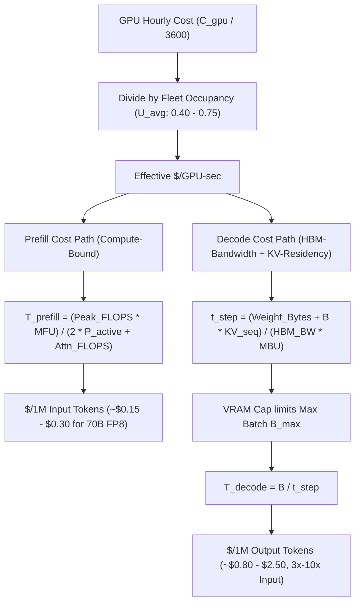
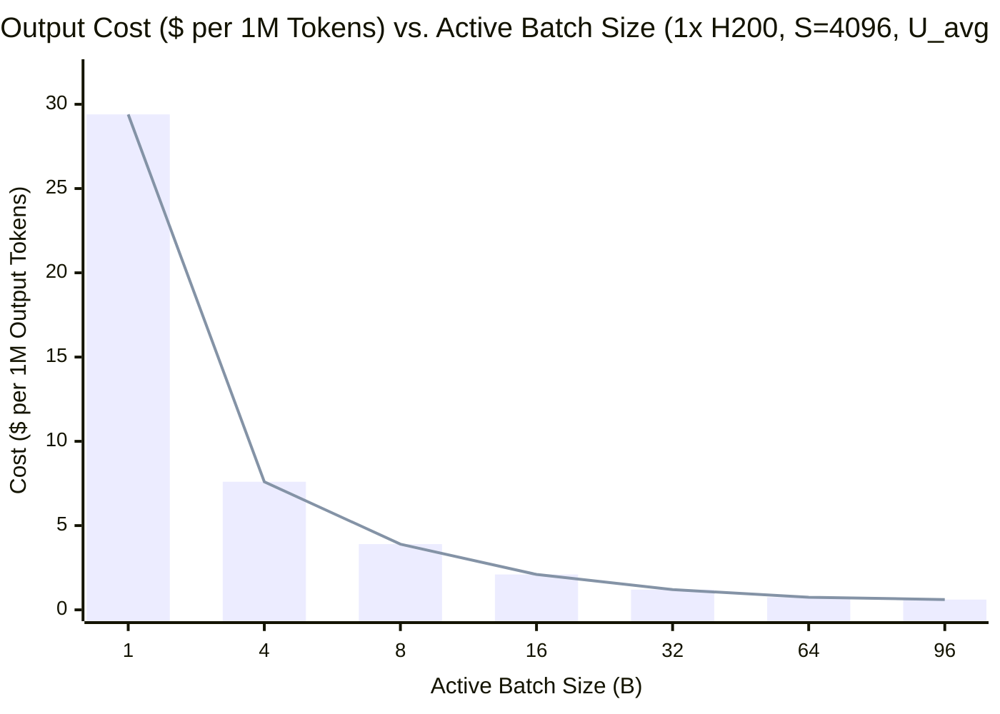
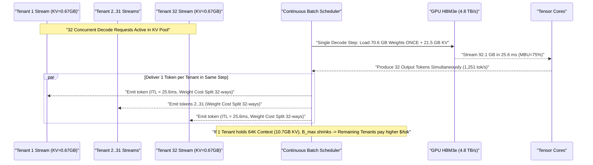

# 04. Inference Unit Economics

**Navigation:** [← Stage 10 Overview](./README.md) | [← Previous: Spot Orchestration & Resilience](./03-spot-orchestration-and-resilience.md) | **Topic 04 of 05** | [Next: Multi-Tenant Governance →](./05-multi-tenant-governance.md)

---

Running AI models in production is expensive, and pricing tokens correctly requires understanding the physical hardware limits of each GPU. This chapter derives the exact cost per million input and output tokens from first principles, explaining why output tokens cost 3×–10× more than input tokens and how batch size and GPU hardware choice govern profitability.

## Core Concepts & Terminology

Every financial, hardware, and mathematical term used in this document is defined below in dependency order:

### A. Financial & Utilization Metrics (FinOps)
* **FinOps & Unit Economics (`$/1M tokens`):** Cloud Financial Operations—the practice of measuring and optimizing the exact dollar cost to produce 1,000,000 input or output tokens.
* **$C_{\text{gpu}}$ & $C_{\text{sec}}$ (GPU Cost & CapEx Depreciation):** $C_{\text{gpu}}$ is the fully loaded hourly cost per GPU (`$/hr`), whether rented from a cloud or calculated by spreading hardware purchase cost (**CapEx depreciation**), power, cooling, and networking over a 3-year lifespan. $C_{\text{sec}} = C_{\text{gpu}} / 3600$ is the cost per second.
* **$U_{\text{avg}}$ (Average Fleet Occupancy / Diurnal Load Factor):** The fraction (0 to 1) of rented GPU-hours actually spent serving user requests rather than sitting idle during nighttime valleys (**diurnal troughs**), cold-start warmups, or safety headroom.

### B. Model Architecture, Precisions & Silicon Physics
* **Parameters ($P_{\text{active}}$ vs. $P_{\text{total}}$) & Sparse MoE:** A model's learned weights. In a **dense** model, all parameters run for every token ($P_{\text{active}} = P_{\text{total}}$). In a **Sparse Mixture-of-Experts (MoE)** model, only a subset of "expert" weights run per token ($P_{\text{active}} \ll P_{\text{total}}$), though all $P_{\text{total}}$ weights must still fit in VRAM.
* **Precision & Bytes per Parameter ($b_w$):** Numerical formats trading precision for speed and memory savings: **FP16/BF16** ($b_w = 2\text{ bytes}$), **FP8/INT8** ($b_w = 1\text{ byte}$), and **FP4/INT4/NVFP4** ($b_w = 0.5\text{ bytes}$). **Sparsity** (2:4 structured sparsity) skips zero weights to double theoretical TFLOPS.
* **Transformer Dimensions ($L, d_{\text{model}}, n_q, n_{\text{kv}}, d_h$):** $L$ is the number of layers; $d_{\text{model}}$ is the hidden vector width; $n_q$ and $n_{\text{kv}}$ are the number of query and Key/Value attention heads (**GQA**, Grouped-Query Attention, uses $n_{\text{kv}} < n_q$ to shrink KV cache); $d_h$ is the width per head.
* **$\Phi_{\text{peak}}$ (Peak Compute) & $\beta_{\text{HBM}}$ (Peak Memory Bandwidth):** $\Phi_{\text{peak}}$ is a GPU's maximum Tensor Core math speed (TFLOPS = trillions of Floating-Point Operations per second). $\beta_{\text{HBM}}$ is how fast data moves from High Bandwidth Memory (HBM) to the compute cores (TB/s).
* **Arithmetic Intensity & Ridge Point:** **Arithmetic intensity** is the ratio of math operations performed per byte of memory read (`FLOPs/byte`). The **ridge point** ($\Phi_{\text{peak}} / \beta_{\text{HBM}}$, roughly 300–600 FLOPs/byte in FP8 on modern GPUs) is the threshold where a workload transitions from **memory-bandwidth-bound** (limited by $\beta_{\text{HBM}}$) to **compute-bound** (limited by $\Phi_{\text{peak}}$).
* **MFU ($\eta_{\text{MFU}}$) & MBU ($\eta_{\text{MBU}}$):** **Model FLOPs Utilization** is the fraction of $\Phi_{\text{peak}}$ actually achieved; **Model Bandwidth Utilization** is the fraction of $\beta_{\text{HBM}}$ actually achieved.

### C. Inference Phases, Batching & Multi-GPU Scaling
* **Prefill vs. Decode:** **Prefill** processes all input prompt tokens in parallel using large matrix-matrix multiplications (**GEMMs**) and **causal attention** ($QK^T$ and $PV$ matrices with **causal masking** so tokens only attend to earlier tokens, accelerated by **FlashAttention-3**). **Decode** generates output tokens one step at a time, reading all model weights and **KV Cache** ($K_{\text{seq}}(S)$ bytes per sequence of length $S$) from HBM at every step.
* **Colocated vs. Disaggregated Serving & Chunked Prefill:** **Colocated** engines run prefill and decode on the same GPU; **chunked prefill** splits long prompts into smaller pieces interleaved with decode steps to limit latency interference. **Disaggregated** serving separates prefill and decode onto dedicated GPU pools.
* **Continuous Batching, $B_{\max}$, & KV Residency ("VRAM Rent"):** **Continuous batching** groups $B$ active decode requests together so the expensive model weight read is shared across $B$ users in one step. Because each active stream pins its KV cache in HBM for seconds (**KV residency**), total VRAM limits the maximum batch size $B_{\max}$.
* **Tensor Parallelism ($N_{\text{TP}}$) & `AllReduce` ($t_{\text{comm}}$):** Splitting a model across $N_{\text{TP}}$ GPUs. After each layer, GPUs must synchronize partial sums via an **`AllReduce`** collective operation (taking microseconds over **NVLink**, or milliseconds over **PCIe**).

### D. Latency SLAs & Datacenter GPU SKUs
* **TTFT, ITL, P99, SLA, & Pareto Frontier:** **TTFT** is Time to First Token; **ITL** is Inter-Token Latency ($t_{\text{step}}$ between output tokens); **P99** is 99th-percentile latency; **SLA** is the reliability contract. The **Pareto frontier** is the set of optimal configurations where you cannot lower unit cost further without worsening ITL.
* **LoRA Adapters:** Lightweight fine-tuned weight patches served on top of a shared base model.
* **GPU SKUs:**
  * **NVIDIA L40S:** 48 GB slower **GDDR6** memory (0.864 TB/s), PCIe Gen4 only (no NVLink).
  * **NVIDIA H100 SXM:** 80 GB HBM3 (3.35 TB/s), 900 GB/s NVLink 4.
  * **NVIDIA H200 SXM:** 141 GB HBM3e (4.80 TB/s), 900 GB/s NVLink 4.
  * **NVIDIA B200 SXM:** 192 GB HBM3e (8.00 TB/s), 1,800 GB/s NVLink 5, native **NVFP4** support.

---

## 1. First-Principles Mathematical Derivation of Cost per 1M Tokens

Every LLM serving platform converts **GPU-seconds rented ($C_{\text{gpu}} / 3600$)** into **tokens delivered**. Because LLM inference consists of two physically orthogonal phases—**compute-bound Prefill** (processing input tokens) and **memory-bandwidth-bound Decode** (generating output tokens)—a single blended token cost hides massive margin leaks. Rigorous FinOps models derive input and output unit costs separately from silicon physics.

### 1.1 Core Variables & Hardware Parameters

Let:
* $C_{\text{gpu}}$: Fully loaded hourly price per GPU ($/hr), including instance rental (or CapEx depreciation + power/cooling/networking amortized over 3-year lifespan) divided by GPUs per node.
* $C_{\text{sec}} = \frac{C_{\text{gpu}}}{3600}$: GPU cost per second ($/s).
* $\Phi_{\text{peak}}$: Peak dense Tensor Core compute throughput (FLOP/s) at the serving precision (e.g., FP8 or FP16).
* $\beta_{\text{HBM}}$: Peak HBM memory bandwidth (bytes/s).
* $P_{\text{active}}$: Active parameters executed per token (for dense models, $P_{\text{active}} = P_{\text{total}}$; for sparse MoE, $P_{\text{active}} \ll P_{\text{total}}$, though **VRAM capacity** still depends on $P_{\text{total}}$).
* $b_w$: Bytes per parameter (e.g., $2\text{ B}$ for BF16/FP16, $1\text{ B}$ for FP8/INT8, $0.5\text{ B}$ for FP4/INT4).
* $U_{\text{avg}} \in (0, 1]$: **Average Fleet Occupancy / Diurnal Load Factor**—the fraction of rented GPU-hours actually spent executing client workloads rather than sitting idle in diurnal valleys, cold-start warmup, or headroom buffers.

### 1.2 Phase 1: Cost per 1M Input Tokens (Compute-Bound Prefill)

During prefill of prompt length $S_{\text{in}}$ tokens, all $S_{\text{in}}$ tokens execute in parallel via large matrix-matrix multiplications (`GEMM`). Ignoring attention at short/medium contexts ($S_{\text{in}} \le 8\text{K}$), each token performs $\approx 2 P_{\text{active}}$ FLOPs of linear projections; at long contexts, causal attention adds $4 L d_{\text{model}} S_{\text{in}}$ FLOPs across $L$ layers (actually $2 L n_q d_{\text{head}} S_{\text{in}}$ for $QK^T$ and $2 L n_q d_{\text{head}} S_{\text{in}}$ for $PV$, amortized by $1/2$ due to causal masking $\implies 2 L d_{\text{model}} S_{\text{in}}$):

$$F_{\text{tok}}(S_{\text{in}}) \approx 2 P_{\text{active}} + 2 L d_{\text{model}} S_{\text{in}}$$

Given empirical **Model FLOPs Utilization (MFU)** $\eta_{\text{MFU}} \in (0, 1)$ (typically $0.35\text{–}0.60$ on FlashAttention-3 + FP8 GEMMs), sustained prefill throughput per GPU (or per TP group of $N_{\text{TP}}$ GPUs) is:

$$T_{\text{prefill}} = \frac{N_{\text{TP}} \cdot \Phi_{\text{peak}} \cdot \eta_{\text{MFU}}}{F_{\text{tok}}(S_{\text{in}})} \quad [\text{tokens/s}]$$

Accounting for average fleet occupancy $U_{\text{avg}}$, the exact **cost per 1,000,000 input tokens** is:

$$\text{Cost}_{1\text{M, input}} = \frac{10^6 \cdot (N_{\text{TP}} \cdot C_{\text{gpu}})}{3600 \cdot T_{\text{prefill}} \cdot U_{\text{avg}}} = \frac{10^6 \cdot C_{\text{gpu}} \cdot F_{\text{tok}}(S_{\text{in}})}{3600 \cdot \Phi_{\text{peak}} \cdot \eta_{\text{MFU}} \cdot U_{\text{avg}}}$$

*(Note: Notice that if $N_{\text{TP}}$ scales linearly with perfect efficiency, $N_{\text{TP}}$ cancels out in raw compute cost—though Tensor Parallel `AllReduce` overhead degrades $\eta_{\text{MFU}}$ slightly as $N_{\text{TP}}$ increases).*

### 1.3 Phase 2: Cost per 1M Output Tokens (Bandwidth-Bound Decode)

During autoregressive decode with active batch size $B$ and average context length $S = S_{\text{in}} + \frac{S_{\text{out}}}{2}$, every forward step generates **$B$ tokens** while reading:
1. Active model weights: $W_{\text{bytes}} = P_{\text{active}} \cdot b_w$ (for MoE, if $B$ is large, multiple experts activate so effective weight bytes read per step approaches $\min(P_{\text{total}}, B \cdot P_{\text{active\_routed}}) \cdot b_w$).
2. KV cache for all $B$ sequences across $L$ layers with GQA head count $n_{\text{kv}}$ and head dimension $d_h$:
   $$K_{\text{seq}}(S) = 2 \cdot L \cdot n_{\text{kv}} \cdot d_h \cdot b_{\text{kv}} \cdot S \quad [\text{bytes/sequence}]$$

Given empirical **Model Bandwidth Utilization (MBU)** $\eta_{\text{MBU}} \in (0, 1)$ (typically $0.65\text{–}0.85$ for coalesced CUDA/Triton kernels) and aggregate HBM bandwidth $N_{\text{TP}} \cdot \beta_{\text{HBM}}$ (ignoring small TP `AllReduce` latency $t_{\text{comm}}$ for simplicity, or adding $+ t_{\text{comm}}$ explicitly):

$$t_{\text{step}}(B, S) = \frac{W_{\text{bytes}} + B \cdot K_{\text{seq}}(S)}{N_{\text{TP}} \cdot \beta_{\text{HBM}} \cdot \eta_{\text{MBU}}} + t_{\text{comm}}(N_{\text{TP}})$$

*(Bounded below by the compute floor $\frac{2 B P_{\text{active}}}{N_{\text{TP}} \cdot \Phi_{\text{peak}} \cdot \eta_{\text{MFU}}}$ once $B$ exceeds the hardware arithmetic-intensity ridge point).*

Aggregate decode throughput is $T_{\text{decode}}(B, S) = \frac{B}{t_{\text{step}}(B, S)}$ tokens/s, yielding the exact **cost per 1,000,000 output tokens**:

$$\text{Cost}_{1\text{M, output}}(B, S) = \frac{10^6 \cdot (N_{\text{TP}} \cdot C_{\text{gpu}})}{3600 \cdot T_{\text{decode}}(B, S) \cdot U_{\text{avg}}} = \frac{10^6 \cdot C_{\text{gpu}} \cdot \left(W_{\text{bytes}} + B \cdot K_{\text{seq}}(S)\right)}{3600 \cdot B \cdot \beta_{\text{HBM}} \cdot \eta_{\text{MBU}} \cdot U_{\text{avg}}}$$

*(when $t_{\text{comm}} \approx 0$ on single-GPU or fast NVLink).*

### 1.4 Complete Worked Example: Llama-3.1-70B FP8 on 1× H100 SXM vs. 1× H200 SXM

Let's plug in real silicon numbers for **Llama-3.1-70B** ($P = 70.6\text{B}$, $L = 80$, $n_{\text{kv}} = 8$ GQA, $d_h = 128$, FP8 weights $W_{\text{bytes}} = 70.6\text{ GB}$, FP8 KV cache $b_{\text{kv}} = 1\text{ B} \implies K_{\text{seq}}(4096) = 2 \cdot 80 \cdot 8 \cdot 128 \cdot 1 \cdot 4096 = 671\text{ MB}$ per 4K-token sequence):

Suppose we run on **1× NVIDIA H200 SXM** (141 GB HBM3e, $\beta_{\text{HBM}} = 4.8\text{ TB/s}$, $\Phi_{\text{peak}} = 1,979\text{ TFLOPS FP8}$, $C_{\text{gpu}} = \$3.50/\text{hr}$, $U_{\text{avg}} = 0.65$, $\eta_{\text{MFU}} = 0.48$, $\eta_{\text{MBU}} = 0.75$):

1. **Input Cost ($S_{\text{in}} = 4,096$):**
   * $F_{\text{tok}} = 2(70.6 \times 10^9) + 2(80)(8192)(4096) = 141.2\text{ GFLOP} + 5.37\text{ GFLOP} = 146.6\text{ GFLOP/tok}$.
   * $T_{\text{prefill}} = \frac{1,979,000 \times 0.48}{146.6} = 6,480\text{ tokens/s}$.
   * **$\text{Cost}_{1\text{M, input}}$:**
     $$\frac{10^6 \times \$3.50}{3600 \times 6,480 \times 0.65} = \mathbf{\$0.231\text{ per 1M input tokens}}$$

2. **Output Cost at $B = 32$, $S = 4,096$:**
   * KV cache footprint for $B=32$: $32 \times 0.671\text{ GB} = 21.47\text{ GB}$ (total VRAM used = $70.6 + 21.5 + 3\text{ GB overhead} \approx 95\text{ GB} < 141\text{ GB}$—fits comfortably on 1× H200!).
   * Step time:
     $$t_{\text{step}} = \frac{70.6\text{ GB} + 21.47\text{ GB}}{4.8\text{ TB/s} \times 0.75} = \frac{92.07\text{ GB}}{3,600\text{ GB/s}} = 25.58\text{ ms} \quad (\sim 39\text{ tok/s per user})$$
   * Aggregate decode throughput: $T_{\text{decode}} = \frac{32}{0.02558} = 1,251\text{ tokens/s}$.
   * **$\text{Cost}_{1\text{M, output}}$:**
     $$\frac{10^6 \times \$3.50}{3600 \times 1,251 \times 0.65} = \mathbf{\$1.196\text{ per 1M output tokens}}$$

In this concrete single-node calculation, **1M output tokens cost $5.18\times$ more than 1M input tokens** ($1.196 vs. $0.231)—matching commercial API pricing ratios almost identically!

---

## 2. Why Output Tokens Cost 3x–10x More Than Input Tokens

The 3x–10x price multiplier on completion tokens is not arbitrary marketing; it reflects three compounding hardware constraints:

1. **Compute vs. Memory-Bandwidth Throughput Gap (4x–15x):**
   On modern datacenter GPUs (H100/H200/B200), the **ridge point** ($\Phi_{\text{peak}} / \beta_{\text{HBM}}$) is roughly **300–600 FLOPs/byte** in FP8. Prefill operates above the ridge point (parallelizing across thousands of prompt tokens simultaneously), achieving **6,000+ tok/s** on 70B. Decode operates far below the ridge point at practical interactive batch sizes ($B = 16\text{–}64$, arithmetic intensity $\approx 32\text{–}128$ FLOPs/byte), yielding **400–1,500 tok/s**. Since cost is inversely proportional to delivered tokens/sec, decode directly costs 4x–15x more GPU time per token.

2. **KV Cache Residency & VRAM Opportunity Cost ("VRAM Rent"):**
   An input token finishes prefill in ~100–300 ms. By contrast, an output sequence generating $N_{\text{out}} = 1,000$ tokens at 40 tok/s keeps its KV cache pages **pinned in scarce HBM for 25 full seconds**. Because total HBM capacity caps maximum batch size $B_{\max}$:
   $$\text{Cost}_{\text{residency}} \propto \text{GB}_{\text{KV}} \times \text{seconds}_{\text{occupied}}$$
   Every long-lived decode stream crowds out other concurrent tenants that could otherwise share the $70\text{ GB}$ weight read—reducing achievable $B$ and pushing unit output cost higher!

3. **Tail-Latency & Colocated Interference Penalty:**
   In colocated serving engines (without Prefill/Decode disaggregation), long decode batches shrink the headroom for incoming prefills, forcing either chunked-prefill stalls or extra idle replica capacity ($U_{\text{avg}} \downarrow$) to preserve P99 TTFT and ITL SLOs.

---

## 3. Cost vs. Batch Size vs. Latency Curves (The Pareto Frontier)

Inspection of the output cost equation reveals a fundamental tension:

$$\text{Cost}_{1\text{M, output}}(B) \propto \frac{W_{\text{bytes}}}{B} + K_{\text{seq}}(S) \qquad \text{while} \qquad \text{ITL}(B) = t_{\text{step}}(B) \propto W_{\text{bytes}} + B \cdot K_{\text{seq}}(S)$$

* **Low Batch ($B = 1\text{–}4$):** Minimal ITL (~19–22 ms on H200 = ~45–52 tok/s per user), **horrendous unit economics** ($7–$25 per 1M output tokens because 1–4 users pay for the entire 70.6 GB weight read every step).
* **Sweet-Spot Interactive Batch ($B = 16\text{–}64$):** Weight read cost drops by $16\times\text{–}64\times$ while KV read overhead ($B \cdot 0.67\text{ GB}$) only adds ~20–40% to step time. ITL rises modestly from 20 ms to ~26–35 ms (still faster than human reading speed!), while cost collapses by **>85%**.
* **High-Throughput Batch ($B = 128\text{–}256+$):** Weight read is now fully amortized, KV reads dominate HBM traffic (and attention compute becomes significant), pushing ITL above **60–150+ ms** (<15 tok/s per user) and risking KV OOM unless context length $S$ is short. Unit cost flattens asymptotically (diminishing returns).

This creates distinct **Pareto operating regimes**:
* **Interactive / Voice Agent SLA ($\text{ITL} \le 25\text{ ms}$):** Caps $B \le 24$, commanding premium pricing.
* **Standard Chat / Coding Assistant ($\text{ITL} \le 45\text{ ms}$):** Targets $B \approx 32\text{–}64$ via continuous batching.
* **Offline Batch / Synthetic Data API ($\text{ITL} \le 250\text{ ms}$):** Pushes $B \to 256+$ (often with 50% API batch discount).

---

## 4. Hardware SKU Selection Economics (H100 vs. H200 vs. B200 vs. L40S)

Choosing the cheapest hourly GPU (`$/hr`) almost never yields the lowest **cost per 1M tokens (`$/1M`)**. SKU selection must match model footprint ($W_{\text{bytes}}$), required KV concurrency ($B_{\max}$), and phase bottleneck (FLOPs vs. HBM bandwidth).

| GPU SKU | VRAM & Memory Type | Memory Bandwidth ($\beta$) | Peak FP8 Dense Compute | NVLink / Interconnect | Typical Cloud Price ($C_{\text{gpu}}$) | Optimal LLM Inference Niche |
| :--- | :--- | :--- | :--- | :--- | :--- | :--- |
| **NVIDIA L40S** | 48 GB GDDR6 | **0.864 TB/s** | 733 TFLOPS (FP8 w/ sparsity: 1,466) | PCIe Gen4 only (**no NVLink**) | **~$1.00 – $1.80 / hr** | Small models (7B–14B FP8), LoRA multi-tenancy, embeddings, low-concurrency prefill/batch. Terrible for 70B high-batch decode (4× TP over PCIe + low BW). |
| **NVIDIA H100 SXM** | 80 GB HBM3 | **3.35 TB/s** | 1,979 TFLOPS | **900 GB/s NVLink 4** | **~$2.50 – $3.80 / hr** | **Prefill workhorse** & 8B–32B serving. Requires **TP=2** for 70B FP8 at decent context/batch (80 GB leaves only ~9 GB KV at TP=1). |
| **NVIDIA H200 SXM** | **141 GB HBM3e** | **4.80 TB/s** (+43%) | 1,979 TFLOPS | **900 GB/s NVLink 4** | **~$3.20 – $4.50 / hr** | **70B–120B Decode Champion.** Eliminates TP=2 for 70B FP8 (leaves ~70 GB KV on 1 GPU!) and gives +43% decode speed for only ~20% higher $/hr -> **~30–40% lower $/1M output tokens** vs H100. |
| **NVIDIA B200 SXM** | **192 GB HBM3e** | **8.00 TB/s** (+139%) | **~4,500 TFLOPS FP8** (~9,000 TFLOPS FP4) | **1,800 GB/s NVLink 5** | **~$5.50 – $8.50 / hr** | **Frontier MoE (400B–671B) & FP4 Decode.** 2.4× HBM bandwidth + native NVFP4 halves weight bytes ($W_{\text{bytes}}$), delivering ~2.5–4× higher tokens/sec than H100 -> beats H100 on $/1M tokens at high batch. |

### 4.1 Why L40S Loses on 70B Decode Despite Cheap Hourly Price

Suppose someone tries to save money by running 70B FP8 across **2× L40S** ($2 \times \$1.40 = \$2.80/\text{hr}$, 96 GB total VRAM, aggregate 1.73 TB/s GDDR6, no NVLink) vs **1× H200** ($3.50/hr, 141 GB HBM3e, 4.8 TB/s):
* **2× L40S** has **2.77× less memory bandwidth**, leaves only ~25 GB total KV cache (vs. 70 GB on H200), *and* pays PCIe `AllReduce` synchronization penalties (~15–25 µs per layer × 160 `AllReduce`s = 2.4–4.0 ms wasted every single token!).
* Result: 1× H200 generates **~3× more output tokens/sec** than 2× L40S for only 25% higher hourly cost—meaning **H200 is >2× cheaper per 1M tokens**!

Conversely, for a **Llama-3-8B FP8** model (8 GB weights, low KV footprint), 1× L40S at $1.40/hr achieves ~45% of H100's compute for ~40% of the price and can host 40 GB of KV cache/LoRA adapters—making L40S highly competitive for small models and embeddings.

---

## 5. Unit Economics Model & Batch Amortization Diagrams

### 5.1 Unit-Economics Cost Breakdown Model

### 5.2 Cost per 1M Output Tokens vs. Batch Size (Llama-3.1-70B FP8 on 1× H200, S=4096)

*(Corresponding per-user ITL across these batch sizes grows from **19.8 ms** at $B=1$ to **21.1 ms** at $B=8$, **25.6 ms** at $B=32$, **31.5 ms** at $B=64$, and **37.5 ms** at $B=96$, illustrating why $B=32\text{–}64$ captures 95% of the cost reduction while keeping streaming fast).*

### 5.3 Continuous Batching Amortization Across Concurrent Tenants

---

**Navigation:** [← Stage 10 Overview](./README.md) | [← Previous: Spot Orchestration & Resilience](./03-spot-orchestration-and-resilience.md) | **Topic 04 of 05** | [Next: Multi-Tenant Governance →](./05-multi-tenant-governance.md)
