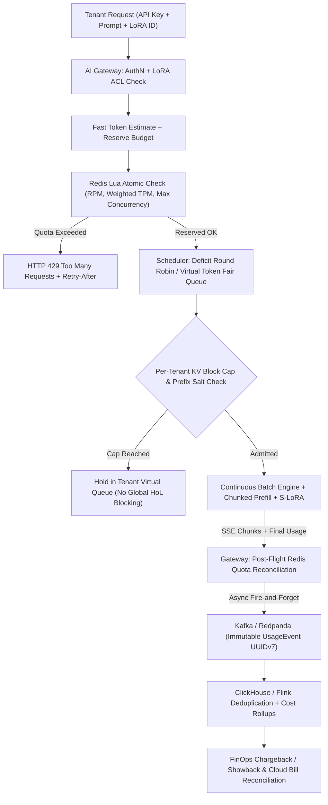
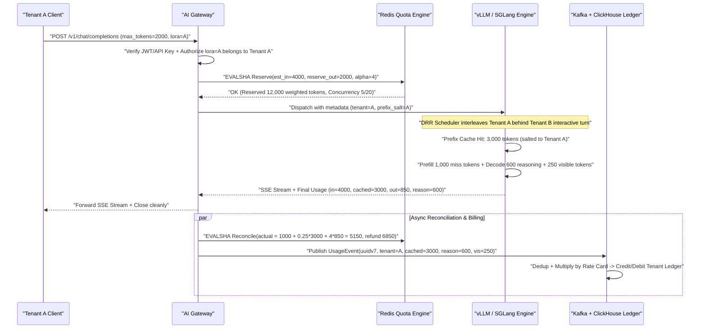

# 05. Multi-Tenant Governance

**Navigation:** [← Stage 10 Overview](./README.md) | [← Previous: Inference Unit Economics](./04-inference-unit-economics.md) | **Topic 05 of 05**

---

When multiple teams or paying customers share a single AI cluster, the platform must prevent any one user from hogging GPU memory, slowing down others, seeing another user's cached data, or racking up unbilled compute costs. This chapter covers how to count every type of token accurately, enforce fair rate limits and GPU scheduling isolation, and build a reliable billing pipeline that never slows down live inference.

## Core Concepts & Terminology

Every governance, scheduling, security, and billing term used in this document is defined below in dependency order:

### A. Multi-Tenancy, Auth & Token Accounting Taxonomy
* **Multi-Tenant Platform & Tenant:** A shared inference cluster serving multiple independent teams, products, or external customers (**tenants**).
* **AuthN (Authentication), API Key, JWT, & ACL:** **AuthN** verifies who a caller is using an **API Key** or **JWT (JSON Web Token)**; an **ACL (Access Control List)** enforces which models or adapters that tenant is allowed to invoke.
* **Token Cost Classes:** Because different tokens consume vastly different GPU resources, governance classifies them separately:
  * **Uncached Prompt Tokens ($N_{\text{in, miss}}$):** New input tokens requiring full parallel prefill matrix math (**GEMMs**) and KV cache writes to HBM.
  * **Cached Prefix Tokens ($N_{\text{in, hit}}$):** Repeated prompt prefixes matched in **Automatic Prefix Caching (APC)** or **RadixAttention**, skipping prefill math and costing only KV reads.
  * **Visible Completion Tokens ($N_{\text{out, vis}}$):** Generated output tokens streamed to the user.
  * **Reasoning / Hidden Tokens ($N_{\text{out, reason}}$):** Internal chain-of-thought tokens generated inside `<think>...</think>` blocks by reasoning models (e.g., DeepSeek-R1, QwQ) before the final answer; they consume full decode bandwidth and VRAM.
  * **Tool-Call & Grammar FSM Masking:** Structured JSON outputs enforced by a **Finite-State Machine (FSM)** grammar mask that restricts allowed next tokens at each step.
  * **Speculative Rejected Draft Tokens (EAGLE head):** Candidate tokens guessed by a fast draft model/head that fail verification and are discarded.
* **Tokenizer Divergence & `stream_options: {"include_usage": true}`:** Different models split text into different token counts (e.g., OpenAI's `cl100k_base` vs. Llama-3's tokenizer). Passing `include_usage: true` on **SSE (Server-Sent Events)** streams instructs the serving engine to report authoritative token counts at stream end.

### B. Rate Limiting & Two-Phase Quota Control
* **RPM, TPM (ITPM / OTPM / Weighted TPM), & Max Concurrency:** **RPM** limits Requests Per Minute; **TPM** limits Tokens Per Minute (split into Input **ITPM** and Output **OTPM**, or combined as **Weighted TPM** where output tokens carry a multiplier $\alpha \in [3, 5]$); **Max Concurrency** caps simultaneous active requests/KV tokens.
* **Redis, Lua (`EVALSHA`), Token-Bucket / Sliding-Window, & TTL:** **Redis** is an in-memory key-value store. Executing a **Lua script (`EVALSHA`)** runs quota checks and updates as one **atomic** (indivisible) operation, preventing race conditions. A **TTL (Time-To-Live)** automatically expires leaked concurrency locks if a gateway crashes.
* **Two-Phase Quota Accounting & HTTP `429`:** **Phase 1 (Pre-Flight)** reserves worst-case tokens before forwarding to the GPU (rejecting over-limit callers with **`429 Too Many Requests`** and `Retry-After` headers); **Phase 2 (Post-Flight)** reconciles actual engine `usage` and refunds unused headroom.
* **Guaranteed Tier vs. Opportunistic Burst Tier:** Paid baseline capacity (**Guaranteed**) versus temporary extra throughput (**Burst**) granted only when cluster KV and queue pressure are low.

### C. Fair Scheduling, VRAM Isolation & Multi-LoRA
* **FCFS & Head-of-Line (HoL) Blocking:** **First-Come, First-Served** queuing lets one tenant's huge batch stall all later interactive users behind it (**HoL blocking**).
* **Deficit Round Robin (DRR) & Virtual Token Counter (VTC):** Fair-queuing schedulers that maintain separate virtual sub-queues per tenant and interleave admissions based on weighted token work consumed (`virtual_work[i] / w_i`) so bursty tenants cannot starve interactive ones.
* **Chunked Prefill (`max_num_batched_tokens`):** Splitting long prompt prefills into bounded slices interleaved with decode steps to protect other tenants' Inter-Token Latency (ITL).
* **Per-Tenant KV Block Caps & Prefix-Cache Side-Channel (`namespace_isolation`):** Limiting how many PagedAttention KV blocks one tenant can occupy, and salting KV prefix hashes with `(tenant_id, prefix_hash)` so one tenant cannot probe whether another tenant queried secret text or **PII (Personally Identifiable Information)** by measuring TTFT cache-hit speedups.
* **S-LoRA / Punica & SGMV Kernels:** Techniques for hosting 50–500 fine-tuned **LoRA** adapters ($W = W_{\text{base}} + B_i A_i$) on one shared base model. **SGMV (Segmented Gather Matrix-Vector/Matrix-Multiply)** kernels execute heterogeneous tenant adapters in one batched pass, backed by a tiered **LRU (Least Recently Used)** cache (`--max-loras` in VRAM, `--max-cpu-loras` in host RAM).

### D. Chargeback, Showback & Asynchronous Metering
* **Showback vs. Chargeback, GL Codes, & ERP:** **Showback** reports per-team token/dollar usage for visibility; **chargeback** deducts real spend against team budgets, accounting General Ledger (**GL**) codes, or **ERP**/Stripe invoices.
* **Hot Path & Idempotent Asynchronous Metering:** The **hot path** is the latency-sensitive request loop; billing writes must happen **asynchronously** off the hot path and be **idempotent** (safe to retry without double-charging).
* **Kafka / Redpanda / NATS JetStream, Protobuf, & UUIDv7:** Durable message queues that buffer immutable `UsageEvent` records (serialized in JSON or binary **Protobuf**) tagged with a time-ordered unique **`UUIDv7`** ID for **exactly-once deduplication**.
* **ClickHouse (`ReplacingMergeTree`), Apache Flink, Materialized Views, & Rate Card:** High-speed stream processors (**Flink**) and analytical databases (**ClickHouse**) that deduplicate events, multiply token counts by a versioned **Rate Card** (`$/1M tokens`), and maintain pre-aggregated rollups.
* **Cloud Cost Reconciliation (AWS CUR, GCP BigQuery, Kubecost) & Fleet Recovery Ratio:** Comparing attributed tenant bills against actual cloud invoices (**AWS Cost & Usage Report**, **GCP BigQuery**, **Kubecost**) to measure how much paid GPU capacity was recovered versus lost to idle time ($1 - U_{\text{avg}}$).

---

## 1. Granular Token Accounting Taxonomy

In a multi-tenant inference platform (internal enterprise AI gateway or commercial API), naive token counting (`len(prompt) + len(completion)`) creates severe billing inaccuracies, arbitrage exploits, and margin leaks. Modern governance pipelines classify every token into distinct cost classes matching its true silicon footprint:

| Token Category | Physical Workload Executed | Billing / Metering Rule |
| :--- | :--- | :--- |
| **1. Uncached Prompt Tokens ($N_{\text{in, miss}}$)** | Full prefill GEMMs + attention + KV write to HBM. | Standard input rate (**1.0× input**). |
| **2. Cached Prefix Tokens ($N_{\text{in, hit}}$)** | Matched in vLLM Automatic Prefix Cache (APC) or SGLang RadixAttention; **skips prefill GEMMs** and KV write, incurring only KV read during suffix attention. | Discounted input rate (**0.1× – 0.5× input**, e.g., 50%–90% discount). Must track hit blocks exact to block granularity (e.g., 16-token blocks). |
| **3. Visible Completion Tokens ($N_{\text{out, vis}}$)** | Autoregressive decode step + KV cache residency across $N_{\text{out}}$ steps. | Full output rate (**1.0× output**, 3×–10× input rate). |
| **4. Reasoning / Hidden Tokens ($N_{\text{out, reason}}$)** | Tokens generated inside `<think>...</think>` blocks by reasoning models (DeepSeek-R1, QwQ) before emitting the user-visible answer. | **Must be metered at 1.0× full output rate**, even if stripped or summarized by the client UI! They consume identical HBM bandwidth and KV VRAM. |
| **5. Tool-Call & Structured Grammar Tokens** | JSON schema injected into prompt ($N_{\text{in}}$) + generated tool arguments/JSON ($N_{\text{out}}$). Grammar FSM masking adds tiny CPU overhead. | Schema tokens billed as prompt (often prefix-cached across turns!); emitted JSON billed as output. |
| **6. Speculative Rejected Draft Tokens** | Candidate tokens proposed by draft model/EAGLE head and rejected during target verification. | **Never billed directly to tenants** (billing varies unpredictably with prompt entropy); amortized internally into the effective per-output-token rate. |

### 1.1 Exact Tokenization & Mid-Stream Disconnect Accounting

* **Gateway vs. Engine Tokenizer Divergence:** Never compute final billing counts using HTTP character heuristics or a different tokenizer (e.g., `cl100k_base` for Llama-3). The **authoritative token counts** must come directly from the inference engine's response `usage` block (captured via `stream_options: {"include_usage": true}` on SSE streams):
  ```json
  {
    "usage": {
      "prompt_tokens": 8192,
      "completion_tokens": 1420,
      "prompt_tokens_details": { "cached_tokens": 6144 },
      "completion_tokens_details": { "reasoning_tokens": 980 }
    }
  }
  ```
* **Client Abort / Timeout Edge Case:** If a client closes the TCP socket after receiving 400 tokens of a 2,000-token stream, the engine aborts generation at token ~405. The AI Gateway **must track emitted SSE token chunks** (or consume the engine's abort-finalization hook) so the tenant is accurately charged for the 405 tokens actually generated on the GPU, rather than losing billing telemetry on client disconnect.

---

## 2. Dynamic TPM, RPM & Concurrency Quotas (Admission Control)

Rate limiting protects both cluster stability and financial budgets across three orthogonal dimensions:

1. **RPM (Requests Per Minute):** Bounds HTTP parsing, router dispatch, tokenizer CPU, and scheduler queue-entry overhead.
2. **TPM (Tokens Per Minute):** Bounds GPU compute and HBM bandwidth consumption. Because output tokens cost 3×–10× more GPU time than input tokens, platforms enforce either:
   * Separate **ITPM** (Input TPM) and **OTPM** (Output TPM) buckets, **or**
   * A **Weighted Equivalent TPM** budget:
     $$\text{TPM}_{\text{weighted}} = N_{\text{in, miss}} + (0.25 \cdot N_{\text{in, hit}}) + (\alpha \cdot N_{\text{out}}) \quad \text{where } \alpha \in [3, 5]$$
3. **Max Concurrency & Active KV Token Cap:** Essential because TPM alone fails against burst attacks! A tenant with a `1,000,000 TPM` quota could fire **10 concurrent 100K-token requests in 50 ms**, instantaneously pinning 100% of the cluster's KV cache blocks and starving all other tenants for 30 seconds while staying within their per-minute token quota.

### 2.1 Two-Phase Quota Reservation & Reconciliation (Atomic Redis Lua)

A single-phase post-request counter update suffers from a race condition: 500 concurrent requests pass the check at `t=0` before any completes, exhausting the quota by 50×. Production gateways implement **Two-Phase Quota Accounting**:

1. **Phase 1 — Pre-Flight Atomic Reservation (Before Forwarding to GPU):**
   * Estimate input tokens fast (`ceil(utf8_bytes / 3.5)` or fast Rust `tokenizers` binding) and compute worst-case output reserve $R_{\text{out}} = \min(\text{max\_tokens}, \text{default\_reserve})$ (e.g., `2048` if `max_tokens` is omitted).
   * Execute an atomic **Redis Lua (`EVALSHA`)** script implementing a sliding-window or token-bucket check across RPM, Weighted TPM, and `active_concurrency`:
     * If sufficient budget exists: atomically deduct `reserved_cost = est_in + alpha * R_out` and increment `active_concurrency[tenant] += 1` (with a safety TTL, e.g., `180s`, so gateway crashes never leak concurrency slots!).
     * If exhausted: immediately reject with HTTP **`429 Too Many Requests`**, returning standard `Retry-After`, `x-ratelimit-remaining-tokens`, and `x-ratelimit-reset-tokens` headers.
2. **Phase 2 — Post-Flight Reconciliation (On Stream End or Abort):**
   * Compute `actual_cost` from authoritative engine `usage` (crediting prefix-cache discounts and true output/reasoning tokens).
   * Atomically apply `delta = actual_cost - reserved_cost` back to the tenant's Redis bucket (typically refunding unused `max_tokens` headroom) and decrement `active_concurrency[tenant] -= 1`.

### 2.2 Dynamic / Elastic Burst Quotas

Static hard caps waste paid GPU capacity during off-peak hours (hurting $U_{\text{avg}}$). **Two-tier dynamic quotas** maximize utilization:
* **Guaranteed Tier (SLA-backed):** Tenant A pays for 200K TPM guaranteed capacity.
* **Opportunistic Burst Tier:** If cluster `gpu_cache_usage_perc < 0.50` and `num_requests_waiting == 0`, the gateway temporarily raises Tenant A's effective multiplier (e.g., up to 3× TPM) tagged with `priority: "burst"`. As soon as guaranteed-tier demand rises, burst throttling clamps back to 1.0× within seconds.

---

## 3. Noisy-Neighbor Isolation Inside the Engine & Cluster


Gateway rate limits stop aggregate over-consumption, but **they cannot prevent micro-scale interference inside the GPU continuous batching scheduler**. Even if two tenants stay within their per-minute token budgets, a single tenant submitting 200 long-context requests simultaneously can monopolize the FIFO queue and shared VRAM KV pool unless the scheduler isolates queues, memory blocks, and LoRA weights per tenant.

### 3.1 Fair Queuing via Deficit Round Robin (DRR)

Standard serving engines default to **FCFS (First-Come, First-Served)** scheduling. If Tenant A dumps 200 long-prompt requests into the waiting queue at `t=0`, Tenant B's interactive 100-token request arriving at `t=10ms` experiences **Head-of-Line (HoL) blocking**, sitting behind Tenant A's entire backlog while TTFT spikes from 150 ms to 15 seconds.

**Deficit Round Robin (DRR) / Virtual-Time Fair Queuing (e.g., VTC — Virtual Token Counter):**
* Maintain an isolated waiting sub-queue $Q_i$ per tenant $i$, each configured with priority weight $w_i$ (default $w_i = 1$).
* Track a per-tenant cumulative service counter `virtual_work[i]` (incremented by weighted tokens served: $\Delta = N_{\text{in}} + \alpha N_{\text{out}}$, decaying exponentially or normalized against the minimum active tenant's counter so idle tenants don't accumulate infinite burst credit!).
* On every scheduling step, the engine admits the next request from the active tenant with the **lowest `virtual_work[i] / w_i`** (or in DRR, adds `quantum * w_i` to `deficit[i]` and pops requests while `deficit[i] >= req_cost`).
* **Result:** Tenant A's 200-request flood only consumes its fair share of scheduling slots; Tenant B's newly arrived request jumps straight to the front of admission and achieves sub-200 ms TTFT!
* **Paired with Chunked Prefill (`max_num_batched_tokens=512..2048`):** Even if Tenant A has a 64K-token prompt admitted, chunking its prefill into 512-token slices interleaved with Tenant B's decode steps prevents Tenant A from stalling Tenant B's ITL.

### 3.2 Per-Tenant VRAM KV Cache Quota Caps & Prefix-Cache Security

* **KV Block Caps (`max_kv_blocks[tenant]`):** Enforce a ceiling (e.g., max 30% of total PagedAttention blocks per tenant on shared pools) inside the scheduler or gateway concurrency/context-token gate. If Tenant A opens fifty 64K-context sessions, only Tenant A's excess requests queue or get preempted—preventing global KV exhaustion that would evict Tenant B's active decode sessions.
* **Prefix-Cache Timing Side-Channel Isolation:** Automatic Prefix Caching (APC / RadixAttention) hashes token chunks (`hash(block_tokens)`) to share KV blocks across requests. **Security Hazard:** If KV hashes are global across tenants, Tenant A can probe whether Tenant B recently queried a secret document or PII string by measuring TTFT latency (50 ms cache hit vs. 500 ms cache miss!).
  * **Fix:** Salt every KV block hash with `(tenant_id, prefix_block_hash)` (`namespace_isolation`), restricting cross-tenant sharing exclusively to explicitly published, immutable system prompts.

### 3.3 Multi-Tenant LoRA Adapter Isolation (S-LoRA / Punica)

Enterprise platforms frequently host **50–500 fine-tuned LoRA adapters** ($W = W_{\text{base}} + B_i A_i$, rank $r \in [8, 64]$) per tenant on top of a single shared frozen base model ($W_{\text{base}}$). Conceptually, every request computes `y = W_base @ x + B_i @ (A_i @ x)`:
* **Batched Heterogeneous Execution (Punica / SGMV Kernels):** Instead of dedicating separate GPUs per tenant adapter (which destroys $U_{\text{avg}}$), Segmented Gather Matrix-Vector/Matrix-Multiply (`SGMV`) kernels batch requests targeting *different* LoRA adapters into the same base GEMM pass (`W_base @ X`), then apply each request's respective low-rank $(A_i, B_i)$ slice in parallel.
* **Bounded Adapter Cache & Eviction:** Keep top-$K$ hot LoRA weights pinned in a reserved GPU VRAM pool (`--max-loras 16`), spill warm adapters to a pinned CPU RAM LRU cache (`--max-cpu-loras 128`), and stream cold adapters on demand from NVMe/S3—bounding worst-case LoRA VRAM overhead to < 2–4 GB.
* **Strict Cryptographic ACLs:** Gateway enforces `tenant_id` ownership before passing `model="lora-tenant-A"` to the engine so no tenant can invoke another tenant's proprietary weights.

---

## 4. Chargeback & Showback Telemetry Pipelines

FinOps governance requires converting raw inference usage into auditable financial attribution:
* **Showback:** Exposes per-team/per-product token and GPU dollar consumption dashboards to drive engineering cost awareness without automated budget locks.
* **Chargeback:** Deducts real cloud/API spend against tenant budgets, cost-center GL codes, or customer prepaid credits/invoices.

### 4.1 Asynchronous, Idempotent Metering Pipeline

**Cardinal Rule:** *Never write synchronous billing ledger transactions on the inference hot path.* Database locks or ClickHouse hiccups must never add 1 ms to TTFT.

1. **Immutable `UsageEvent` Emission:** Upon request completion (or abort), the AI Gateway publishes a compact JSON/Protobuf event to a durable message bus (**Kafka / Redpanda / NATS JetStream**):
   * `event_id` (UUIDv7 — guarantees **exactly-once deduplication** downstream on retries).
   * `timestamp_utc`, `tenant_id`, `cost_center`, `api_key_id`, `model_id`, `sku_tier` (`h200-spot`, `h100-od`).
   * `prompt_tokens_uncached`, `prompt_tokens_cached`, `completion_tokens_visible`, `completion_tokens_reasoning`.
   * `ttft_ms`, `e2e_latency_ms`, `cache_hit_ratio`, `status` (`ok`, `client_abort`, `preempted`).
2. **Stream Enrichment & Aggregation (Flink / ClickHouse Materialized Views):**
   * Deduplicate by `event_id` (`ReplacingMergeTree` in ClickHouse or Flink stateful dedup).
   * Join with versioned **Rate Card / Unit Economics Table** (mapping `(model_id, sku_tier, effective_date)` to $/1M uncached input, $/1M cached input, $/1M output).
   * Materialize 1-minute and 1-hour rollups per `(tenant_id, model_id, cost_center)` for sub-second dashboard queries and Stripe/ERP invoice export.
3. **Cluster Cost Reconciliation (`Idle / Unallocated Cost`):**
   * Reconcile total billed tenant dollars against actual cloud GPU billing (AWS CUR / GCP BigQuery / Kubecost).
   * Compute **Fleet Recovery Ratio** $= \frac{\sum \text{Attributed Tenant Cost}}{\text{Actual Cloud GPU Bill}}$; any gap exposes idle capacity ($1 - U_{\text{avg}}$), cold-start waste, or miscalibrated unit pricing.

---

## 5. Multi-Tenant Governance Diagrams

### 5.1 Multi-Tenant Admission, Fair Queuing & Chargeback Architecture



### 5.2 End-to-End Multi-Tenant Request Lifecycle



---

## 6. Governance Anti-Patterns & Hardening Summary

| Anti-Pattern | Failure Mode | Required Engineering Control |
| :--- | :--- | :--- |
| **Unweighted TPM (`in + out` treated 1:1)** | Tenants run 0-input / 4,000-output loops, saturating HBM bandwidth while staying inside TPM budget. | Enforce separate **OTPM** or weighted TPM ($\alpha \cdot N_{\text{out}}$). |
| **Excluding `<think>` reasoning tokens from usage** | 10× unbilled GPU decode burn on reasoning models; instant negative margin. | Meter `completion_tokens` inclusive of `reasoning_tokens` from engine `usage`. |
| **Global FCFS queue without KV caps** | Single tenant's 100K-token batch blocks interactive tenants' TTFT and triggers KV preemptions. | **DRR / Virtual Token Fair Queuing** + **Chunked Prefill** + **Per-Tenant KV Block Caps**. |
| **Unsalted global Prefix Cache** | Cross-tenant timing side-channel leaks prompt existence; security compliance failure. | Key APC / Radix trees with `(tenant_id, prefix_hash)`. |
| **Synchronous Postgres billing write per request** | Billing DB lock contention spikes P99 TTFT and causes cascading timeouts. | Asynchronous **UUIDv7 idempotent event log** to Kafka/ClickHouse. |

---

**Navigation:** [← Stage 10 Overview](./README.md) | [← Previous: Inference Unit Economics](./04-inference-unit-economics.md) | **Topic 05 of 05**
