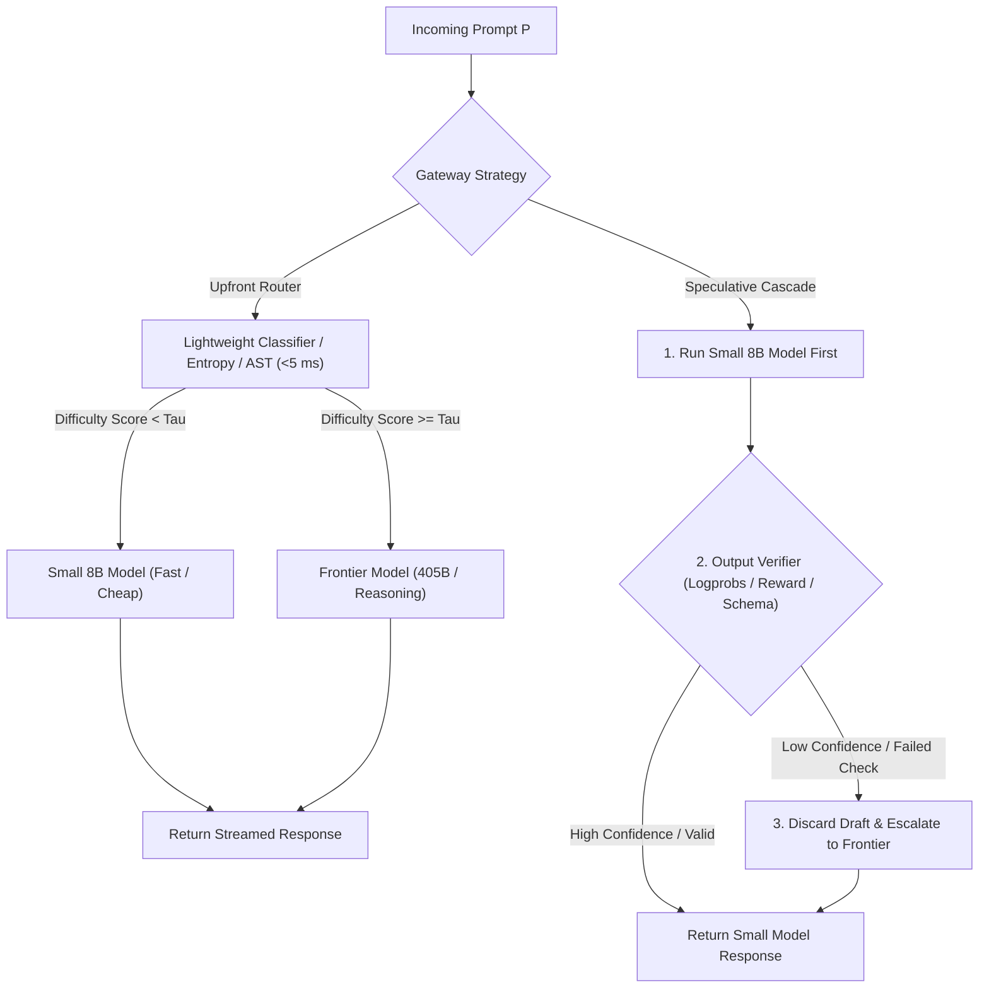
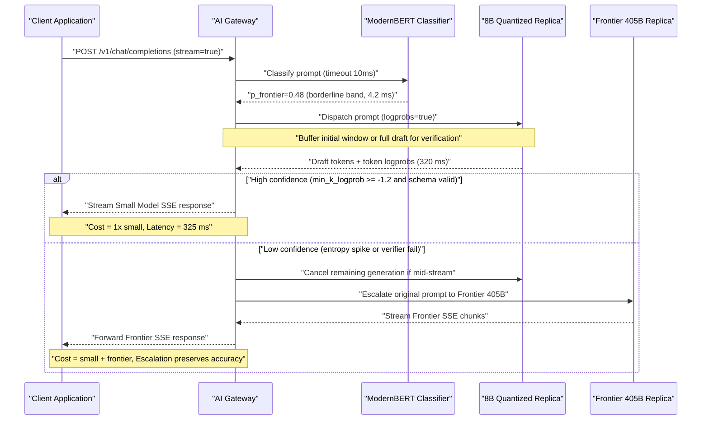
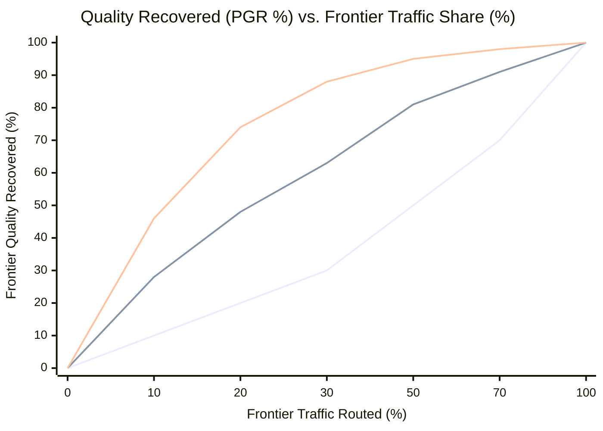

# 01 — Dynamic Routing & Model Cascading

[← Stage 11 Overview](./README.md) | [Next: 02 — Semantic Caching →](./02-semantic-caching.md)

---

Multi-tier inference fleets route simple requests to small, inexpensive models while reserving large frontier models for complex reasoning. This document explains the hardware economics, upfront routing classifiers, post-generation verification cascades, and evaluation metrics used to build production AI gateways.

## Core Concepts & Terminology

* **LLM (Large Language Model) & Token:** A neural network trained to understand and generate text or code. Text is broken into **tokens**—subword units of roughly 3–4 characters (~0.75 words) that serve as the atomic unit of model input and output.
* **Prefill & Autoregressive Decode:** LLM inference runs in two phases. **Prefill** processes all input prompt tokens in parallel to build initial internal representations. **Autoregressive Decode** then generates output tokens one at a time in a sequential loop, feeding each newly produced token back as input for the next step.
* **HBM (High-Bandwidth Memory) & SRAM (Static Random-Access Memory):** **HBM** is high-capacity stacked memory on the GPU package that holds model weights and conversation state. **SRAM** is tiny, ultra-fast on-chip memory inside GPU compute cores where active arithmetic executes.
* **FLOP, GEMV, & Arithmetic Intensity:** A **FLOP** is one floating-point arithmetic operation. **GEMV (General Matrix-Vector Multiplication)** multiplies a large weight matrix by a single token vector during decode. **Arithmetic intensity** is the ratio of math operations performed per byte read from memory ($\text{FLOP/byte}$); low arithmetic intensity makes single-request decode **memory-bandwidth-bound** (limited by HBM transfer speed rather than compute speed).
* **KV Cache (Key-Value Cache):** Stored intermediate attention vectors (Keys and Values) from previously processed tokens so the engine does not recompute them on every decode step.
* **Precision & Quantization (FP8, INT4):** **Precision** is the bit-width used to store numbers. **Quantization** compresses weights from 16-bit/32-bit formats into **FP8** (8-bit floating point) or **INT4** (4-bit integer) to shrink HBM usage and memory traffic.
* **Tensor Parallelism (TP) & NVLink:** **Tensor Parallelism** splits individual model layers across multiple GPUs (e.g., `TP=8`) connected via **NVLink**, a high-speed direct GPU-to-GPU interconnect, so they compute each token together.
* **TTFT & E2E Latency:** **TTFT (Time to First Token)** is the wait time from request arrival until the first output token is emitted. **E2E (End-to-End) Latency** is the total time until the final output token completes.
* **AI Gateway:** A centralized proxy sitting between client applications and LLM backends that handles routing, caching, rate limiting, failover, and telemetry.
* **Dynamic Routing vs. Model Cascading:** **Dynamic Routing** inspects a prompt *before* calling any LLM and dispatches it once to the smallest model tier expected to succeed. **Model Cascading** optimistically runs a small, fast model first, checks its output with a verifier, and **escalates** to a frontier model only if verification fails.
* **AST (Abstract Syntax Tree) & Cyclomatic Complexity:** An **AST** is a tree representation of source code's syntactic structure produced by a parser (such as `tree-sitter`). **Cyclomatic complexity** counts independent branching paths (`if`, `match`, `try`) in code.
* **RoPE & Attention Dilution:** **RoPE (Rotary Position Embedding)** encodes token positions by rotating attention vectors and can degrade if extrapolated beyond trained context lengths. **Attention dilution** occurs when relevant constraints get drowned out inside very long prompts.
* **Logits, Softmax, & Log-Probabilities (`logprobs`):** **Logits** are raw, unnormalized output scores from a model's final layer. **Softmax** converts logits into probabilities summing to $1$. A **log-probability** ($\log P$) expresses token confidence on a logarithmic scale.
* **Perplexity (PPL) & Shannon Entropy ($H$):** **Perplexity** measures how surprised a reference language model is by a prompt (high PPL means rare jargon or unusual syntax). **Shannon entropy** measures uncertainty (in bits) across possible next tokens; high entropy signals **epistemic uncertainty** about how to begin answering.
* **Bidirectional Encoder Classifiers (DeBERTa, ModernBERT):** Unlike autoregressive LLMs, bidirectional encoders read the entire prompt at once to classify it. **DeBERTa** uses disentangled content-to-position attention, while **ModernBERT** combines RoPE, **FlashAttention** (memory-efficient exact attention), and **sequence unpadding** (packing variable-length prompts without wasted `[PAD]` compute) to support 8,192-token contexts in milliseconds.
* **ONNX Runtime, AVX-512 VNNI, & TensorRT:** **ONNX Runtime** is a cross-platform inference engine for models exported to the ONNX format, accelerated on CPUs via **AVX-512 VNNI** vector instructions for INT8 math. **TensorRT** is NVIDIA's high-throughput GPU inference compiler and runtime.
* **Temperature Scaling:** A calibration step dividing raw classifier logits by a tuned scalar $T$ before softmax/sigmoid so predicted probabilities match actual empirical pass rates.
* **RouteLLM, Matrix Factorization (MF), Bradley-Terry, SW Ranking, & LoRA:** **RouteLLM** trains routers on pairwise human preference data (e.g., Chatbot Arena / LMSYS-1M). **Matrix Factorization (MF)** represents each model as a latent vector and projects prompt embeddings into the same space to compute a **Bradley-Terry** head-to-head win probability. **Similarity-Weighted (SW) Ranking** uses k-nearest-neighbor cosine similarity over historical prompts, while **LoRA (Low-Rank Adaptation)** fine-tunes a small causal LLM router efficiently.
* **Verifier Signals (Symbolic, Self-Consistency, PRM):** **Symbolic verifiers** run deterministic checks (JSON Schema, Pydantic, SQL `EXPLAIN`, Python AST/tests). **Self-consistency** samples $K$ answers and checks majority agreement. A **Reward Model / Process Reward Model (PRM)** is a trained neural scorer that evaluates `(prompt, draft_response)` quality.
* **SSE (Server-Sent Events) & `RST_STREAM`:** **SSE** is an HTTP streaming format that pushes generated tokens incrementally as `data:` events. **`RST_STREAM`** is an HTTP/2 frame that immediately cancels an in-flight backend stream.
* **Quality–Cost Pareto Frontier, CPT, PGR, & APGR:** The **Pareto frontier** traces optimal trade-offs where quality cannot rise without increasing cost. **CPT (Cost-Performance Threshold)** is the minimum cost/frontier share needed to reach a target quality (e.g., 90% of frontier). **PGR (Performance Gap Recovered)** measures how much of the quality gap between weak and strong models a router recovers, and **APGR (Average Performance Gain Ratio)** summarizes the normalized area under the PGR curve over random routing.
* **Distribution Shift & Shadow Traffic:** **Distribution shift** occurs when live traffic diverges from classifier training data. **Shadow traffic** asynchronously mirrors a small sample of live requests to a frontier model (or offline judge) to monitor quality drift without adding user latency.

---

## 1. First-Principles Economics & Physics of Multi-Model Routing

In production LLM fleets, prompt difficulty follows a heavy-tailed distribution: **60%–80%** of incoming requests (classification, extraction, summarization, boilerplate code completion, simple FAQ retrieval) do not require the reasoning capacity of a frontier model, yet routing all traffic to a frontier endpoint wastes both money and silicon bandwidth.

From Stage 3, autoregressive **decode** is **memory-bandwidth-bound** (`GEMV`, arithmetic intensity $\approx 1\text{–}2\text{ FLOP/byte}$ per batch item). Every generated token requires streaming nearly all active model weights from HBM into SRAM:

$$t_{\text{decode\_step}} \approx \frac{\text{Bytes}_{\text{active\_weights}} + \text{Bytes}_{\text{KV\_cache}}}{\text{BW}_{\text{HBM\_effective}}}$$

Consider the concrete physical gap between two tiers serving at batch size $B=1$:

| Tier | Model Example | Precision | Active Weights Read / Token | Compute / Token (Decode) | Hardware Footprint | Relative Cost / 1M Tokens |
| :--- | :--- | :--- | :--- | :--- | :--- | :--- |
| **Small Local Tier** | Llama-3.1-8B | INT4 / FP8 | $\sim 4.5\text{ GB}$ (INT4) / $8.5\text{ GB}$ (FP8) | $1.6 \times 10^{10}$ FLOPs | $1\times$ L4 / L40S / consumer GPU | **$\$0.03\text{–}\$0.08$** ($1\times$) |
| **Frontier Dense Tier** | Llama-3.1-405B | FP8 | $\sim 405\text{ GB}$ | $8.1 \times 10^{11}$ FLOPs | $8\times$ H100 (TP=8, NVLink) | **$\$1.50\text{–}\$5.00$** ($50\times\text{–}100\times$) |

Even with Tensor Parallelism ($TP=8$) and high-bandwidth HBM3e ($4.8\text{ TB/s}$ per H200), serving the 405B tier consumes **$50\times\text{–}90\times$ more HBM bytes moved and GPU-seconds per token** than an 8B quantized model. Consequently, the core goal of **Dynamic Routing** and **Model Cascading** is to maximize quality-adjusted throughput per dollar by matching each query's intrinsic difficulty to the smallest model capable of satisfying the accuracy threshold.

---

## 2. Upfront Dynamic Routing vs. Speculative Model Cascading


There are two fundamentally distinct architectural paradigms for multi-tier dispatch. In PyTorch terms, an upfront router acts like a fast `if/else` gate running a tiny 20M-parameter CPU classifier before deciding which model checkpoint to call, whereas a speculative cascade runs the small 8B model first and inspects its output `logprobs` or a reward verifier before deciding whether to discard the draft and invoke the 405B model:

1. **Upfront Dynamic Routing (Pre-Inference Classification):** Inspect the prompt *before* calling any LLM using a cheap heuristic, entropy estimator, or trained classifier ($<5\text{ ms}$), and dispatch once to either the small model $M_s$ or the frontier model $M_f$.
2. **Speculative Model Cascading (Post-Inference Verification):** Optimistically send the prompt to the cheap/fast model $M_s$ first, evaluate a confidence or verifier signal on $M_s$'s output, and **escalate** to $M_f$ only if $M_s$ exhibits low confidence or fails verification.



### Analytical Cost & Latency Comparison

Let $c_s, c_f$ denote the per-request cost of the small and frontier models ($c_f \gg c_s$), $T_s, T_f$ denote their end-to-end latencies, and $c_{\text{cls}}, T_{\text{cls}}$ denote the upfront classifier's cost and latency ($c_{\text{cls}} \approx 0$, $T_{\text{cls}} \approx 2\text{–}8\text{ ms}$).

* **Upfront Router:** Let $r_f$ be the fraction of requests routed to $M_f$:
  $$E[C]_{\text{router}} = c_{\text{cls}} + (1 - r_f)\,c_s + r_f\,c_f$$
  $$E[T]_{\text{router}} = T_{\text{cls}} + (1 - r_f)\,T_s + r_f\,T_f$$
  Zero wasted LLM calls: a request never pays for both $M_s$ and $M_f$. Streaming to the client can start immediately after $T_{\text{cls}} + \text{TTFT}_s$ or $T_{\text{cls}} + \text{TTFT}_f$.

* **Speculative Cascade:** Let $r_{\text{esc}}$ be the escalation rate (fraction of requests rejected by the verifier) and $c_{\text{ver}}, T_{\text{ver}}$ be verifier overhead:
  $$E[C]_{\text{cascade}} = c_s + c_{\text{ver}} + r_{\text{esc}}\,c_f$$
  $$E[T]_{\text{cascade}} = T_s + T_{\text{ver}} + r_{\text{esc}}\,T_f$$
  Notice the **double-execution penalty** on escalated queries: an escalated query pays **$c_s + c_f$** in cost and **$T_s + T_f$** in latency. Furthermore, **cascading breaks immediate token streaming** unless the verifier runs over a short prefix or buffers the full small-model response before releasing tokens to the user.

---

## 3. Prompt Complexity Classification Techniques

An upfront router must predict whether $M_s$ will match $M_f$'s quality using *only the prompt* $p$ within a strict latency budget ($<5\text{–}10\text{ ms}$). Production gateways layer four complementary mechanisms from fastest to highest semantic fidelity.

### 3.1 Structural & AST Heuristics (Sub-Millisecond Pre-Filters)

Deterministic parsers run in $50\text{–}500\text{ }\mu\text{s}$ in Rust or C++ and isolate obvious structural complexity before touching neural encoders:
* **Context & Constraint Density:** Prompts exceeding a length threshold (e.g., $L_{\text{in}} > 16\text{k}$ tokens for needle-in-a-haystack multi-document synthesis) or containing $>3$ nested tool/function JSON schemas frequently degrade on heavily quantized 8B models due to attention dilution and RoPE extrapolation sensitivity.
* **Code AST & Cyclomatic Complexity:** Parsing fenced code blocks with `tree-sitter` to count AST node depth, branching (`if`/`match`/`try`), concurrency primitives, or multi-file diffs. A 5-line docstring request goes to 8B; a 300-line Rust lifetime error or SQL query with 4 CTEs and window functions escalates to frontier.
* **Domain & Safety Triggers:** Regex/keyword matches for formal math proofs, medical/legal compliance instructions, or explicit multi-step constraint keywords (`"prove"`, `"step-by-step"`, `"strictly conform to"`).

### 3.2 Token-Level Entropy & Perplexity Scoring

Information-theoretic scoring measures how **predictable** or **in-distribution** a prompt is under a tiny reference language model (e.g., a 125M–1B causal LM or even the small model's own prefill pass):

1. **Prompt Perplexity ($\text{PPL}$):** Given a tiny scoring LM $\theta$ (e.g., Qwen2.5-0.5B or GPT-2 small running in $<3\text{ ms}$ prefill), compute the negative log-likelihood across the $N$ prompt tokens:
   $$\text{PPL}(p) = \exp\left( -\frac{1}{N} \sum_{t=1}^{N} \log P_\theta(x_t \mid x_{<t}) \right)$$
   High perplexity indicates rare domain jargon, obfuscated syntax, adversarial phrasing, or non-standard logic where small models lack parametric knowledge.
2. **Next-Token Shannon Entropy ($H$):** At the final prompt position (or averaged over the first $k$ probe tokens), compute the Shannon entropy of the softmax vocabulary distribution $\mathcal{V}$:
   $$H(x_{N+1} \mid p) = -\sum_{v \in \mathcal{V}} P_\theta(v \mid p)\,\log_2 P_\theta(v \mid p)$$
   When $P_\theta$ is flat across many candidate continuations (high entropy, e.g., $H > 4.5\text{ bits}$), the model exhibits high **epistemic uncertainty** about how to begin answering.

> **Failure Mode — Raw Character/Byte Entropy vs. Semantic Difficulty:** Never confuse raw string Shannon entropy with reasoning complexity. A base64-encoded string or UUID (`"9f8a1c4e-..."`) has near-maximal character entropy ($\sim 5.8\text{ bits/char}$) while requiring zero reasoning; conversely, a deceptive logic riddle (`"A bat and a ball cost $1.10..."`) uses trivial vocabulary with low token perplexity yet defeats small models. Thus, LM perplexity/entropy must be paired with semantic encoders.

### 3.3 Trained Lightweight Encoder Classifiers (BERT / ModernBERT / DeBERTa)

The workhorse of production AI gateways is a fine-tuned bidirectional encoder trained to predict $P(M_{\text{small}} \text{ succeeds} \mid p)$ or a multi-class tier label (`tier_0_8b`, `tier_1_70b`, `tier_2_frontier`).

* **Model Choices & Architectural Mechanics:**
  * **DeBERTa-v3-small / base (44M–86M params):** Uses disentangled content-to-position attention, providing strong accuracy on subtle reasoning cues up to 512 tokens.
  * **ModernBERT-base / large (149M–395M params):** Replaces absolute positional embeddings with **RoPE**, uses alternating local/global attention, **FlashAttention**, and sequence **unpadding** (concatenating variable-length prompts into a single 1D batch without wasted `[PAD]` token compute, analogous to ragged tensors), supporting **8,192-token contexts** natively in single-digit milliseconds.
* **Deployment Latency Optimization:** Exporting to **INT8 ONNX Runtime** (CPU with AVX-512 VNNI) or **FP16 TensorRT** (co-located on a lightweight T4/L4 or sidecar GPU) executes a 512-token forward pass in **$2\text{–}6\text{ ms}$**.
* **Probability Calibration:** Raw classifier logits are uncalibrated. Gateways apply **Temperature Scaling** ($p = \sigma(z / T)$) fitted on a held-out validation set so that setting a routing threshold $\tau = 0.85$ reliably guarantees $\ge 85\%$ expected pass-rate on the small model.

```python
# Conceptual INT8 ONNX Router Classifier with Temperature Calibration
import numpy as np
import onnxruntime as ort

class ComplexityRouter:
    def __init__(self, onnx_path: str, tokenizer, temperature: float = 1.35, threshold: float = 0.62):
        opts = ort.SessionOptions()
        opts.intra_op_num_threads = 4
        opts.graph_optimization_level = ort.GraphOptimizationLevel.ORT_ENABLE_ALL
        self.session = ort.InferenceSession(onnx_path, opts, providers=["CPUExecutionProvider"])
        self.tokenizer = tokenizer
        self.temperature = temperature
        self.threshold = threshold  # Tuned on Cost-Quality Pareto curve

    def route(self, prompt: str) -> tuple[str, float]:
        enc = self.tokenizer(prompt, truncation=True, max_length=2048, return_tensors="np")
        # Logits shape: [1, 2] -> [logit_small_ok, logit_needs_frontier]
        logits = self.session.run(None, {
            "input_ids": enc["input_ids"].astype(np.int64),
            "attention_mask": enc["attention_mask"].astype(np.int64),
        })[0][0]
        scaled = logits / self.temperature
        exp_s = np.exp(scaled - np.max(scaled))
        prob_frontier = float(exp_s[1] / np.sum(exp_s))
        tier = "frontier-405b" if prob_frontier >= self.threshold else "local-8b-fp8"
        return tier, prob_frontier
```

### 3.4 RouteLLM: Matrix Factorization & Preference-Based Routing

Traditional binary classifiers assume fixed pairs of `(small_model, large_model)` and require re-labeling whenever a new model launches. **RouteLLM** (Ong et al., 2024) frames routing as **latent preference prediction** trained directly on pairwise human evaluation datasets (e.g., Chatbot Arena / LMSYS-1M).

Given a prompt $p$, a strong model $M_s$ (e.g., GPT-4 / 405B), and a weak model $M_w$ (e.g., Llama-3-8B), the router models the **Bradley-Terry win probability** $P(\text{win}_{M_s \succ M_w} \mid p)$:

1. **Matrix Factorization (MF) Router:**
   Each model $m$ is represented by a low-rank latent capability vector $v_m \in \mathbb{R}^{d_m}$, and the prompt embedding $e_p = \text{Embed}(p) \in \mathbb{R}^{d_p}$ is projected via a learned linear map $W_p e_p + b_p$ into the same latent space:
   $$\delta(m, p) = v_m^\top \tanh(W_p e_p + b_p)$$
   The pairwise preference probability between strong and weak models is:
   $$P(\text{win}_{M_s \succ M_w} \mid p) = \sigma\big(\delta(M_s, p) - \delta(M_w, p)\big) = \frac{1}{1 + \exp\big(-(\delta(M_s, p) - \delta(M_w, p))\big)}$$
   **Key Systems Advantage:** Because every model is parameterized by a single vector $v_m$, adding a newly released model to the pool only requires learning its $d_m$-dimensional vector (a few hundred preference pairs) rather than retraining a deep classifier. Moreover, a single scalar threshold $\alpha \in [0, 1]$ on $P(\text{win}_{M_s \succ M_w} \mid p) > \alpha$ dynamically dials the exact frontier traffic percentage ($0\% \to 100\%$) without retraining.

2. **Similarity-Weighted (SW) Ranking:**
   A non-parametric k-NN alternative that computes cosine similarity between $e_p$ and historical Arena prompts $e_i$, weighting historical pairwise win/loss outcomes by $\exp(-\beta (1 - \cos(e_p, e_i)))$ to fit a local Bradley-Terry score on the fly.

3. **Causal LLM Router:**
   Fine-tuning a small instruction model (e.g., Llama-3-8B LoRA) to output a difficulty token (`1`–`5`) before routing; higher accuracy on subtle instruction-following traps, at a higher routing latency cost ($\sim 15\text{–}30\text{ ms}$) compared to MF ($\sim 3\text{–}5\text{ ms}$).

---

## 4. Model Cascading Mechanics & Verifier Signals

When errors are expensive or prompts are hard to classify *a priori* (e.g., multi-hop QA, code generation, tool use), **Model Cascading** shifts the decision from *pre-prompt prediction* to *post-generation verification*.

### 4.1 Verifier Signal Taxonomy

| Verifier Type | Mechanism | Latency Overhead | Best-Suited Workload | Failure Mode |
| :--- | :--- | :--- | :--- | :--- |
| **Token Probability / Entropy** | Reject if mean log-prob $< \tau_1$, min-$k\%$ token log-prob $< \tau_2$, or normalized sequence entropy $> \tau_3$. | $\sim 0\text{ ms}$ (emitted inline by serving engine) | General QA, factual recall, translation | **Overconfident hallucinations:** quantized 8B models frequently emit wrong facts with $p > 0.95$. |
| **Deterministic / Symbolic Verifier** | JSON Schema / Pydantic parser, SQL `EXPLAIN` syntax check, Python AST/unit-test runner, or regex invariants. | $0.5\text{–}20\text{ ms}$ | Structured extraction, SQL/code gen, agent tool calls | Cannot catch semantically wrong logic that happens to be syntactically valid. |
| **Self-Consistency (Agreement)** | Sample $K$ outputs from $M_s$ at $T=0.7$; escalate if majority agreement $< K/2 + 1$. | $0\text{ ms}$ extra wall-clock if batched ($K=3\text{–}5$), $K\times$ tokens | Math, reasoning, classification | $K\times$ small-model compute cost; unanimous wrong answers still pass. |
| **Trained Scalar Verifier / PRM** | Lightweight Reward Model or Process Reward Model scoring `(prompt, draft_response)` jointly. | $8\text{–}25\text{ ms}$ | Open-ended instruction following, RAG faithfulness | Adds tail latency to *every* non-escalated request. |

### 4.2 Streaming Tension in Cascades

In interactive chat applications, users expect **TTFT $< 500\text{ ms}$**. A naive cascade that waits for $M_s$ to finish generating 400 tokens before running a verifier destroys TTFT ($T_s \approx 2\text{–}4\text{ s}$ even on cache/non-escalated paths!). Production gateways resolve this with three patterns:
1. **Non-Streaming / Batch Background Pipelines:** Async agents, ETL extraction, evaluation, and classification jobs have no TTFT constraint—full-response verification is ideal.
2. **Prefix-Window Verification (Early-Exit Cascade):** Buffer only the first $W$ tokens (e.g., $W=16\text{–}32$ tokens, $\sim 150\text{ ms}$ on 8B), inspect the mean entropy/logprobs of the opening reasoning step, and either flush the buffer and stream the rest of $M_s$ or immediately abort $M_s$ (`RST_STREAM` / request cancellation) and escalate to $M_f$.
3. **Router + Cascade Hybrid:** Use an upfront classifier for obvious `easy` (bypass verifier, stream immediately) and obvious `hard` (direct to frontier) buckets, and apply full-response cascading *only* to the uncertain middle band (e.g., classifier probability $0.40 \le p \le 0.65$).

### 4.3 End-to-End Execution Timeline (Upfront Classification + Confidence Escalation)



---

## 5. Latency vs. Cost vs. Quality Trade-Off Analysis

Evaluating a router strictly on accuracy or cost in isolation is misleading. Systems engineers evaluate routing policies along the **Quality–Cost Pareto Frontier** using standardized metrics:

1. **Cost-Performance Threshold (CPT / CPT-90):** The minimum average inference cost (or fraction of frontier calls $r_f$) required to achieve **90%** (or 95%/99%) of the frontier model's benchmark score (e.g., MT-Bench, MMLU-Pro, HumanEval, or production judge win-rate).
2. **Performance Gap Recovered (PGR):** Normalizes quality relative to the weak and strong baselines:
   $$\text{PGR}(r_f) = \frac{Q_{\text{router}}(r_f) - Q_{\text{weak}}}{Q_{\text{strong}} - Q_{\text{weak}}} \in [0, 1]$$
   A random router achieves $\text{PGR}(r_f) = r_f$ (diagonal line). A well-calibrated ModernBERT or RouteLLM MF router routinely achieves **$\text{PGR} \ge 0.85\text{–}0.92$ at $r_f = 0.25\text{–}0.35$**, recovering ~90% of frontier quality while cutting frontier GPU consumption by **65%–75%**.
3. **Average Performance Gain Ratio (APGR):** Area between the router's PGR curve and the random-routing baseline normalized by the oracle ceiling.

### Illustrative Pareto Trade-Off Curve (Cost vs. Quality Recovery)



### Operational Failure Modes in Production Routing

* **Distribution Shift & Silent Decay:** If the classifier was trained on clean ChatGPT-style queries and production traffic shifts to noisy OCR transcripts or multi-turn agent tool outputs, classifier calibration breaks down—routing hard agent states to 8B. **Mitigation:** Continuously sample 1%–2% of `small`-routed traffic as **shadow traffic** to the frontier model (or LLM-as-a-judge offline) to track live PGR drift.
* **System-Prompt Dilution:** Many applications prepend a 4,000-token system prompt containing rules and few-shot examples. If the router embeds the *entire* string, all queries look 98% identical in embedding space! **Mitigation:** Strip or hash the static `system` prompt separately and feed only the dynamic `user` query (plus a compressed tool-count/context-length feature vector) into the semantic router classifier.
* **Tail-Latency Amplification in Cascades:** Under high load, if the 8B tier queues up, cascading adds `queue_8B + decode_8B` directly onto the frontier tier's TTFT, pushing P99 E2E latency above client timeouts. **Mitigation:** Dynamically bypass the cascade and route straight to the target tier (or shed load) whenever the small tier's queue depth exceeds an SLA threshold.

---

[← Stage 11 Overview](./README.md) | [Next: 02 — Semantic Caching →](./02-semantic-caching.md)
