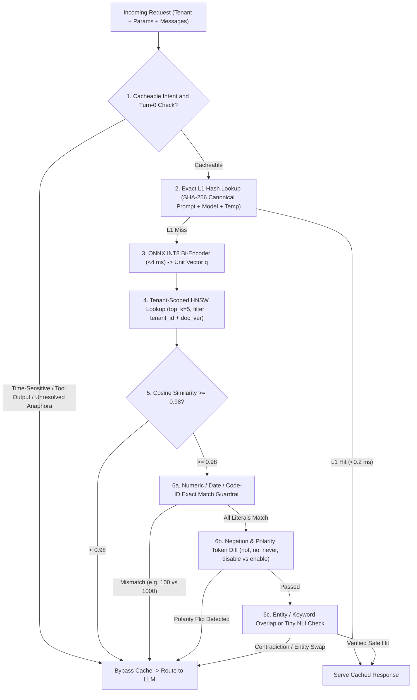
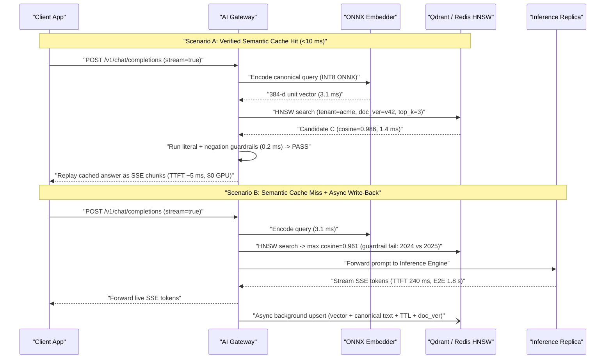

# 02 — Semantic Caching

[← Previous: 01 — Dynamic Routing & Model Cascading](./01-dynamic-routing-and-model-cascading.md) | [Stage 11 Overview](./README.md) | [Next: 03 — Session-Aware & Prefix Routing →](./03-session-aware-and-prefix-routing.md)

---

Exact-match web caches rarely hit on natural-language prompts because users phrase the same question in slightly different ways. This document explains how AI gateways use dense vector embeddings, in-memory similarity indexes, strict verification guardrails, and tenant-scoped invalidation to serve repeated intents in milliseconds with zero GPU compute.

## Core Concepts & Terminology

* **Exact Byte Caching & `SHA-256`:** Traditional caching that keys responses on an exact cryptographic hash (`SHA-256`) of the raw input string, missing paraphrased requests.
* **Dense Vector Embedding & Semantic Caching:** An **embedding** maps text into a fixed-length numerical vector in $\mathbb{R}^d$ representing its meaning. **Semantic Caching** indexes these vectors so paraphrased prompts can match previously answered requests without running GPU prefill or decode.
* **TTFT & E2E Latency:** **TTFT (Time to First Token)** is the delay until the first output token arrives; **E2E (End-to-End) Latency** is the total time until the response finishes.
* **ANN (Approximate Nearest Neighbor):** Search algorithms that find the closest vectors in a dataset in sublinear time with minimal accuracy loss, avoiding an exhaustive $O(N)$ scan.
* **RAG (Retrieval-Augmented Generation) & PII:** **RAG** injects retrieved external documents into a prompt at query time. **PII (Personally Identifiable Information)** is sensitive user or tenant data that must never leak across organizational boundaries.
* **Bi-Encoder vs. Cross-Encoder (and NLI):** A **bi-encoder** embeds a single prompt independently into a vector so cached entries can be pre-indexed. A **cross-encoder** processes a `(query, candidate)` pair together through full attention—ideal for borderline **NLI (Natural Language Inference)** entailment verification, but $O(N)$ and too slow for primary search.
* **Matryoshka Representation Learning (MRL):** A training method that packs the most informative features into the leading dimensions of an embedding so vectors can be truncated (e.g., $d=768 \to 256$) to save RAM and compute.
* **ONNX Runtime, TensorRT, INT8 Quantization, & AVX-512 VNNI:** **ONNX Runtime** executes models exported to the open ONNX format, often using **INT8 static quantization** (8-bit integers) accelerated on CPUs by **AVX-512 VNNI** vector instructions. **TensorRT** compiles and runs quantized models on GPU **Tensor Cores**. **Sequence unpadding** and **micro-batching** avoid wasted compute on padding tokens and amortize weight loads across concurrent requests.
* **L2 Normalization, Cosine Similarity, SIMD, & FMA:** **L2 normalization** scales a vector by its Euclidean length ($\|u\|_2$) to unit length $1$. **Cosine similarity** measures the angle between two vectors; on unit-length vectors, it reduces to a dot product executed via **SIMD** (Single Instruction, Multiple Data) **FMA** (Fused Multiply-Add) CPU instructions.
* **HNSW (Hierarchical Navigable Small World) & SQ8:** **HNSW** is an in-memory multi-layer proximity graph (like a skip list) enabling $O(\log N)$ ANN search, controlled by `M` (edges per node), `efConstruction` (build beam width), and `efSearch` (query beam width). **SQ8 (Scalar Quantization)** compresses `float32` coordinates (4 bytes) to `int8` (1 byte) for $4\times$ RAM savings. **Filtered HNSW** avoids dead-end graph traversals or empty top-$k$ results when combining vector search with tenant filters.
* **IVF-PQ (Inverted File with Product Quantization) & ADC:** **IVF** clusters $\mathbb{R}^d$ into $K$ Voronoi cells (`nlist`) and searches only the nearest `nprobe` cells. **PQ** splits each vector into $m$ sub-vectors and encodes each chunk as a 1-byte centroid ID. **ADC (Asymmetric Distance Computation)** precomputes a small query-to-centroid distance table so candidate scoring takes $m$ table lookups.
* **Anisotropy (Narrow Cone Phenomenon):** A property of transformer embeddings where unrelated sentences in the same domain already share $0.55\text{–}0.75$ cosine similarity, forcing semantic caches to operate at strict $0.98+$ thresholds.
* **Lexical, Literal, & Polarity Guardrails:** Deterministic post-search checks verifying that numbers, dates, code identifiers, and negation words (`not`, `never`, `disable` vs. `enable`) match before serving a cached hit.
* **SSE (Server-Sent Events):** An HTTP streaming format (`data: {...}\n\n` + `data: [DONE]\n\n`) that cached hits must replay when a client requests `stream=true`.
* **TTL & Corpus Snapshot Versioning:** **TTL (Time-to-Live)** bounds how long cached entries remain valid. **Corpus snapshot versioning** (`corpus_version` / `doc_id:etag`) invalidates stale RAG answers in $O(1)$ when source documents update.
* **Anaphora / Coreference & Contextual Query Rewriting:** **Anaphora** refers to pronouns or references (`"Why did it crash?"`) that depend on prior conversation turns and must be resolved (or bypassed) before semantic caching.

---

## 1. Motivation: The Fastest, Cheapest Token Is the One Never Generated

Traditional web caches key on exact byte equality (`SHA-256(URL + query_params)`). For natural-language LLM workloads, exact byte caching routinely achieves $<5\%$ hit rates because users express identical intents with minor lexical drift:
* `"How do I reset my Kubernetes kubeconfig context?"`
* `"how to reset kubeconfig context in k8s?"`

**Semantic Caching** replaces exact string equality with dense vector similarity over prompt embeddings, cutting end-to-end latency from **$800\text{–}4,000\text{ ms}$** (GPU prefill + decode) down to **$3\text{–}10\text{ ms}$** (CPU/GPU embedding + in-memory ANN lookup) and eliminating **$100\%$ of GPU compute cost** for cache hits.

However, naive semantic caching is a notorious source of silent production bugs: returning stale RAG facts, leaking cross-tenant PII, or inverting answers on single-word negations (`"not"`, `"without"`, `"$100"` vs `"$1000"`). A production semantic cache therefore requires **sub-5 ms embedding inference**, **cache-friendly ANN indexing**, **strict threshold calibration**, **deterministic lexical/entity guardrails**, and **context-aware invalidation**.

---

## 2. Sub-5 ms Low-Latency Embedding Models

For the semantic cache to reduce TTFT, the combined embedding + vector search + guardrail pipeline must complete well under **$10\text{ ms}$** (ideally **$3\text{–}7\text{ ms}$**), leaving ample headroom below typical GPU TTFT ($100\text{–}500\text{ ms}$).

### 2.1 Bi-Encoder Architecture & Quantized Execution

Semantic caching uses **bi-encoders** (embedding prompt $p$ independently into $\mathbb{R}^d$) rather than cross-encoders (which require running full self-attention over every pair $(p, c_i)$ in the cache and are $O(N)$ per lookup).

* **Model Selection:** Compact transformer encoders ($22\text{M–}110\text{M}$ params, $6\text{–}12$ layers), such as `all-MiniLM-L6-v2` (22M, $d=384$), `bge-small-en-v1.5` (33M, $d=384$), or `nomic-embed-text-v1.5` with **Matryoshka Representation Learning (MRL)**—which concentrates the highest-variance semantic information in the leading dimensions so embeddings can be truncated from $d=768 \to 256$ with minimal recall drop while cutting RAM and dot-product latency by **$3\times$**.
* **ONNX Runtime / TensorRT Acceleration:**
  * **Static Quantization (INT8):** Quantizing linear projections and attention matmuls to INT8 on **AVX-512 VNNI** CPUs (or FP16/INT8 Tensor Cores via TensorRT on a sidecar GPU) reduces model weight traffic and yields **$1.8\text{–}3.5\text{ ms}$** per short prompt ($32\text{–}128$ tokens) in C++/Rust (`ort` / `onnxruntime`).
  * **Sequence Unpadding & Dynamic Batching:** Even a $2\text{ ms}$ micro-batch window (`max_batch_size=16`) amortizes weight loads across concurrent gateway requests.
* **L2 Normalization at Write/Query Time:**
  Pre-normalizing vectors to unit length ($\hat{u} = \frac{u}{\|u\|_2}$) reduces Cosine Similarity to a single SIMD inner product (dot product):
  $$\cos(u, v) = \frac{\langle u, v \rangle}{\|u\|_2 \|v\|_2} = \langle \hat{u}, \hat{v} \rangle = \sum_{i=1}^{d} \hat{u}_i \hat{v}_i$$
  On AVX-512, a 384-dimensional `float32` dot product takes $384 / 16 = 24$ FMA instructions ($\sim 10\text{–}15\text{ ns}$).

---

## 3. In-Memory Vector Stores & Index Internals

Once the query vector $\hat{q} \in \mathbb{R}^d$ is computed, the gateway searches $N$ cached entries ($N = 10^5\text{–}10^8$).

### 3.1 HNSW (Hierarchical Navigable Small World Graphs)

**HNSW** is the dominant in-memory Approximate Nearest Neighbor (ANN) structure for low-latency semantic caches. It constructs a multi-layer proximity graph analogous to a probabilistic skip list:
* **Layer Hierarchy:** Layer $L_{\max}$ is extremely sparse (long-range "highway" edges); Layer $0$ contains every cached vector with dense local edges.
* **Search Mechanics ($O(\log N)$):** Query enters at the top layer's entry point, greedily hops to neighbors closer to $\hat{q}$ until reaching a local minimum, drops to Layer $l-1$ using that node as the new entry point, and at Layer $0$ executes a best-first beam search maintaining a dynamic candidate priority queue of size `efSearch`.
* **Key Tuning Parameters:**
  * `M` ($16\text{–}48$): Maximum bidirectional links per node on upper layers ($2M$ on Layer $0$). Higher `M` improves recall on high-dimensional data at linear RAM cost.
  * `efConstruction` ($100\text{–}400$): Beam width during index insertion (higher = better graph connectivity, slower writes).
  * `efSearch` ($32\text{–}128$): Beam width at query time—directly trades latency ($0.3\text{–}2\text{ ms}$) for recall.
* **Exact RAM Footprint:**
  $$\text{Bytes}_{\text{HNSW}} \approx N \times \Big( 4 \cdot d_{\text{fp32}} + 8 \cdot M_{\text{avg}} \Big) + \text{payload\_metadata}$$
  For $N = 10^6$ vectors at $d=384$ (`float32`) and $M=16$ ($M_{\text{avg}} \approx 32$ bidirectional `uint32`/`uint64` links including Layer 0):
  $$10^6 \times (1,536 + 256) \approx 1.79\text{ GB RAM}$$
  Using **Scalar Quantization (SQ8 / INT8)** shrinks vector storage $4\times$ to $384\text{ bytes/vec}$ with $<0.5\%$ recall loss at high similarity thresholds.
* **Filtered HNSW Pitfall:** If a tenant filter matches only $0.5\%$ of nodes (`tenant_id = "acme"`), naive **post-filtering** retrieves top-$k$ global matches and discards $99.5\%$ (returning zero results!), while naive **pre-filtering** breaks HNSW graph connectivity because skipped nodes act as dead ends. Modern engines (Qdrant, Redis, Milvus) solve this using **filterable HNSW** (dynamic traversal over matching subgraphs / ACORN / fallback to brute-force SIMD scan when selectivity $< 1\%$).

### 3.2 IVF-PQ (Inverted File with Product Quantization)

When cache size scales to $10^7\text{–}10^9$ entries and RAM becomes prohibitive for uncompressed HNSW:
1. **IVF (Coarse Quantizer):** Partition $\mathbb{R}^d$ into $K$ Voronoi cells via $k$-means (`nlist`, e.g., $4,096\text{–}65,536$ centroids). At query time, probe only the closest `nprobe` cells ($8\text{–}64$).
2. **PQ (Fine Compression):** Split each $d$-dimensional vector into $m$ contiguous sub-vectors of dimension $d/m$ (e.g., $d=384, m=48 \implies 8$-dim chunks). Quantize each sub-vector to its nearest of $256$ sub-centroids, storing a single **1-byte code** ($48\text{ bytes/vector}$ instead of $1,536\text{ bytes}$ — **$32\times$ compression**!).
3. **Asymmetric Distance Computation (ADC):** Precompute a tiny $[m \times 256]$ distance table between the query sub-vectors and all centroids once per query, reducing candidate scoring to $m$ table lookups and additions.
* **Trade-Off for Semantic Caching:** PQ introduces quantization noise ($\pm 0.02\text{–}0.04$ cosine error). Because semantic caching requires **$\ge 0.98$ cosine precision**, IVF-PQ must always include a **re-ranking step** (`refine` using exact INT8/FP16 vectors from RAM/SSD for the top-50 PQ candidates) to prevent false positives.

### 3.3 Production Vector Store Comparison

| Engine | Core Index / Architecture | Latency ($1\text{M}$ vecs) | Filtering & Multi-Tenancy | Best Fit for AI Gateway |
| :--- | :--- | :--- | :--- | :--- |
| **Redis Stack (RediSearch)** | In-memory HNSW + FLAT; single-shard event loop or clustered | $0.5\text{–}2.5\text{ ms}$ | Hybrid pre-filter / HNSW; native Redis TTL (`EXPIRE`) per key | Ultra-low-latency L2 cache co-located with Rate Limiter state |
| **Qdrant** | Rust-native HNSW + `mmap` + SQ8/Binary Quantization | $1.0\text{–}4.0\text{ ms}$ | Custom **tenant-aware HNSW** subgraphs (zero cross-tenant leakage) | High-scale multi-tenant SaaS gateways with rich metadata filters |
| **Milvus / Zilliz** | Distributed Knowhere C++ engine (HNSW, IVF-PQ, DiskANN) | $2.0\text{–}8.0\text{ ms}$ | Partition keys + bitset pre-filtering; decoupled object storage | Massive enterprise caches ($10^8+$ entries) shared across regions |

---

## 4. Cosine Similarity Threshold Calibration & Guardrails

### 4.1 Why `0.85` Fails and `0.98+` Is Required

A common mistake is setting the cache threshold to `0.80` or `0.85` (standard RAG retrieval thresholds). In **RAG**, retrieving a slightly adjacent chunk at `0.82` is helpful context; in **Semantic Caching**, returning a cached final answer directly replaces LLM reasoning—a single false positive delivers a completely wrong answer to the user.

Furthermore, transformer embedding spaces exhibit **anisotropy** (the *narrow cone phenomenon*): embeddings of arbitrary English sentences within the same domain already share a baseline cosine similarity of **$0.55\text{–}0.75$**. Consequently, subtle adversarial or factual perturbations sit dangerously high on the cosine scale:

| Query A | Query B (Perturbed) | Typical Cosine (`bge-small` / `MiniLM`) | Safe to Serve Cache? |
| :--- | :--- | :---: | :---: |
| `"How do I enable TLS 1.3 in Nginx?"` | `"Configure TLS 1.3 on Nginx"` | **`0.978`** | Yes (True Positive) |
| `"How do I delete my billing account?"` | `"How do I NOT delete my billing account?"` | **`0.956`** | **NO (Negation Flip)** |
| `"What is the API rate limit on Pro tier?"` | `"What is the API rate limit on Enterprise tier?"` | **`0.964`** | **NO (Entity Swap)** |
| `"Convert 100 USD to EUR"` | `"Convert 1000 USD to EUR"` | **`0.987`** | **NO (Numeric Literal Swap)** |
| `"Explain Python GIL in 2 sentences"` | `"Explain Python GIL in 2000 words"` | **`0.961`** | **NO (Constraint Change)** |

Notice the last two rows: even **`0.987`** cosine similarity is **not sufficient alone** when numeric literals (`100` vs `1000`), units, dates, code identifiers, or negation particles differ!

### 4.2 Multi-Stage Verification & Hybrid Guardrail Pipeline

To achieve near-zero false-positive rates ($<0.01\%$) while maximizing recall on genuine paraphrases, production semantic caches enforce a **layered pipeline**:

#### Concrete Guardrail Implementation Rules
1. **L1 Canonical Exact Hash (`<0.2 ms`):** Normalize whitespace, lowercase outside quotes/code, and compute `SHA-256(tenant_id | model_id | temperature_bucket | system_prompt_hash | doc_version | canonical_user_prompt)`. Handles identical automated retries and polling loops with zero embedding compute.
2. **Numeric, Temporal & Identifier Invariance:** Extract all numbers, currencies, versions (`v1.2`, `TLS 1.3`), UUIDs, URLs, and backticked identifiers from both query $Q$ and candidate $C$ via regex. Require `extract_literals(Q) == extract_literals(C)`. If `100` $\ne$ `1000`, immediately reject the cache hit even at cosine `0.992`.
3. **Negation & Modal Polarity Gate:** Extract negation and antonym pairs (`not`, `n't`, `never`, `without`, `except`, `disable`, `enable`, `allow`, `deny`, `increase`, `decrease`). Any asymmetric presence between $Q$ and $C$ forces a cache miss.
4. **Borderline NLI Cross-Encoder (Optional Tier for `0.94–0.98`):** For prompts falling in the gray zone (`0.94 <= cos < 0.98`), an ultra-tiny DeBERTa NLI classifier (~$3\text{ ms}$ on the top-1 pair) verifies bidirectional entailment ($Q \iff C$) rather than mere topical relatedness.

---

## 5. Cache Hit vs. Miss Execution Timeline

A critical systems detail on a cache **miss** is keeping the cache write-back **strictly off the critical response path** (asynchronous background write) so cache indexing never adds latency to TTFT or E2E generation. Conversely, on a cache **hit** for a streaming client (`stream=true`), the gateway must replay the cached response as valid **Server-Sent Events (SSE)** frames (`data: {"choices": [{"delta": ...}]}\n\n` + `data: [DONE]\n\n`) to preserve wire-protocol compatibility.

---

## 6. TTL, Context-Based Invalidation & Namespace Isolation

### 6.1 TTL & Temporal Cacheability Filtering
Not all prompts should be cached, and cached entries do not live forever:
* **Volatile Intent Rejection:** Queries referencing mutable world state (`"today"`, `"latest"`, `"current price"`, `"status of pod X"`) or requests with `temperature > 0.3` / explicit `cache_control: no-store` must bypass caching entirely.
* **Tiered TTLs:** Static knowledge/documentation queries receive long TTLs ($24\text{ h–}7\text{ d}$), whereas operational summaries receive short TTLs ($5\text{–}60\text{ min}$). Notice that Redis expires HNSW keys natively via `EXPIRE`, while standalone vector DBs require either periodic sweep jobs over a `expires_at` integer payload filter (`expires_at > now_ts`) during HNSW traversal.

### 6.2 RAG Document Version Invalidation
In Retrieval-Augmented Generation (RAG), a cached answer depends not only on the user's question $Q$, but on the exact retrieved knowledge state $\mathcal{D}_t$:
* **Corpus Snapshot Versioning:** Include `corpus_version` or `index_generation_id` in the vector metadata filter (`filter: corpus_version == current_v`). Updating a single HR policy or API specification bumps `corpus_version` (or per-document `doc_id:etag` tags), **instantly invalidating stale answers in $O(1)$** without scanning or deleting millions of vectors synchronously!
* **Granular Document Tagging:** Store `source_doc_hashes: ["doc_12:a9f1", "doc_88:3c02"]` on cached RAG answers. When `doc_12` is re-indexed, invalidate only the cache entries referencing `doc_12` via a reverse secondary index (`doc_id -> set[cache_key]`).

### 6.3 Tenant & User-ID Namespace Isolation (Security Boundary)
**Cross-tenant semantic cache poisoning is a severe data-breach vector.** If Tenant A asks `"Summarize our Q3 revenue risks"` (which injects Tenant A's proprietary RAG context or system prompt) and the cache matches Tenant B asking `"Summarize our Q3 revenue risks"`, Tenant B receives Tenant A's confidential financial data!
* **Mandatory Partitioning Key:** Every vector lookup and L1 exact hash **must** be strictly scoped by `(tenant_id, user_role_acl, system_prompt_hash, model_id)`.
* **Physical vs. Logical Isolation:** In Qdrant/Milvus, use native `tenant_id` shard/payload partitioning; in Redis, prefix keys and index per-tenant namespaces (or mandatory `TAG` pre-filter `@tenant_id:{acme}`). Never allow fallback to a global unpartitioned index unless the prompt is explicitly flagged as `public_knowledge=true` with zero tenant-specific context.

---

## 7. Multi-Turn Conversation Pitfalls

Caching single-turn FAQ prompts is straightforward; caching multi-turn conversations fails catastrophically if implemented naively:

1. **The Anaphora / Coreference Trap:**
   Turn 2 of a conversation is frequently context-dependent: `"Why did it crash?"`, `"Rewrite that in Rust"`, or `"Summarize the third point"`. Embedding only the last user message maps `"Why did it crash?"` to an arbitrary unrelated conversation's explanation!
   * **Rule 1 (Turn-0 Fast Path):** Only embed the standalone user message when `len(messages) == 1` (excluding static system prompt).
2. **History Dilution & Exponential Hit-Rate Collapse:**
   If you concatenate all previous turns `[u1, a1, u2, a2, u3]` into a single string for embedding, two problems occur:
   * Embeddings truncate at 512 tokens, silently dropping `u3` (the actual question!) at the end of a long history.
   * Slight variations in `a1` or `a2` cause combinatorial divergence, dropping hit rates toward $0\%$.
3. **Production Mitigation Patterns for Multi-Turn Caching:**
   * **Contextual Query Rewriting (De-contextualization):** For high-value support bots, use a fast small model or heuristic to resolve pronouns (`"Why did it crash?"` $\to$ `"Why did the PostgreSQL WAL writer crash?"`) before cache lookup—though this adds $30\text{–}80\text{ ms}$, making it worthwhile mainly when the downstream target is an expensive 405B/reasoning model.
   * **Exact Prefix + Turn-Window Hashing:** For deterministic automated multi-step agent loops (e.g., CI triage workflows following identical tool-output state transitions), hash the canonical state prefix + current turn (`SHA-256(system + tool_history)`) as a metadata partition filter, and embed only the final `user` turn.

---

[← Previous: 01 — Dynamic Routing & Model Cascading](./01-dynamic-routing-and-model-cascading.md) | [Stage 11 Overview](./README.md) | [Next: 03 — Session-Aware & Prefix Routing →](./03-session-aware-and-prefix-routing.md)
