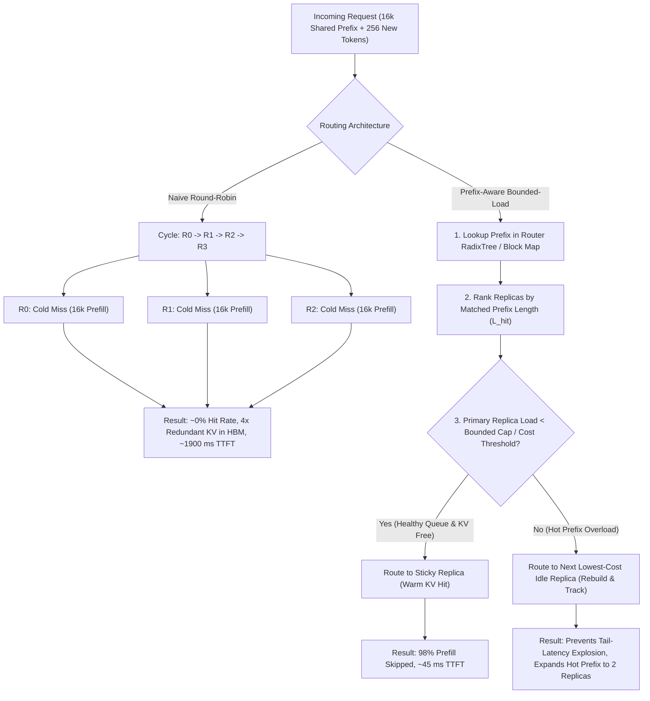
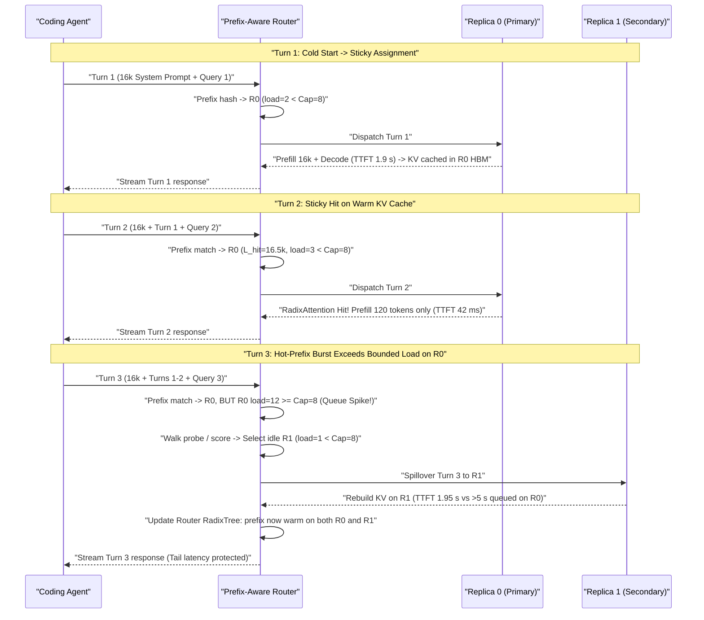

# 03 — Session-Aware & Prefix Routing

[← Previous: 02 — Semantic Caching](./02-semantic-caching.md) | [Stage 11 Overview](./README.md) | [Next: 04 — Traffic Control & Reliability →](./04-traffic-control-and-reliability.md)

---

Standard web load balancers spread requests evenly across servers, which accidentally destroys GPU prefix caches and forces every replica to recompute identical prompt prefixes. This document explains how inference-aware routers preserve Key-Value cache locality across replicas while preventing hot-prefix overload.

## Core Concepts & Terminology

* **KV Cache (Key-Value Cache):** Intermediate attention Key and Value tensors computed for prompt tokens and stored in GPU **HBM** (High-Bandwidth Memory) or CPU **DRAM** so subsequent steps or turns do not recompute them.
* **Prefill, Decode, & FLOPs:** **Prefill** processes all input prompt tokens in parallel ($\approx 2 \cdot P \cdot L$ floating-point operations, or **FLOPs**, for a $P$-parameter model and $L$-token prompt). **Decode** generates output tokens sequentially one at a time.
* **Tensor Parallelism (TP), FP8, & Tensor Cores:** **Tensor Parallelism** splits model layers across multiple GPUs (e.g., `TP=4`). **FP8** is an 8-bit floating-point format executed on specialized GPU matrix units (**Tensor Cores**) rated in **TFLOP/s** ($10^{12}$ FLOP/s) or **PFLOPs** ($10^{15}$ FLOPs).
* **GQA (Grouped-Query Attention):** An attention design where multiple query heads share fewer Key/Value heads (e.g., 8 KV heads), shrinking per-token KV cache memory.
* **Prefix Caching (`RadixAttention` / `APC` / `KV Cache Reuse`):** Engine-level reuse of stored KV blocks across requests sharing a leading token prefix. **SGLang `RadixAttention`** indexes prefixes in a **radix tree** (compressed prefix trie), while **vLLM `APC` (Automatic Prefix Caching)** indexes fixed-size token blocks by hash.
* **TTFT & ITL:** **TTFT (Time to First Token)** is the wait until token 1 is emitted; **ITL (Inter-Token Latency)** is the time between consecutive output tokens.
* **Round-Robin, Least-Connections, & LRU Eviction:** Standard proxies (`kube-proxy`, NGINX, Envoy) cycle requests sequentially (**Round-Robin**) or pick the fewest open sockets (**Least-Connections**). **LRU (Least Recently Used) eviction** discards the oldest unused KV blocks when HBM fills up.
* **Consistent Hashing (`xxHash64`, `BLAKE3`, `Jump`, `HRW`, `Maglev`):** Deterministic mapping from a routing key (`session_id` or fast prefix hash via `xxHash64`/`BLAKE3`) to a replica so scaling by 1 node moves only $\sim 1/N$ of keys. **Jump Consistent Hash** is a zero-memory $O(\ln N)$ bucket mapper (tail-scaling only), whereas **Rendezvous Hashing (HRW)** and **Virtual-Node Hash Rings / Maglev** handle arbitrary crashed nodes cleanly.
* **Hot-Prefix Overload & Bounded-Load Consistent Hashing:** **Hot-prefix overload** occurs when one popular prompt (Zipfian skew) overwhelms its single assigned GPU. **Bounded-load consistent hashing** enforces a per-replica load ceiling (`Cap`) using imbalance factor $\epsilon$, spilling excess traffic along a deterministic probe sequence to warm secondary replicas.
* **KV Preemption & Head-of-Line Blocking:** **KV preemption** occurs when an overloaded GPU evicts or pauses active decode requests to free HBM. **Head-of-line blocking** occurs when requests queue behind heavy prefill work, spiking tail latency (**P95/P99**).
* **Inference-Native Routers (SGLang Router, vLLM Production Stack / LMCache, NVIDIA Dynamo):** Routers that track live prefix placement and replica queue depth via **Prometheus**, **ZMQ** (ZeroMQ), or **NATS** messaging to balance cache affinity against queue wait time.
* **Disaggregated Serving, RDMA, NIXL, & NVMe:** Separating **Prefill** GPUs from **Decode** GPUs and transferring computed KV blocks over **RDMA** (Remote Direct Memory Access) / **NIXL** zero-copy networking, or offloading cold KV blocks to CPU DRAM / **NVMe** SSDs.

---

## 1. Why Naive Load Balancing Destroys Prefix Caching & RadixAttention

Modern LLM serving engines—such as **SGLang** (`RadixAttention`), **vLLM** (`Automatic Prefix Caching / APC`), and **TensorRT-LLM** (`KV Cache Reuse`)—preserve computed Key-Value (KV) tensors across requests in GPU HBM (and CPU DRAM tiers) indexed by prefix token blocks or a radix tree. When an incoming request shares a prefix of $L_{\text{hit}}$ tokens with a resident KV cache entry, the engine skips prefilling those $L_{\text{hit}}$ tokens entirely.

### 1.1 The Physics of Prefix Reuse

Consider a multi-turn coding agent or enterprise RAG pipeline sending a **$16,384$-token shared prefix** (system instructions + tool definitions + repository context) followed by a $256$-token new user message on a **Llama-3-70B FP8** deployment ($TP=4$ on $4\times$ H100):
* **Prefill Compute Cost:** Dense transformer prefill requires $\approx 2 \cdot P \cdot L$ FLOPs:
  $$2 \times 70 \times 10^9 \times 16,384 \approx 2.29 \times 10^{15}\text{ FLOPs (2.29 PFLOPs)}$$
  At $\sim 1,200\text{ TFLOP/s}$ effective aggregate FP8 Tensor Core throughput across $4\times$ H100 (accounting for attention memory traffic and collective sync), a **cold cache miss** incurs **$\approx 1,900\text{ ms}$** of pure prefill compute before emitting token 1!
* **Warm Prefix Cache Hit:** Prefilling only the $256$ new suffix tokens requires $2 \times 70 \times 10^9 \times 256 \approx 35.8\text{ TFLOPs}$ (plus reading the cached KV blocks during attention), dropping **TTFT from $\sim 1,900\text{ ms}$ to $\sim 35\text{–}60\text{ ms}$**—a **$30\times\text{–}50\times$ TTFT reduction** and a **$98.4\%$ reduction in prefill GPU FLOPs**!

### 1.2 The Round-Robin / Least-Connections Catastrophe

Traditional Kubernetes Services (`kube-proxy`), NGINX, and Envoy default to **Round-Robin** or **Least-Connections** load balancing across a fleet of $N$ identical GPU replicas. Let us calculate what happens to prefix caching across $N = 16$ replicas:

1. **Single-Session Hit Rate Collapse:** If an agent runs an 8-turn loop under Round-Robin across $N=16$ replicas, Turn 1 hits Replica 0, Turn 2 hits Replica 1, Turn 3 hits Replica 2... **Every single turn lands on a cold replica with $0\%$ prefix cache hit rate!** Even after 16 turns wrap around, Turn 1's KV blocks on Replica 0 have likely been evicted by LRU pressure from other tenants' traffic.
2. **Fleet-Wide KV HBM Duplication ($N\times$ Waste):** For popular shared system prompts (e.g., 500 concurrent users sharing the same 10k-token coding assistant prompt), Round-Robin sprays requests across all $N=16$ replicas. Every replica must materialize and retain its own redundant copy of that 10k-token KV cache in HBM!
   * For Llama-3-70B (GQA with $8$ KV heads, $80$ layers, $d_{\text{head}}=128$, FP8 = $1\text{ byte}$):
     $$\text{KV/token} = 2 \times 80 \times 8 \times 128 \times 1\text{ B} = 163,840\text{ bytes} \approx 160\text{ KB/token}$$
     A 16k-token prefix consumes **$2.56\text{ GB}$ of HBM**. Replicating it redundantly across $16$ replicas wastes **$40.96\text{ GB}$ of precious HBM** instead of pinning it once on $1\text{–}2$ replicas and using the remaining HBM across the fleet for distinct user contexts!

---

## 2. Consistent Hashing on Prefix Hashes & Session IDs

To restore KV cache locality, the gateway must route requests sharing a prefix or conversation deterministically to the **same replica** while minimizing key churn when replicas scale up or crash.

### 2.1 Choosing the Routing Key: `session_id` vs. `prefix_hash`

| Routing Key Strategy | Construction | Strengths | Blind Spots |
| :--- | :--- | :--- | :--- |
| **`session_id` / `conversation_id`** | Explicit HTTP header (`x-session-id`) or thread ID. | Trivial $O(1)$ string hash; isolates multi-turn user state cleanly. | Misses **cross-user** prefix reuse (1,000 users sharing one 12k-token system prompt + RAG doc still scatter across $N$ replicas!). |
| **Canonical Prefix Chunk Hash** | Tokenize or byte-slice the first $K$ chars/tokens (e.g., `system` prompt + `tools` + initial `documents`, or block-aligned 512-token chunks) and hash via `xxHash64` / `BLAKE3`. | Captures **both** single-user multi-turn reuse *and* cross-user shared-prefix reuse automatically with zero client headers. | Needs hierarchical longest-prefix matching if prompts diverge after token $K$ (e.g., Turn 2 adds 500 tokens after the system prompt). |
| **Hierarchical Prefix Hashes** | Compute rolling block hashes `[h_0, h_1, ..., h_m]` over fixed $B$-token chunks (e.g., $B=64$ tokens). | Mirrors vLLM's exact APC block-hash table; matches arbitrary prefix depths (`system` + `doc` + `turn_1` + `turn_2`). | Slightly higher router state/CPU overhead than single `session_id` hashing. |

### 2.2 Hash Ring vs. Jump Consistent Hash vs. Bounded-Load Hashing

Standard `hash(key) % N` fails during autoscaling (adding 1 replica from $N=8 \to 9$ remaps $\sim 89\%$ of keys, causing a **fleet-wide cache storm**). Production gateways use specialized consistent hashing algorithms:

1. **Jump Consistent Hash (Lamping & Veach, 2014):**
   A stateless, **zero-memory** algorithm mapping a 64-bit key to a bucket in `[0, num_buckets - 1]` in **$O(\ln N)$ time** with exact uniform balance and minimal key movement ($1/N$ keys move when adding a bucket):
   ```python
   def jump_consistent_hash(key: int, num_buckets: int) -> int:
       b = -1
       j = 0
       while j < num_buckets:
           b = j
           key = ((key * 2862933555777941757) + 1) & 0xFFFFFFFFFFFFFFFF
           j = int((b + 1) * (1 << 31) / ((key >> 33) + 1))
       return b
   ```
   *Limitation:* Only supports shrinking/growing from the tail (`bucket N-1`). If Replica #3 crashes out of `[0..15]`, **Rendezvous Hashing (HRW)** or a **Virtual-Node Hash Ring / Maglev Table** is preferred so arbitrary dead replicas can be removed without shifting remaining IDs.

2. **Bounded-Load Consistent Hashing (Mirrokni et al., Google):**
   Pure consistent hashing suffers from the **Hot-Prefix Overload Problem**: if one viral agent system prompt generates $40\%$ of cluster traffic, its single assigned GPU melts down with 200 queued requests while the other $15$ GPUs sit at $5\%$ utilization!
   **Bounded-Load Hashing** enforces a strict load ceiling per replica using imbalance parameter $\epsilon \in [0.1, 0.5]$ (e.g., $c = 1 + \epsilon = 1.25$):
   $$\text{Cap} = \left\lceil (1 + \epsilon) \cdot \frac{\sum_{i=1}^{N} L_i + 1}{N} \right\rceil$$
   where $L_i$ is replica $i$'s current active load (in-flight requests or pending prefill tokens). If the primary consistent-hashed replica $r_0$ satisfies $L_{r_0} < \text{Cap}$, route to $r_0$ (preserving warm KV cache). If $L_{r_0} \ge \text{Cap}$, deterministically walk the hash probe sequence $(r_1, r_2, \dots)$ until finding the first replica below $\text{Cap}$—creating a **secondary warm replica** rather than randomly scattering load!

---

## 3. Prefix-Aware + Load-Aware Composite Routing

Bounded-load consistent hashing uses a binary capacity threshold (`< Cap`). Modern inference-native routers—**SGLang Router**, **vLLM Production Stack (LMCache Router)**, and **NVIDIA Dynamo**—replace blind hashing with **KV-aware + Load-aware composite routing**, tracking *where* prefixes actually live in real time.

### 3.1 Comparing Naive Round-Robin vs. Prefix-Aware Bounded-Load Routing



### 3.2 Production Architectures

#### A. SGLang Router (Approximate RadixTree + Cache-Threshold Switching)
The SGLang Cache-Aware Router maintains a **lightweight approximate RadixTree** in the gateway's memory (with periodic LRU pruning matching worker HBM capacity) rather than polling full KV tables over the network on every request:
1. For prompt $p$, match $p$'s token/char prefix against each worker's approximate tree to get `matched_len[w]`.
2. Check cluster load balance: compute $\text{imbalance} = \max_w(\text{queue}_w) - \min_w(\text{queue}_w)$ (or ratio $\max/\min$).
3. **Cache-Affinity Mode (Balanced Cluster):** Select the worker $w^* = \arg\max_w \text{matched\_len}[w]$ to maximize RadixAttention reuse.
4. **Load-Balancing Mode (Imbalanced / Hot Prefix):** When `imbalance > balance_abs_threshold` and `max / min > balance_rel_threshold`, switch to the **shortest-queue worker** $w_{\min}$ to protect tail latency, and insert $p$ into $w_{\min}$'s approximate tree so subsequent bursts naturally balance across both $w^*$ and $w_{\min}$.

#### B. vLLM Production Stack / LMCache Controller
Replicas expose real-time engine metrics via Prometheus/ZMQ (`vllm:num_requests_running`, `vllm:num_requests_waiting`, `vllm:gpu_cache_usage_perc`, plus prefix-cache block events). The router combines:
* **Prefix-Hash Affinity:** Longest-prefix block match over `block_size=16` token chunks.
* **KV Pressure Penalty:** Avoids routing a long prompt to a replica whose `gpu_cache_usage_perc > 90%`, because landing there would immediately trigger **KV block preemption or eviction** of active decode requests!

#### C. NVIDIA Dynamo KV-Aware Planner (Explicit Time-Cost Model)
Rather than heuristic thresholds, Dynamo models the exact **time-to-first-token cost** of routing prompt $p$ (total length $L_{\text{total}}$) to replica $r$ using real-time **KV block creation/eviction events** published by workers over NATS/ZMQ:

$$\text{Score}(r, p) = w_{\text{overlap}} \cdot \underbrace{\big(L_{\text{total}} - L_{\text{matched}}(r, p)\big)}_{\text{Tokens Requiring Prefill}} + w_{\text{load}} \cdot \underbrace{\text{PendingPrefillTokens}(r)}_{\text{Queue Wait Work}} + w_{\text{decode}} \cdot \underbrace{\text{ActiveDecodeLoad}(r)}_{\text{KV & Bandwidth Pressure}}$$

Notice the physical beauty of this formulation: **if replica $r_0$ holds 16,000 cached prefix tokens ($L_{\text{matched}} = 16,000$) but has 40,000 tokens queued ahead of it**, an idle replica $r_1$ ($L_{\text{matched}} = 0$, $\text{PendingPrefillTokens} = 0$) wins whenever:
$$t_{\text{prefill}}(16,000) < t_{\text{queue\_wait}}(40,000)$$
That is, the router spills over **precisely at the physical crossover point** where recomputing the KV cache from scratch on an idle GPU is faster than waiting in line for the warm GPU!

---

## 4. Multi-Turn Sticky Routing & Bounded-Load Spillover Timeline



---

## 5. Cache-Hit-Rate vs. Tail-Latency Trade-Offs

Tuning the affinity-versus-load-balance knob (bounded-load $\epsilon$, SGLang's `balance_rel_threshold`, or Dynamo's $w_{\text{overlap}}/w_{\text{load}}$ ratio) governs a classic U-shaped tail-latency curve:

| Regime | Policy Configuration | Prefix Hit Rate | Fleet Prefill Capacity | P99 TTFT & ITL Behavior |
| :--- | :--- | :---: | :---: | :--- |
| **Pure Load-Balance** ($\epsilon \to 0$) | Least-Queue / Round-Robin | $\sim \frac{1}{N} \approx 5\text{–}10\%$ | **Severely degraded** (every GPU wastes cycles re-prefilling identical tokens) | Low variance at tiny RPS, **catastrophic saturation cliff** at moderate RPS as prefill queues explode. |
| **Pure Sticky / Unbounded** ($\epsilon \to \infty$) | Strict Consistent Hash | $\sim 90\text{–}98\%$ | Maximum FLOP reuse on uniform traffic | **Severe head-of-line blocking & P99 spikes** under Zipfian/hot-prefix traffic; one GPU OOMs/preempts while peers sit idle. |
| **Bounded-Load / Cost-Aware Sweet Spot** ($\epsilon \approx 0.2\text{–}0.35$) | Affinity within load cap; cost-based spillover | $\sim 75\text{–}90\%$ | Near-optimal (hot prefixes naturally replicate across $2\text{–}k$ GPUs proportional to demand!) | **Lowest P95/P99 TTFT and ITL** across both uniform and skewed workloads. |

### Key Subtlety: Self-Scaling Hot Prefixes
In bounded-load or cost-aware routing, hot prefixes **automatically replicate proportionally to their request rate** without manual configuration:
* A cold/rare prefix stays pinned on **1 replica** (zero wasted HBM).
* A moderately popular prefix exceeding 1 GPU's $\text{Cap}$ spills deterministically to **probe #2**, warming a second replica and doubling its effective throughput while still achieving a ~90% cache hit rate across those 2 replicas.
* A massive global system prompt naturally warms **only as many replicas as its RPS demands**, leaving the rest of the cluster free for long-tail prompts.

### Disaggregated Prefill/Decode Interaction (Link to Stage 9)
In disaggregated clusters where **Prefill** pools and **Decode** pools are separated:
* **Prefix-aware routing applies primarily to the Prefill pool** (to skip redundant prefill FLOPs via warm Radix/APC blocks or CPU/NVMe KV stores like Mooncake/LMCache).
* Once the Prefill node finishes, only the newly generated KV delta (or full KV blocks) is transferred via **RDMA/NIXL** to a **Decode node** chosen purely by **free KV HBM capacity and active batch decode utilization**—decoupling prefix affinity from decode memory pressure!

---

[← Previous: 02 — Semantic Caching](./02-semantic-caching.md) | [Stage 11 Overview](./README.md) | [Next: 04 — Traffic Control & Reliability →](./04-traffic-control-and-reliability.md)
