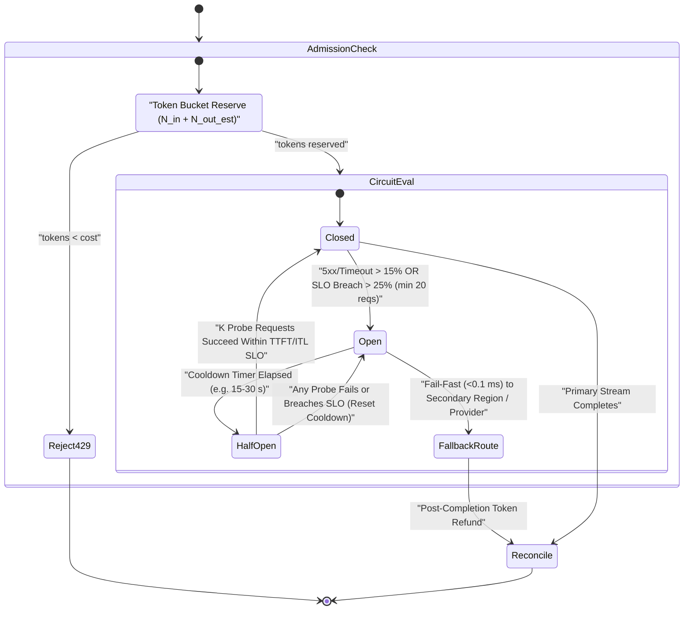
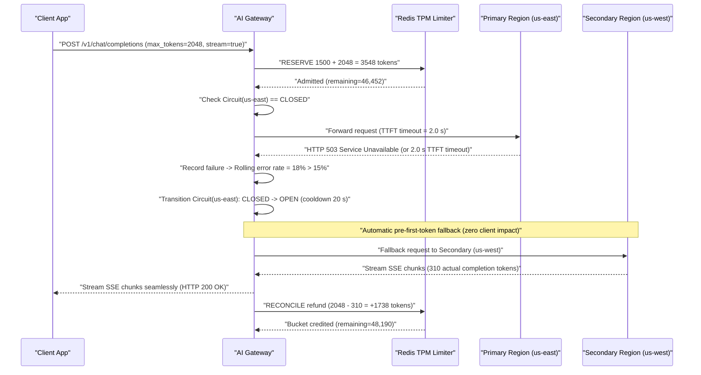

# 04 — Traffic Control & Reliability

[← Previous: 03 — Session-Aware & Prefix Routing](./03-session-aware-and-prefix-routing.md) | [Stage 11 Overview](./README.md) | [Next: 05 — Observability & Chaos Engineering →](./05-observability-and-chaos-engineering.md)

---

## 1. Why HTTP Request Rate Limiting (RPM) Fails for LLMs

In conventional REST APIs, every request consumes roughly comparable CPU/DB work, making **Requests Per Minute (RPM)** an effective admission unit. In LLM inference, request cost spans **4 to 5 orders of magnitude**:

* **Request A (Intent Classifier):** $50$ input tokens, $5$ output tokens ($0.5\text{ ms}$ prefill, $40\text{ ms}$ decode, $\sim 8\text{ MB}$ KV cache).
* **Request B (Long-Context Codebase Synthesis):** $100,000$ input tokens, $4,000$ output tokens ($\sim 12\text{ s}$ prefill on 70B FP8, $\sim 60\text{ s}$ decode, **$16.6\text{ GB}$ KV cache**).

A tenant capped at `1,000 RPM` sending Request B consumes **$104,000,000\text{ TPM}$** and exhausts the entire GPU cluster's HBM and compute budget in seconds, whereas capping `100 RPM` starves lightweight autocomplete apps. Production AI Gateways must therefore govern admission in **Tokens Per Minute (TPM)**—and specifically separate **Input TPM (ITPM)** from **Output TPM (OTPM)**—because compute-bound prefill tokens and memory-bandwidth-bound decode tokens have radically different GPU cost profiles ($1\text{ output token} \approx 3\times\text{–}10\times$ GPU-time/cost of $1\text{ input token}$).

---

## 2. Token-Bucket & Sliding-Window Admission with Post-Completion Reconciliation

Because output length $N_{\text{out}}$ is unknown at admission time (generation terminates unpredictably at `EOS` or `max_tokens`), token-based rate limiting requires a **Two-Phase Reservation & Reconciliation Protocol**.

### 2.1 Token-Bucket vs. Sliding-Window Algorithms

| Algorithm | Mathematical State | Burst Behavior | Precision | Implementation Overhead |
| :--- | :--- | :--- | :--- | :--- |
| **Token Bucket (Continuous Refill)** | `(tokens_remaining, last_refill_ts)` with capacity $B$ and refill rate $R = \text{TPM}/60$ tok/s. | Permits controlled short bursts up to capacity $B$ while enforcing long-term average $R$. | Exact continuous time; $O(1)$ RAM per tenant (2 floats). | 1 atomic Redis Lua script (`HMGET` + `HMSET`). |
| **Sliding-Window Log / Counter** | Sorted Set (`ZSET`) of timestamped token reservations pruned via `ZREMRANGEBYSCORE`, or weighted dual-bucket sub-windows. | Prevents **boundary-burst double-spending** (e.g., spending 100k at `:59s` and 100k at `:01s` in fixed windows). | Exact rolling 60s window (`ZSET`), or ~1% error with sub-window counters. | Higher Redis RAM for `ZSET` if RPM is huge; $O(\log K)$ cleanup. |

### 2.2 Two-Phase Accounting: Pre-Flight Reservation + Post-Completion Reconciliation

1. **Phase 1 — Pre-Flight Estimation (`RESERVE`):**
   * Count exact input tokens $N_{\text{in}}$ using a fast Rust tokenizer (`tiktoken` / HuggingFace `tokenizers` in $<0.5\text{ ms}$) or a conservative fast-path byte heuristic (`ceil(bytes / 3.0)`) for massive prompts.
   * Estimate output tokens as $N_{\text{out\_est}} = \min(\text{request.max\_tokens} \text{ or } \text{default\_max}, \text{cap})$.
   * Compute weighted admission debit:
     $$W_{\text{est}} = N_{\text{in}} + w_{\text{out}} \cdot N_{\text{out\_est}}$$
     (where $w_{\text{out}} = 1$ for unified TPM, or $w_{\text{out}} = 4$ for compute-normalized TPM; alternatively enforce two independent buckets: `ITPM` and `OTPM`).
   * Atomically test-and-deduct $W_{\text{est}}$ in Redis. If `tokens_remaining < W_est`, immediately reject with **HTTP `429 Too Many Requests`** and `Retry-After: ceil((W_est - tokens_remaining) / refill_rate)`.
2. **Phase 2 — Post-Completion Reconciliation (`REFUND`):**
   * Suppose a user sets `max_tokens=4096` (default SDK parameter) but the model stops after emitting $N_{\text{out\_actual}} = 120$ tokens (or the client disconnects early at token $50$).
   * Upon stream termination (`[DONE]`, client EOF, or upstream error), compute the over-reserved delta:
     $$\Delta_{\text{refund}} = w_{\text{out}} \cdot (N_{\text{out\_est}} - N_{\text{out\_actual}})$$
   * Credit $\min(B, \text{tokens\_remaining} + \Delta_{\text{refund}})$ back into the tenant's bucket!
   * **Orphaned Lease Protection:** If a gateway pod `SIGKILL`s mid-stream, Phase 2 never runs. Using a bounded `max_tokens` cap (e.g., capping unverified reservations at `4096`) and continuous token-bucket refill ensures leaked reservations self-heal within seconds without permanently locking a tenant's quota.

```lua
-- Atomic Redis Lua Script: Phase 1 Token-Bucket Pre-Flight Reservation
-- KEYS[1] = "ratelimit:tpm:{tenant_id}"
-- ARGV[1] = capacity (max burst tokens)
-- ARGV[2] = refill_rate_per_sec (TPM / 60.0)
-- ARGV[3] = now_ms
-- ARGV[4] = estimated_cost (N_in + w_out * N_out_est)
local bucket = redis.call("HMGET", KEYS[1], "tokens", "last_ts")
local cap = tonumber(ARGV[1])
local rate = tonumber(ARGV[2])
local now = tonumber(ARGV[3])
local cost = tonumber(ARGV[4])

local tokens = tonumber(bucket[1]) or cap
local last_ts = tonumber(bucket[2]) or now

local elapsed_sec = math.max(0, (now - last_ts) / 1000.0)
tokens = math.min(cap, tokens + elapsed_sec * rate)

if tokens < cost then
    local wait_sec = math.ceil((cost - tokens) / rate)
    redis.call("HMSET", KEYS[1], "tokens", tokens, "last_ts", now)
    redis.call("PEXPIRE", KEYS[1], 120000)
    return {0, math.floor(tokens), wait_sec}  -- Reject 429
end

tokens = tokens - cost
redis.call("HMSET", KEYS[1], "tokens", tokens, "last_ts", now)
redis.call("PEXPIRE", KEYS[1], 120000)
return {1, math.floor(tokens), 0}  -- Admit
```

---

## 3. Circuit Breakers: Handling Hard Failures & Gray SLO Failures

When an upstream inference replica pool or external LLM API fails or enters severe congestion, blindly retrying turns a localized outage into a **gateway-wide thread/connection exhaustion cascade**. A **Circuit Breaker** monitors rolling health telemetry per `(provider, region, model)` endpoint and short-circuits failing backends immediately.

### 3.1 Why LLM Circuit Breakers Must Trip on SLO Violations, Not Just 5xx

GPU serving fleets frequently suffer **gray failures**:
* A GPU thermal-throttles or enters heavy KV-block swapping (`vllm` CPU offload thrashing), continuing to return **`HTTP 200 OK`**—but **TTFT degrades from $250\text{ ms}$ to $18\text{ s}$** and **ITL stalls to $400\text{ ms/token}$**.
* A naive HTTP-5xx-only circuit breaker keeps the broken endpoint **Closed**, trapping thousands of streaming SSE connections open until client timeouts cascade!

Therefore, production LLM circuit breakers evaluate a composite rolling-window health predicate (over e.g. last $W = 30\text{ s}$ or $N_{\min} = 20$ requests):
* **Hard Failure Rate:** `5xx_rate + connect_timeout_rate + mid_stream_reset_rate > 15%`
* **SLO Violation Rate:** `fraction(TTFT > ttft_slo_ms OR P95_ITL > itl_slo_ms) > 25%`

### 3.2 Circuit Breaker State Machine & Token-Bucket Admission Flow



* **Thundering Herd Prevention in `Half-Open`:** Never let all concurrent requests enter `Half-Open` simultaneously when the cooldown expires. Guard the `Half-Open` state with an **atomic probe semaphore** (`max_probes = 3`). While 3 probe requests test the recovering endpoint, all other concurrent requests continue failing fast to the fallback pool until the probes confirm healthy TTFT and error-free completion.

---

## 4. Hedged Requests & Exponential Backoff with Full Jitter

### 4.1 Exponential Backoff with Full Jitter & Retry Budgets

When an upstream returns a transient `429` or `503` before streaming starts, deterministic retries (`1s, 2s, 4s`) synchronize all failing clients into **periodic retry storms** that repeatedly knock down the recovering GPU cluster.

Using **Exponential Backoff with Full Jitter** (Brooker, AWS Architecture):
$$t_{\text{cap}}(a) = \min\big(T_{\max},\; T_{\text{base}} \cdot 2^{a}\big)$$
$$\text{sleep}(a) = \text{Uniform}\big(0,\; t_{\text{cap}}(a)\big)$$
For $T_{\text{base}} = 100\text{ ms}$, $T_{\max} = 5\text{ s}$, attempt $a \in \{0, 1, 2\}$ spreads retries uniformly across `[0, 100ms]`, `[0, 200ms]`, `[0, 400ms]`, completely eliminating synchronized spikes.

* **Retry Budget Cap:** Retries amplify load during brownouts. Enforce a gateway-level **retry budget** (e.g., max $15\%$ of total active upstream RPS may be retries, plus per-request `max_attempts = 2–3` bounded by a total request deadline header `x-request-deadline-ms`). If a cluster is $100\%$ saturated, retries are suppressed in favor of immediate fallback or `503` load shedding.

### 4.2 Hedged Requests (Tail-Latency Cutting)

For latency-critical interactive traffic (without side effects), **Hedged Requests** eliminate P99 tail latency caused by sudden replica garbage collection, prefill head-of-line blocking, or network micro-bursts:
1. Dispatch Request #1 to Primary Replica $A$.
2. Start a hedge timer set to the tier's expected **P95 TTFT** (e.g., $t_{\text{hedge}} = 350\text{ ms}$).
3. If Replica $A$ emits the first non-empty token before $350\text{ ms}$ ($95\%$ of requests), cancel the hedge timer—**zero extra GPU work**.
4. If $350\text{ ms}$ elapses with no first token from $A$, immediately dispatch Request #2 (the hedge) to Secondary Replica $B$ (or a secondary region).
5. Whichever replica emits token #1 first wins the race! Immediately send an **HTTP/2 `RST_STREAM` / `CANCEL`** to the losing replica so the engine aborts its remaining prefill/decode work immediately.
* **Cost Guardrail:** Hedge **only before token #1**, and enforce a **hedging token budget** (e.g., disable hedging whenever fleet KV utilization $> 75\%$ so hedging never accelerates cluster saturation!).

---

## 5. Multi-Provider / Multi-Region Fallback Chains & Mid-Stream Recovery

A resilient AI Gateway chains heterogeneous backends in priority order:
`Primary (Self-Hosted H100 us-east) -> Secondary (Self-Hosted us-west) -> Tertiary (External Managed API / Smaller Quantized Model)`.

### 5.1 Pre-First-Token Failure vs. Mid-Stream Failure

* **Pre-First-Token Failure:** If Primary returns `503`, `429`, TCP reset, or exceeds TTFT timeout *before* any SSE data chunk has been flushed to the client, fallback is **100% transparent**: the client sees a slightly higher TTFT and receives a clean `200 OK` SSE stream from Secondary.
* **Mid-Stream Failure (The Streaming Dilemma):** Once the gateway flushes `HTTP/1.1 200 OK` + `Content-Type: text/event-stream` and streams 180 tokens to the user, **it is impossible under HTTP semantics to retract the `200` status code and replay from token 0 without duplicating already-rendered text!**

#### Production Mid-Stream Recovery Protocol (Continuation Stitching)
1. **Delta Accumulation Buffer:** As the gateway forwards SSE chunks to the client, it buffers the emitted `partial_assistant_text` (and counts emitted completion tokens $N_{\text{emitted}}$).
2. **Mid-Stream Fault Detection:** Suppose at token 180, Primary suffers a GPU OOM / `SIGKILL` or exceeds an **inter-token stall timeout** (e.g., `itl_stall_timeout = 5.0 s` with zero SSE bytes).
3. **Seamless Continuation Rewrite:** Rather than dropping the TCP socket or emitting broken JSON, the gateway constructs a **continuation request** to Secondary by appending the exact partial generation as a prefilled assistant turn:
   ```json
   {
     "model": "secondary-70b",
     "messages": [
       {"role": "system", "content": "..."},
       {"role": "user", "content": "Explain Raft consensus."},
       {"role": "assistant", "content": "<exact 180-token partial_assistant_text>"}
     ],
     "continue_final_message": true
   }
   ```
   *(Note: Engines like vLLM/SGLang natively support `continue_final_message: true` / `add_generation_prompt: false`, forcing the secondary model to treat the buffered text as its own prefix without inserting an artificial turn delimiter! For external APIs lacking assistant-prefill support, inject a lightweight continuation system instruction: `"Continue seamlessly from the exact character where your previous response stopped, without repeating anything."`)*
4. **Terminal Error Frame (Last Resort):** If all fallback tiers are exhausted mid-stream, emit a well-formed SSE event (`event: error`, `data: {"error": "upstream_interrupted", "tokens_emitted": 180, "recoverable": true}`) followed by `data: [DONE]\n\n` so client SDKs parse the partial truncation deterministically instead of crashing on malformed chunked encoding.

### 5.2 End-to-End Failure, Circuit Opening & Fallback Timeline



---

[← Previous: 03 — Session-Aware & Prefix Routing](./03-session-aware-and-prefix-routing.md) | [Stage 11 Overview](./README.md) | [Next: 05 — Observability & Chaos Engineering →](./05-observability-and-chaos-engineering.md)
