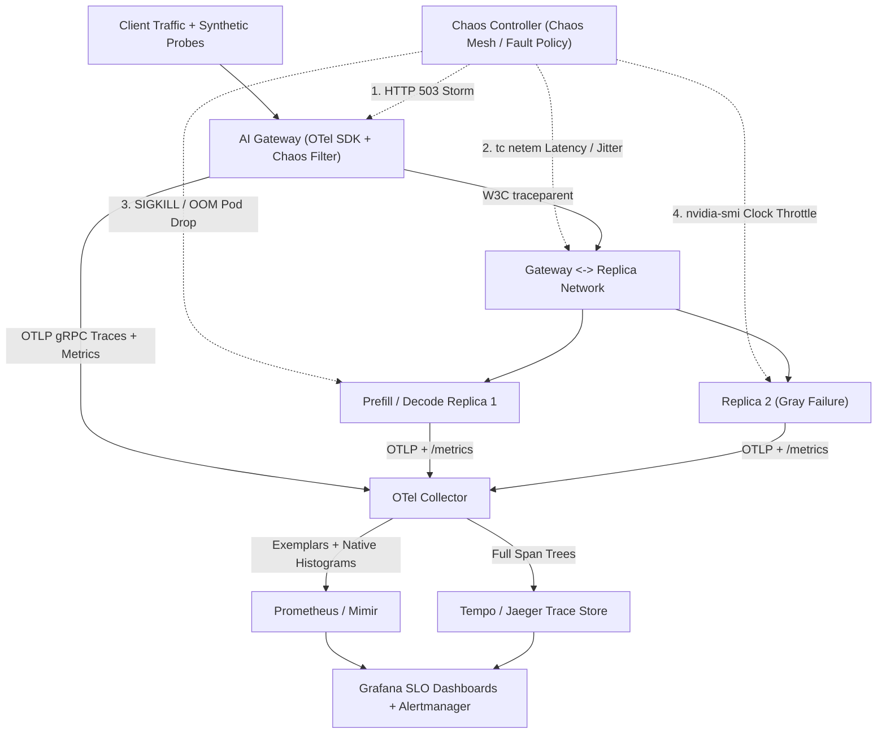
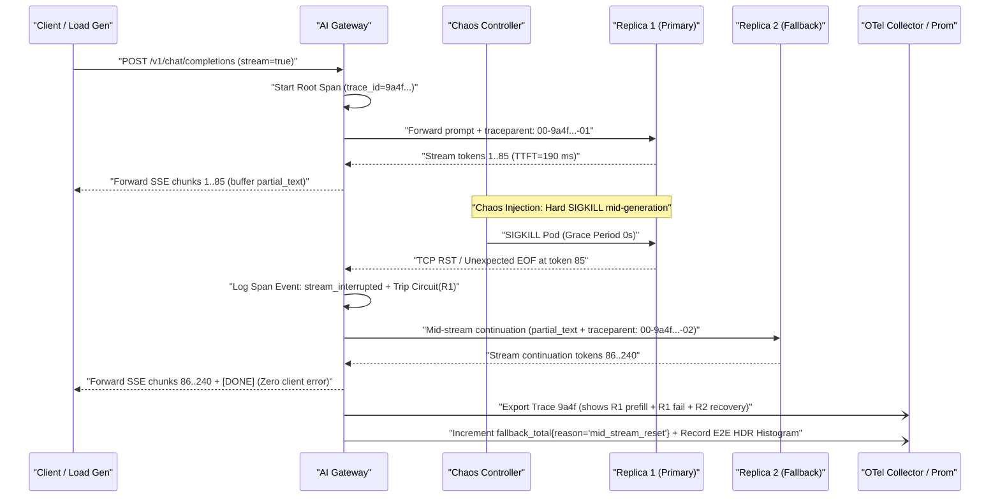

# 05 — Observability & Chaos Engineering

[← Previous: 04 — Traffic Control & Reliability](./04-traffic-control-and-reliability.md) | [Stage 11 Overview](./README.md)

---

## 1. Granular LLM Inference Telemetry (OpenTelemetry & Prometheus)

Traditional microservice observability tracks coarse `http_requests_total` and `http_request_duration_seconds`. For streaming LLM inference, aggregate request duration is largely useless: a $50\text{-token}$ reply taking $4\text{ s}$ feels broken, whereas a $1,000\text{-token}$ reply taking $10\text{ s}$ ($100\text{ tok/s}$) feels instantaneous. Production AI Gateways and inference engines must instrument **phase-separated physical metrics**.

### 1.1 Exact Metric Definitions & Measurement Boundaries

| Metric | Exact Mathematical Definition | Physical Phase Measured | Primary Failure Diagnosis |
| :--- | :--- | :--- | :--- |
| **TTFT** (*Time to First Token*) | $t_{\text{first\_non\_empty\_token\_sent}} - t_{\text{request\_received\_at\_gateway}}$ | Gateway overhead + Queue wait + Prefill + 1st decode step | High TTFT indicates **queue buildup**, **cold prefix cache**, or **compute-bound prefill saturation**. |
| **ITL** (*Inter-Token Latency*) | $\Delta t_i = t_{\text{token}_i} - t_{\text{token}_{i-1}}$ for every $i \ge 2$ | Single autoregressive decode iteration | Captures **per-step stalls** (KV preemption, chunked-prefill interference, GC pauses, RDMA jitter). |
| **TPOT** (*Time Per Output Token*) | $\frac{t_{\text{EOS}} - t_{\text{first\_token}}}{N_{\text{out}} - 1}$ | Mean decode time per request | Useful for unit-cost & average stream speed; **masks mid-stream freezes**! |
| **E2E Latency** | $t_{\text{EOS}} - t_{\text{request\_received}} = \text{TTFT} + \sum_{i=2}^{N_{\text{out}}} \text{ITL}_i$ | Full request lifecycle | Client-perceived total completion time; drives worker connection occupancy. |
| **Queue Wait Time** | $t_{\text{scheduled\_on\_gpu}} - t_{\text{enqueued\_in\_engine}}$ | Scheduler backlog | Triggers **KEDA autoscaling** and **bounded-load spillover** before TTFT violates SLOs. |
| **Prefill Duration** | $t_{\text{first\_logit\_complete}} - t_{\text{scheduled\_on\_gpu}}$ | Pure Tensor Core prefill compute | Isolates prefix cache efficiency and prompt length scaling ($O(L)$ / $O(L^2)$). |
| **Token Throughput & Goodput** | $\text{tok/s}$ (input & output separately); **Goodput** = $\text{req/s}$ meeting *both* $\text{TTFT} \le S_1$ and $\text{ITL}_{\text{P99}} \le S_2$ | Effective cluster yield | Prevents fake capacity gains achieved by overloading batches at the expense of UX. |
| **Cache Hit Ratio** | Semantic: $\frac{\text{sem\_hits}}{\text{total\_reqs}}$; Prefix: $\frac{\text{cached\_prompt\_tokens}}{\text{total\_prompt\_tokens}}$ | Gateway vector hit rate & GPU Radix/APC reuse | Validates routing stickiness and embedding threshold health. |
| **Active KV Utilization** | $\frac{\text{allocated\_kv\_blocks}}{\text{total\_kv\_blocks}}$ (+ preemption counter) | GPU HBM pressure | Predicts imminent **KV eviction thrashing** or OOM/swap stalls ($>85\%$ alert). |

### 1.2 Why Averages Lie: ITL vs. TPOT & Tail Percentiles

Consider a $100\text{-token}$ generation where $98$ decode steps run smoothly at $20\text{ ms}$, but at token $50$ a long prompt triggers a KV cache preemption pause of $2,000\text{ ms}$:
* **Mean TPOT:** $\frac{98 \times 20 + 2000}{99} = \mathbf{40.0\text{ ms}}$ ($25\text{ tok/s}$—looks completely healthy on a mean dashboard!).
* **Per-Step ITL P99:** **$\mathbf{2,000\text{ ms}}$**—the user experienced a jarring 2-second freeze mid-sentence!

Similarly, averaging P99 latencies across 16 pods in Grafana (`avg(p99_ttft)`) is mathematically invalid—percentiles are non-additive. You must aggregate **raw histogram buckets** across all pods (`histogram_quantile(0.99, sum by (le, model) (rate(llm_ttft_seconds_bucket[5m])))`).

### 1.3 Classical Bucketed Histograms vs. Native / HDR Histograms

LLM latencies span **4–5 orders of magnitude**—from a $3\text{ ms}$ semantic cache hit to a $45,000\text{ ms}$ reasoning E2E trace:
* **Fixed Linear Buckets Fail:** Coarse buckets (`[0.1, 0.5, 1.0, 5.0, 10.0]`) destroy resolution on `<50 ms` ITL and cache hits (linear interpolation between `0` and `100 ms` produces massive P99 errors), while adding 100 fine-grained buckets across every metric label explodes Prometheus time-series memory.
* **HDR (High Dynamic Range) Histograms & Prometheus Native Histograms (DDSketch):**
  * **HDR Histograms** encode values using a **logarithmic exponent + bounded-precision mantissa** (e.g., 2–3 significant digits), guaranteeing **$\le 1\%$ relative error** uniformly across $1\text{ ms}$ to $100,000\text{ ms}$ with minimal memory.
  * **Prometheus Native Histograms** (sparse exponential buckets) eliminate manual bucket tuning at scrape time and allow exact cross-pod merging without interpolation distortion.

### 1.4 Label Cardinality Hygiene

Every unique label combination creates a separate Prometheus time series (holding ~3 KB RAM + WAL churn):
* **Allowed (Bounded Cardinality):** `model`, `tier`, `region`, `replica_pool`, `cache_status` (`hit_l1`, `hit_semantic`, `miss`), `finish_reason` (`stop`, `length`, `error`, `cancelled`).
* **Forbidden in Metrics (Unbounded Cardinality):** `request_id`, `trace_id`, `user_id`, `session_id`, `prompt_hash`. Putting `user_id` on a 30-bucket histogram with $10^5$ users creates **$3 \times 10^6$ time series**, crashing Prometheus! Place high-cardinality identifiers strictly inside **OpenTelemetry Traces** and **Prometheus Exemplars**.

---

## 2. Distributed Tracing Across Gateway → Router → Prefill → Decode

When a single request hits a P99 TTFT spike of $4.2\text{ s}$, metrics tell you *that* a spike happened; **distributed tracing** tells you *where* in the pipeline the 4.2 seconds went.

### 2.1 End-to-End W3C Trace Context Propagation

The AI Gateway injects **W3C Trace Context** headers (`traceparent: 00-<128bit-trace-id>-<64bit-span-id>-01`) at ingress and propagates them across every hop—including **across disaggregated Prefill $\to$ RDMA/NIXL KV Transfer $\to$ Decode workers** (by attaching `traceparent` to the KV-transfer control plane RPC metadata!):

1. `gateway.ingress` (Root Span)
   * `gateway.rate_limit.reserve` (`token_est`, `tpm_remaining`)
   * `gateway.semantic_cache.lookup` (`embed_ms`, `hnsw_ms`, `top_cosine`, `guardrail_result`)
   * `gateway.dynamic_router` (`classifier_ms`, `p_frontier`, `selected_tier`)
   * `gateway.prefix_lb` (`matched_prefix_tokens`, `target_replica`, `spillover_triggered`)
2. `engine.prefill` (Server/Producer Span)
   * `engine.scheduler.queue_wait` (`queue_depth`, `pending_prefill_tokens`)
   * `engine.prefill.forward` (`kv_cache_hit_tokens`, `computed_tokens`)
   * `engine.kv_transfer.rdma` (`bytes_transferred`, `nic_bw_gbps`) *(in disaggregated clusters)*
3. `engine.decode` (Consumer/Stream Span)
   * Span Event: `gen_ai.first_token` (marks exact TTFT boundary!)
   * Span Event: `gen_ai.fallback_triggered` / `gen_ai.itl_stall` (if $\Delta t_i > 250\text{ ms}$)
   * Attributes (OTel GenAI Semantic Conventions): `gen_ai.system`, `gen_ai.request.model`, `gen_ai.usage.input_tokens`, `gen_ai.usage.output_tokens`, `gen_ai.response.finish_reasons`.

### 2.2 Prometheus Exemplars (Bridging Metrics to Traces)

An **Exemplar** attaches a sampled `(trace_id, value, timestamp)` tuple directly onto a Prometheus histogram bucket increment when a request exceeds an SLO threshold (or via reservoir sampling). In Grafana, clicking an outlier dot on the **P99 TTFT heatmap** jumps straight to the exact Jaeger/Tempo distributed trace showing `queue_wait = 3,850 ms` on `prefill-pod-07`!

---

## 3. Observability & Chaos Engineering Architecture

---

## 4. Chaos Engineering for LLM Inference Resilience

Chaos Engineering is the discipline of **experimenting on a distributed system in a controlled blast radius** to prove that resilience mechanisms (circuit breakers, bounded-load spillover, mid-stream continuation fallback, KEDA autoscaling) actually hold under real failure physics—before a real outage exposes misconfigured timeouts or retry storms.

### 4.1 Chaos Experiment Protocol (Safety Invariants)
Every chaos experiment follows four strict controls:
1. **Steady-State Hypothesis:** Quantify normal behavior before injection (e.g., *"With 200 RPS mixed workload, Goodput $\ge 99.5\%$, P99 TTFT $\le 1.2\text{ s}$, P99 ITL $\le 80\text{ ms}$, zero cross-tenant leaks."*).
2. **Blast Radius Containment:** Target either a dedicated staging shadow cluster mirroring live traffic, or a strict canary slice (`x-chaos-eligible: true` / $\le 5\%$ of non-critical traffic in one availability zone).
3. **Automated Abort Condition:** Immediately halt fault injection if global error budget burn rate exceeds threshold or healthy fallback capacity saturates ($>85\%$ KV utilization).
4. **Verify Observability + Recovery:** Never declare a chaos test passed unless **both** user SLOs hold *and* OTel traces/Prometheus alerts accurately diagnose the injected fault!

### 4.2 LLM-Specific Fault Injection Scenarios

| Fault Class | Injection Mechanism | Target Failure Mode Exposed | Expected Gateway Behavior |
| :--- | :--- | :--- | :--- |
| **1. HTTP 503 / 429 Storms** | Envoy / Gateway fault filter or Chaos Mesh `HTTPChaos` returning `503` on $40\%$ of Primary region responses. | Retry storms (missing full jitter), non-atomic circuit breaker thundering herds in `Half-Open`. | Circuit trips `CLOSED -> OPEN` within $<5\text{ s}$; traffic shifts cleanly to Secondary; `Half-Open` probes capped at $k=3$. |
| **2. Synthetic Network Latency Spikes** | Linux `tc qdisc add dev eth0 root netem delay 600ms 250ms distribution normal` on replica pods or gateway egress. | Missing read/TTFT timeouts, stalled SSE streams hanging open indefinitely, hedge storm amplification. | Hedged requests trigger at $t_{\text{hedge}}$ and cancel slow loser; SLO-based circuit breaker trips on TTFT breach; SSE keepalives detect stalled links. |
| **3. Replica OOM / `SIGKILL` Drops** | `kubectl delete pod vllm-rep-0 --grace-period=0 --force` or `kill -9` mid-decode while holding 30 active streams & hot KV caches. | Silent mid-stream TCP truncation, consistent-hash ring remapping storm, cascading OOM on remaining replicas absorbing traffic. | Bounded-load router removes dead node; remaining nodes spill gracefully without exceeding KV cap; gateway runs **mid-stream continuation fallback** for active streams! |
| **4. GPU Thermal / Clock Throttling (Gray Failure)** | Lock GPU SM clocks low (`nvidia-smi -lgc 300,300`) or inject per-step kernel sleep to degrade decode speed $5\times$ while returning `HTTP 200`. | Naive `200 OK` health checks leave degraded GPU in rotation indefinitely, ruining P99 ITL! | Gateway tracks rolling `P95_ITL > 100 ms` per replica -> trips **SLO-aware Circuit Breaker** -> quarantines gray-failed GPU automatically! |

---

## 5. Chaos-Injected Mid-Stream Failure & Trace Recovery Timeline

The sequence diagram below traces an end-to-end **Chaos `SIGKILL` experiment** executed mid-decode on `Replica 1`, verifying that **W3C `traceparent` spans**, **mid-stream continuation recovery**, and **Prometheus SLO metrics** operate seamlessly together.

---

[← Previous: 04 — Traffic Control & Reliability](./04-traffic-control-and-reliability.md) | [Stage 11 Overview](./README.md)
