# Stage 11: AI Gateway, Routing & Reliability

[Back to Project Overview](../../README.md) | [Complete Syllabus](../../syllabus.md)

---

## Stage Overview

In earlier stages, we focused on optimizing individual inference engines (Continuous Batching, PagedAttention, Prefix Caching, Quantization, Custom Kernels) and scaling them across disaggregated GPU clusters and autoscaling groups. However, raw serving replicas—even highly tuned vLLM, SGLang, or TensorRT-LLM deployments—cannot independently enforce cross-fleet unit economics, semantic deduplication, prefix-affinity scheduling, tenant token governance, or multi-provider fault tolerance.

**Stage 11** sits directly above the serving tier at the **AI Gateway and Control Plane layer**. Its core mandate is to ensure that:
1. **No expensive GPU FLOPs are wasted** on queries that can be answered by a cached response, a small quantized model, or warm KV cache blocks already resident in HBM.
2. **Tail latency (P95/P99 TTFT and ITL)** remains predictable under bursty multi-tenant workloads, hot prefixes, and upstream gray failures.
3. **Reliability and observability** are verifiable empirically through granular OpenTelemetry/Prometheus telemetry and controlled Chaos Engineering before production incidents occur.

### End-to-End AI Gateway Request Pipeline

```mermaid
flowchart LR
    Client["Client / Agent"] --> RL["1. Token-Bucket Rate Limiter (TPM / ITPM / OTPM)"]
    RL -->|"429 Too Many Requests"| Client
    RL --> SC["2. Semantic Cache (ONNX Embedder + HNSW + Guardrails)"]
    SC -->|"Hit > 0.98 (<10 ms)"| OTel["Telemetry (OTel + Prometheus)"]
    SC -->|"Hit > 0.98 (<10 ms)"| Client
    SC -->|"Cache Miss"| DR["3. Dynamic Router / Cascade Classifier"]
    DR -->|"Simple Query"| Small["8B Quantized Tier"]
    DR -->|"Complex Query"| Frontier["Frontier Tier (70B / 405B / MoE)"]
    Small -->|"Low Confidence Escalation"| Frontier
    Small --> PR["4. Session & Prefix-Aware Load Balancer"]
    Frontier --> PR
    PR --> CB["5. Circuit Breaker & Fallback Chain"]
    CB -->|"Primary Healthy"| RepA["Replica A (Warm KV Cache)"]
    CB -->|"Open / 503 / SLO Breach"| RepB["Secondary Region / Provider"]
    RepA --> OTel
    RepB --> OTel
    Chaos["Chaos Fault Injector"] -.->|"503 / Latency / SIGKILL"| RepA
```

---

## Topic Index

| # | Document | Core Technical Focus |
| :---: | :--- | :--- |
| **01** | [**Dynamic Routing & Model Cascading**](./01-dynamic-routing-and-model-cascading.md) | Prompt complexity scoring (token entropy, perplexity, ModernBERT/DeBERTa classifiers, AST heuristics, RouteLLM matrix factorization), speculative model cascading with output verifiers, and latency–cost–quality Pareto trade-offs. |
| **02** | [**Semantic Caching**](./02-semantic-caching.md) | Sub-5 ms quantized ONNX/TensorRT bi-encoders, HNSW and IVF-PQ vector indices (Redis, Qdrant, Milvus), `0.98+` cosine calibration, lexical/numeric/negation guardrails, RAG/tenant invalidation, and multi-turn pitfalls. |
| **03** | [**Session-Aware & Prefix Routing**](./03-session-aware-and-prefix-routing.md) | Why round-robin destroys RadixAttention/APC hit rates, Jump/Bounded-Load Consistent Hashing, composite KV-affinity + queue-depth routing (SGLang Router, vLLM Production Stack, NVIDIA Dynamo), and cache-hit vs. tail-latency bounds. |
| **04** | [**Traffic Control & Reliability**](./04-traffic-control-and-reliability.md) | Pre-flight token estimation and post-completion TPM reconciliation, Closed/Open/Half-Open circuit breakers on 5xx and SLO breaches, hedged requests, full-jitter exponential backoff, and graceful mid-stream fallback continuation. |
| **05** | [**Observability & Chaos Engineering**](./05-observability-and-chaos-engineering.md) | OTel/Prometheus histograms (TTFT, ITL vs. TPOT, E2E, queue wait, KV utilization), HDR/native histograms vs. average-only traps, W3C `traceparent` propagation across disaggregated prefill/decode, and chaos fault injection. |

---

## Navigation

* **Up:** [Project Overview](../../README.md) | [Complete Syllabus](../../syllabus.md)
* **Previous Stage:** [← Stage 10: Autoscaling, FinOps & Economics](../stage-10/README.md)
* **Start Reading:** [01 — Dynamic Routing & Model Cascading](./01-dynamic-routing-and-model-cascading.md)
* **Next Stage:** [Stage 12: Edge Inference & Portfolio →](../stage-12/README.md)
