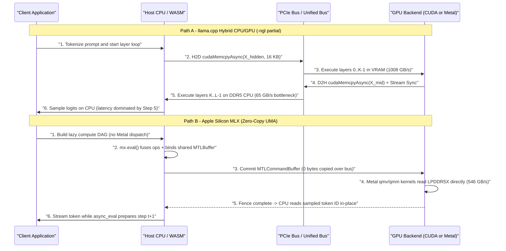

# 01 — Edge Runtimes & Unified Architecture

[← Stage 12 Overview](./README.md) · [Main Docs](../../README.md) · [Syllabus](../../syllabus.md) · [Next: Hybrid Cloud-Edge Architectures →](./02-hybrid-cloud-edge-architectures.md)

---

Running large language models directly on laptops, desktops, and web browsers—rather than in remote data centers—requires adapting to much smaller memory pools, slower data buses, and stricter operating-system limits. This guide explains the hardware constraints and software architectures behind the three dominant local execution engines: `llama.cpp`, Apple Silicon MLX, and in-browser WebGPU.

## Core Concepts & Terminology

Before examining the hardware math and runtime internals, every technical term, acronym, and hardware mechanism used in this document is defined below in dependency order:

* **Token & Autoregressive LLM Inference:** A **token** is the basic unit of text (roughly three-quarters of an English word) that a Large Language Model (**LLM**, a neural network built on the **Transformer** architecture) reads and outputs. **Autoregressive inference** means generating text one token at a time, feeding each newly produced token back in to predict the next.
* **Model Weights, Logits, & Perplexity:** **Weights** (parameters) are the learned numerical values stored inside a neural network. **Logits** are the raw, unnormalized prediction scores the model outputs for every token in its vocabulary before selecting the next token. **Perplexity** measures how well a language model predicts text (lower is better; rising perplexity signals quality loss).
* **Batch Size ($B$), Prefill, & Decode:** **Batch size ($B$)** is the number of user requests processed together in one forward pass ($B = 1$ for a typical single-user local session). Inference has two phases: **Prefill** processes the entire input prompt in parallel to produce the first token (limited by raw math speed, or **compute-bound**), while **Decode** generates subsequent tokens one by one (limited by how fast weights can be read from memory, or **memory-bandwidth-bound**).
* **TTFT & TPOT:** **Time to First Token (TTFT)** is how long a user waits from submitting a prompt until the first output token appears. **Time Per Output Token (TPOT)** is the average interval between consecutive output tokens during decode (its reciprocal, $1/\text{TPOT}$, is tokens per second, $\text{tok/s}$).
* **KV Cache (Key-Value Cache):** A memory buffer that stores intermediate attention "Key" and "Value" tensors for all previously processed tokens so they do not have to be recomputed at every decode step.
* **RAM, DDR5, LPDDR5/5X, VRAM, GDDR6X, & HBM3/3e:** **RAM** (or **DRAM**) is main system memory used by the CPU; **DDR5** is standard desktop/laptop RAM, while **LPDDR5 / LPDDR5X** is low-power RAM soldered next to mobile or Apple Silicon processors. **VRAM** is dedicated memory on a graphics card (GPU): consumer discrete GPUs use **GDDR6X**, whereas data-center GPUs (like NVIDIA H100/B200) use stacked **HBM3 / HBM3e (High Bandwidth Memory)**.
* **Memory Bandwidth ($\text{BW}_{\text{effective}}$):** The rate (in GB/s or TB/s) at which data can be transferred from RAM or VRAM into the processor's compute units.
* **Discrete GPU, iGPU, & PCIe:** A **discrete GPU** is a separate graphics card with its own VRAM connected to the CPU over **PCIe (Peripheral Component Interconnect Express)**—a physical expansion bus (e.g., PCIe 4.0 x16) that is much slower than on-card VRAM. An **integrated GPU (iGPU)** shares the main system RAM on the same chip package as the CPU.
* **Tensor Cores, FLOPs, & MFU:** **Tensor Cores** are specialized hardware matrix-multiplication units on modern GPUs. **FLOPs** count floating-point math operations, and **Model FLOPs Utilization (MFU)** is the fraction of a chip's theoretical peak math speed actually achieved during execution.
* **FP16 & Quantization (`bpw`):** **FP16 (16-bit Floating Point)** stores each number in 2 bytes. **Quantization** compresses weights into smaller formats (such as 4-bit or 2-bit integers) to shrink memory usage and speed up memory-bound decode. **Bits per weight (bpw)** is the average storage size per weight after including compression metadata.
* **Block Quantization, Dequantization, & `vec_dot`:** Storing weights in small fixed-size groups (blocks, e.g., 32 weights) that share a scaling factor (`d`). Weights are unpacked (**dequantized**) back into 16-bit numbers inside processor registers immediately before performing a **vector dot product (`vec_dot`)**.
* **K-Quants (`Q4_0`, `Q4_K_M`, `Q5_K_M`, `Q6_K`):** `Q4_0` is a legacy 4-bit block format with one scale per 32 weights. **K-quants** use a two-level hierarchy: "super-blocks" of 256 weights split into eight 32-weight sub-blocks, each with its own scale and minimum offset (`dmin`), preventing single outlier weights from ruining precision. Suffixes `_S`, `_M`, `_L` apply mixed precision (promoting sensitive layers to `Q5_K` or `Q6_K`).
* **IQ-Quants (`IQ4_NL`, `IQ4_XS`, `IQ2_XXS`, `IQ3_XXS`) & `imatrix`:** Ultra-low-bit quantization using non-linear lookup tables (**LUTs**) or multi-dimensional vector codebooks (E8-lattice grids) instead of uniform integer steps. They rely on an **Importance Matrix (`imatrix`)**—a precomputed calibration pass that measures which weight channels matter most to activations so quantization errors are minimized on important channels.
* **SIMD (`AVX2`, `AVX-512`, `AMX`, `NEON`, `i8mm`, `SME`):** **Single Instruction, Multiple Data (SIMD)** lets a CPU apply one math instruction to many numbers at once. x86 CPUs use `AVX2`, `AVX-512`, and matrix extensions (`AMX`); ARM/Apple CPUs use `NEON`, `i8mm`, and `SME`.
* **Cache Line & Alignment:** CPUs fetch RAM in fixed-size chunks called **cache lines** (typically 64 bytes). **Alignment** ensures tensors start at byte offsets that are multiples of 32 or 64 bytes so SIMD loads do not cross boundaries and trigger **split-load penalties**.
* **Virtual Memory, Page Cache, Page Fault, `mmap()`, & Direct I/O:** Operating systems give programs **virtual memory** addresses mapped to physical RAM pages and cache recently read disk blocks in the **page cache**. **`mmap()`** (POSIX) and **`MapViewOfFile`** (Windows) map a file on an **NVMe SSD** directly into virtual memory ("zero-copy" loading) without `malloc` + `read` copies; a **page fault** lazily loads each 4 KB page from disk on first access, while **`madvise(MADV_WILLNEED)`** hints the OS to prefetch pages asynchronously.
* **`llama.cpp`, `ggml`, & GGUF (v3):** **`llama.cpp`** is a C/C++ edge inference runtime built on the **`ggml`** tensor library, supporting CPU SIMD and GPU backends (**CUDA** for NVIDIA, **Metal** for Apple, **Vulkan**, and **SYCL**). **GGUF (GGML Universal File, v3)** is its single-file binary format storing headers, model metadata, tokenizer tokens, and aligned tensor data.
* **Hybrid Layer Offloading (`-ngl`, `-ot`), `cudaMemcpyAsync`, Amdahl's Law, & MoE:** **`-ngl` (`--n-gpu-layers`)** tells `llama.cpp`'s scheduler (`ggml_backend_sched`) how many transformer layers to run on the GPU while leaving the rest on the CPU, transferring intermediate activations over PCIe via **`cudaMemcpyAsync`**. **Amdahl's Law** states that overall speedup is capped by the slowest unaccelerated part (CPU RAM bandwidth). **MoE (Mixture of Experts)** models activate only a few "expert" sub-networks per token; **`-ot` (tensor override)** keeps dense attention on GPU while streaming sparse experts from CPU RAM.
* **Apple Silicon SoC, ANE, Unified Memory Architecture (UMA), `MTLBuffer`, & `iogpu.wired_limit_mb`:** An Apple **SoC (System on a Chip)** integrates CPU, GPU, and the **ANE (Apple Neural Engine)** on one package sharing a single **Unified Memory Architecture (UMA)** LPDDR5/5X pool. Because CPU and GPU share identical physical addresses (`MTLResourceStorageModeShared` **`MTLBuffer`** in Apple's **Metal** framework), zero bytes are copied between them. **Wired memory** is RAM locked from swapping to disk; macOS caps GPU wired memory via **`iogpu.wired_limit_mb`**.
* **MLX, Lazy Evaluation, Computation DAG, Kernel Fusion, JIT, & Buffer Aliasing:** **MLX** is Apple's array framework for UMA. Unlike eager execution, **lazy evaluation** records operations into a **Directed Acyclic Graph (DAG)** and compiles/runs them only at `mx.eval()` (or `mx.async_eval()`). **Kernel fusion** merges adjacent operations (like **RoPE** position encoding, **RMSNorm**, and **SwiGLU** activations) via **JIT (Just-In-Time)** compilation into one GPU program (**compute shader**), while **buffer aliasing** reuses dead intermediate buffers in-place.
* **Metal `threadgroup` SRAM, `simdgroup`, FlashAttention, `qmv` / `qmm`:** Each Apple GPU core has fast on-chip **threadgroup SRAM** ($32\text{–}64\text{ KB}$) used to tile attention blocks (**FlashAttention**). A **`simdgroup`** is a lockstep group of 32 GPU threads (like a CUDA warp) with fast register reductions (`simd_sum()`) and matrix instructions (`simdgroup_multiply_accumulate`). **`qmv`** (quantized matrix-vector multiply) handles $B=1$ decode, while **`qmm`** handles multi-token prefill.
* **WebGPU, WGSL, Dawn/Tint, wgpu/Naga, & Native Shader IRs (MSL, SPIR-V, DXIL):** **WebGPU** is a browser API for sandboxed GPU compute. Shaders are written in **WGSL (WebGPU Shading Language)**, validated by **Tint** (in Chromium's **Dawn**) or **Naga** (in Firefox's **wgpu**), and compiled to **MSL** (macOS), **SPIR-V** (Linux/Android Vulkan), or **DXIL** (Windows).
* **Web Worker, WebAssembly (`wasm32`, `SIMD128`), FSM, `maxBufferSize`, & OPFS:** A **Web Worker** runs background tasks so the browser's main UI (**DOM**) does not freeze. **WebAssembly (`wasm32`)** runs compiled C/C++/Rust code with 128-bit SIMD (`SIMD128`) but uses 32-bit pointers, capping the heap at 4 GB (~2 GB practical limit before browser **OOM**, Out-Of-Memory, termination). **FSM (Finite-State Machine)** enforces structured outputs like JSON. **`maxBufferSize`** and **`maxStorageBufferBindingSize`** cap individual `GPUBuffer` allocations, requiring weights to be streamed in chunks from **OPFS (Origin Private File System)** or the **Cache API**.

---

## 1. The Physics of On-Device LLM Inference

Moving autoregressive LLM inference from data-center accelerators (H100/B200 with $3.35\text{–}8.0\text{ TB/s}$ HBM3/3e and $80\text{–}192\text{ GB}$ VRAM) onto consumer laptops, workstations, and browser tabs changes every hardware constraint simultaneously:

1. **Decode Remains Strictly Memory-Bandwidth-Bound:** At batch size $B = 1$ (typical single-user interactive edge sessions), generating one token requires streaming the entire quantized model weight footprint $M_{\text{weights}}$ plus the active KV cache $M_{\text{KV}}$ from memory into compute units:
   $$\text{TPOT}_{\text{ideal}} = \frac{M_{\text{weights}} + M_{\text{KV}}}{\text{BW}_{\text{effective}}}$$
   On consumer hardware, memory bandwidth spans two orders of magnitude:
   * **Host DDR5-5600 Dual-Channel CPU:** $\sim 89.6\text{ GB/s}$ theoretical ($\sim 65\text{ GB/s}$ sustained). A 4-bit 8B model ($M_{\text{weights}} \approx 4.8\text{ GB}$) yields $\le 13.5\text{ tok/s}$.
   * **Apple Silicon Unified Memory (LPDDR5/5X):** $100\text{–}120\text{ GB/s}$ (M2/M3 base), $400\text{ GB/s}$ (M3 Max), $546\text{ GB/s}$ (M4 Max), $800\text{ GB/s}$ (M2 Ultra). On M4 Max ($\sim 440\text{ GB/s}$ sustained), the same 4.8 GB model achieves $\sim 90\text{ tok/s}$.
   * **Consumer Discrete GPU (e.g., RTX 4090 GDDR6X):** $1{,}008\text{ GB/s}$ VRAM, but constrained to $24\text{ GB}$ capacity and bridged to host RAM over **PCIe 4.0 x16** ($\sim 25\text{ GB/s}$ effective unidirectional).
2. **Prefill Compute Asymmetry:** Laptop iGPUs and browser WebGPU lack Tensor Core density comparable to server GPUs, causing long-context prefills ($4\text{K–}16\text{K}$ tokens) to dominate Time-to-First-Token (TTFT).
3. **Aggressive Quantization & Zero-Copy Loading:** Because edge RAM/VRAM is scarce ($8\text{–}32\text{ GB}$ shared with the OS and browser), sub-5-bit block-quantized formats (`Q4_K_M`, `IQ4_XS`, MLX 4-bit) and memory-mapped (`mmap`) zero-copy loading are mandatory rather than optional.

---

## 2. `llama.cpp` and the GGUF Binary Format


`llama.cpp` (built atop the `ggml` tensor library) is the canonical C/C++ edge inference runtime engineered to execute quantized transformers across heterogeneous CPU SIMD (`AVX2`, `AVX-512`, `AMX`, `ARM NEON`/`i8mm`/`SME`) and GPU backends (`CUDA`, `Metal`, `Vulkan`, `SYCL`). Unlike server GPUs that hold the entire model in dedicated HBM, consumer laptops and browsers must either split layers between CPU RAM and discrete GPU VRAM or share a single unified memory pool on Apple Silicon:

### 2.1 GGUF Binary Layout & Zero-Copy `mmap()` Mechanics

Earlier formats (GGML v1–v3, PyTorch `.pt` pickles) suffered from unaligned offsets, missing architecture metadata, or arbitrary code execution vulnerabilities. **GGUF (GGML Universal File, currently v3)** enforces a self-contained, single-file, alignment-aware binary layout designed explicitly for POSIX `mmap()` and Windows `MapViewOfFile`:

```text
+-----------------------------------------------------------------------+
| 1. Header (24 bytes)                                                  |
|    magic: "GGUF" (0x46554747) | version: uint32 (3)                   |
|    tensor_count: uint64       | metadata_kv_count: uint64             |
+-----------------------------------------------------------------------+
| 2. Metadata Key-Value Store (variable length)                         |
|    general.architecture ("llama"), general.alignment (default: 32 B)  |
|    llama.context_length, llama.rope.freq_base, tokenizer.ggml.tokens  |
+-----------------------------------------------------------------------+
| 3. Tensor Info Array (tensor_count entries)                           |
|    name (string), n_dims (uint32), dims[n_dims] (uint64),             |
|    type (ggml_type enum: F16, Q4_K, IQ4_XS, ...), offset (uint64)     |
+-----------------------------------------------------------------------+
| 4. Alignment Padding (zero bytes up to multiple of general.alignment) |
+-----------------------------------------------------------------------+
| 5. Contiguous Tensor Data Section                                     |
|    Each tensor starts at (data_base + offset), aligned to alignment   |
|    (e.g., 32 bytes for AVX-256 / 64 bytes for AVX-512 cache lines)    |
+-----------------------------------------------------------------------+
```

**Why `general.alignment` Matters for Inference Performance:**
* When `llama.cpp` opens a `.gguf` file via `mmap(..., PROT_READ, MAP_SHARED, fd, 0)`, the OS maps the file's page-cache pages directly into virtual memory without copying bytes into heap buffers (`malloc` + `read`).
* Aligning every tensor's byte offset to at least `32` bytes (or `64` bytes for AVX-512 cache lines, or `4096` bytes for page-aligned Direct I/O) guarantees that SIMD vector loads (`_mm256_load_si256` / `_mm512_load_si512` / `vld1q_u8`) never cross alignment boundaries or trigger split-load micro-architectural penalties.
* Cold-start latency drops from seconds of disk-to-RAM deserialization to sub-millisecond virtual mapping; physical pages fault in lazily on first layer traversal (or asynchronously via `madvise(MADV_WILLNEED)`).

### 2.2 Block Quantization: Legacy vs. K-Quants vs. IQ-Quants

Every `llama.cpp` quant packs weights into fixed-size blocks so dequantization happens inside registers immediately before multiply-accumulate (`vec_dot`).

#### Legacy Quants (`Q4_0`, `Q8_0`)
* **`Q4_0`:** Group size $g = 32$ weights. Stores $1 \times \text{FP16}$ scale $d$ ($2\text{ B}$) + $32$ signed 4-bit nibbles ($16\text{ B}$) = $18\text{ B}$ per $32$ weights = **$4.50\text{ bits/weight (bpw)}$**.
* Reconstruction: $w_i = d \cdot (q_i - 8)$, where $q_i \in \{0, \dots, 15\}$. Because it lacks an asymmetric minimum offset and uses a relatively coarse 32-weight dynamic range, outliers in one weight crush precision across the entire block.

#### K-Quants (`Q4_K_M`, `Q5_K_M`, `Q6_K`) — Super-Blocks & Dual Scales
Introduced to eliminate outlier sensitivity without exploding scale overhead, **K-quants** organize weights into **super-blocks of 256 weights** divided into **8 sub-blocks of 32 weights** (two-level hierarchical quantization):

* **`Q4_K` Block Struct (144 bytes per 256 weights = 4.50 bpw):**
  1. `d` (`ggml_fp16_t`, $2\text{ B}$): Super-block scale for sub-block scales.
  2. `dmin` (`ggml_fp16_t`, $2\text{ B}$): Super-block scale for sub-block minimums.
  3. `scales[12]` ($12\text{ B} = 96\text{ bits}$): Bit-packed 6-bit quantized scales $s_b \in [0, 63]$ and 6-bit quantized minimums $m_b \in [0, 63]$ for each of the $8$ sub-blocks ($8 \times 6 + 8 \times 6 = 96\text{ bits}$—zero wasted bits!).
  4. `qs[128]` ($128\text{ B}$): 256 packed 4-bit unsigned quantized weights $q_i \in [0, 15]$.
  * **Exact Dequantization Formula:** For weight $i$ inside sub-block $b = \lfloor i / 32 \rfloor$:
    $$w_i = (d \cdot s_b) \cdot q_i - (d_{\min} \cdot m_b)$$
  * Notice the elegance: despite having the **exact same $4.50\text{ bpw}$** memory footprint as `Q4_0`, `Q4_K` provides per-32-weight asymmetric `[min, max]` fitting while amortizing the FP16 headers over 256 weights!

* **`Q5_K` Block Struct (176 bytes per 256 weights = 5.50 bpw):** Identical header (`d`, `dmin`, `scales[12]`) plus `qh[32]` ($32\text{ B}$ holding the 5th high bit of each weight) and `qs[128]` ($128\text{ B}$).
* **Mixed-Precision Recipes (`_S`, `_M`, `_L`):** A GGUF quantization suffix such as `Q4_K_M` does *not* make every tensor `Q4_K`. Instead, `llama-quantize` applies sensitivity-aware mixed precision:
  * **High-sensitivity tensors** (`token_embd`, `output.weight`, `attn_v` in key layers, `ffn_down` in first/last layers and half of middle layers) are promoted to **`Q6_K`** ($6.5625\text{ bpw}$, 210 B per 256 weights) or **`Q5_K`**.
  * **Remaining tensors** (`attn_q`, `attn_k`, `ffn_gate`, `ffn_up`) stay **`Q4_K`**.
  * Result: **`Q4_K_M` averages $\sim 4.85\text{ bpw}$** while retaining perplexity nearly indistinguishable from FP16 on 7B–70B models; **`Q5_K_M` averages $\sim 5.68\text{ bpw}$**.

#### IQ-Quants (`IQ2_XXS`, `IQ3_S`, `IQ4_XS`, `IQ4_NL`) — Lattice & Importance-Matrix Quantization
Below 4 bits per weight, scalar uniform grids degrade severely. **IQ-quants** combine two techniques:
1. **Importance Matrix (`imatrix`):** Computed beforehand by running a short calibration corpus through the FP16 model and recording activation squared magnitudes $I_j = \sum_t x_{t,j}^2$ per input channel $j$ (conceptually measuring which columns of `x` carry the largest signal energy in `y = x @ W.T`). Quantization minimizes weighted reconstruction error $\sum_j I_j (W_{ij} - \hat{W}_{ij})^2$, protecting salient weight channels.
2. **Non-Linear & Vector Lattice Codebooks:**
   * **`IQ4_NL` / `IQ4_XS` ($\sim 4.25\text{ bpw}$):** Replaces uniform 4-bit integers with a fixed 16-entry non-linear Gaussian-optimal lookup table (`kvalues_iq4nl = [-127, -104, ..., 113]`) indexed by 4-bit nibbles, trading negligible LUT latency in registers/shared memory for lower quantization MSE.
   * **`IQ2_XXS` ($\sim 2.06\text{ bpw}$) / `IQ3_XXS` ($\sim 3.06\text{ bpw}$):** Uses **vector quantization over an E8-lattice-inspired codebook**. Groups of 8 weights are encoded jointly as an index into a compact precomputed grid of normalized 8D vectors plus packed sign bits and super-block FP16 scales—enabling 70B models ($\sim 19\text{ GB}$) to fit inside a single $24\text{ GB}$ consumer GPU.

| Format | Block / Super-Block Size | Effective Bits/Weight | 8B Model Size | Scale Structure | Primary Hardware Target |
| :--- | :--- | :--- | :--- | :--- | :--- |
| `Q4_0` | 32 | $4.50\text{ bpw}$ | $\sim 4.5\text{ GB}$ | 1 FP16 scale, symmetric | Legacy CPU/GPU |
| `Q4_K_M` | 256 | $\sim 4.85\text{ bpw}$ | $\sim 4.9\text{ GB}$ | 2 FP16 + 6-bit sub-scales/mins (`Q6_K` mix) | General CPU/Metal/CUDA default |
| `Q5_K_M` | 256 | $\sim 5.68\text{ bpw}$ | $\sim 5.7\text{ GB}$ | 2 FP16 + 6-bit sub-scales/mins + 5th bit | Quality-first edge deployment |
| `IQ4_XS` | 256 | $\sim 4.25\text{ bpw}$ | $\sim 4.3\text{ GB}$ | Non-linear 16-entry LUT + `imatrix` | Bandwidth-constrained VRAM |
| `IQ2_XXS` | 256 | $\sim 2.06\text{ bpw}$ | $\sim 2.1\text{ GB}$ | 8D vector grid + sign bits + `imatrix` | Extreme compression (70B on 24 GB) |

### 2.3 Hybrid CPU/GPU Layer Offloading (`-ngl`)

When a model exceeds discrete GPU VRAM (e.g., a $40\text{ GB}$ `Q4_K_M` 70B model on a $24\text{ GB}$ RTX 4090 + $64\text{ GB}$ DDR5 host RAM), `llama.cpp`'s `ggml_backend_sched` splits the transformer layers $[0, L-1]$ via `--n-gpu-layers` (`-ngl`):

* **Graph Partitioning:** Layers $[0, K-1]$ (or top layers depending on scheduler assignment) and their corresponding KV cache slices reside on the GPU backend (`CUDA`/`Vulkan`); layers $[K, L-1]$, embeddings, or `output` head (if VRAM is exhausted) execute on CPU (`ggml_backend_cpu`).
* **PCIe Synchronization Penalty:** Every forward pass transfers the hidden-state activation tensor $X \in \mathbb{R}^{B \times d_{\text{model}}}$ across PCIe at the CPU↔GPU cut point (`cudaMemcpyAsync` + stream sync). While $X$ itself is tiny at $B=1$ ($8192 \times 2\text{ B} = 16\text{ KB}$, taking $\sim 5\text{–}15\ \mu\text{s}$ latency), the **memory-bandwidth bottleneck** obeys Amdahl's Law across layers!
* **Bandwidth Collapse Math:** Consider a 40 GB model split 50/50 between an RTX 4090 ($1{,}008\text{ GB/s}$) and DDR5-5600 CPU ($65\text{ GB/s}$ sustained):
  $$T_{\text{token}} = \frac{20\text{ GB}}{1{,}008\text{ GB/s}} + \frac{20\text{ GB}}{65\text{ GB/s}} \approx 19.8\text{ ms} + 307.7\text{ ms} = 327.5\text{ ms} \implies 3.05\text{ tok/s}$$
  Offloading **even 50% of weights to CPU drops throughput by $\sim 88\%$** compared to full-GPU execution ($25.2\text{ tok/s}$), because CPU DRAM is $15\times$ slower per byte than GDDR6X. Hybrid offloading is therefore a **capacity survival mechanism**, not a linear speedup. (Note: MoE models like Mixtral or DeepSeek benefit asymmetrically from `-ot` tensor-override offloading: pinning dense attention + KV + router on GPU while streaming sparsely-activated FFN expert matrices from CPU RAM).

---

## 3. MLX on Apple Silicon: Unified Memory & Lazy Metal Graphs

Unlike x86 + discrete GPU systems separated by a narrow PCIe bus, Apple Silicon SoCs (M1–M4 series) physically integrate CPU cores, GPU cores, and the Apple Neural Engine (ANE) onto a single die/interposer wired to a unified, hardware-coherent **LPDDR5/LPDDR5X memory pool**.

### 3.1 Unified Memory Architecture (UMA) & Zero-Copy Sharing

In Apple Silicon UMA, CPU and GPU share the exact same physical DRAM addresses:
* **Allocation Primitive:** When MLX allocates an `mlx::core::array`, its Metal backend calls `MTLDevice::newBufferWithLength:options:MTLResourceStorageModeShared`. Both the CPU pointer (`buffer.contents`) and the GPU device handle point to the **same physical pages**.
* **Zero-Copy Lifecycle:** Tokenization on CPU, weight loading via `mmap`/disk, KV cache writes on GPU, and sampling/logits inspection on CPU require **zero `memcpy` across buses**. Synchronization is purely an execution barrier (`MTLCommandBuffer` completion / fence) rather than a physical byte transfer.
* **macOS Wired Memory Ceiling (`iogpu.wired_limit_mb`):** Because macOS shares RAM with the OS kernel and apps, the Metal driver enforces a default GPU wired-memory cap (typically $\sim 66\%\text{–}75\%$ of physical RAM, e.g., $\sim 85\text{ GB}$ on a $128\text{ GB}$ Mac Studio). Exceeding this cap causes Metal allocations to fail or thrash swap. Production Apple Silicon deployments raise this ceiling explicitly via `sudo sysctl iogpu.wired_limit_mb=...` while leaving $8\text{–}16\text{ GB}$ headroom for macOS kernel page tables.

### 3.2 Lazy Evaluation Graphs & Dynamic Kernel Fusion

Unlike PyTorch eager mode—which dispatches a separate GPU kernel for every Python operator (`x + y`, `* scale`, `silu`)—MLX uses **lazy evaluation** (`mlx::core::eval`):

```python
import mlx.core as mx

# Nothing executes on Metal yet; MLX records a computation DAG:
q = mx.fast.rope(q_proj(x), dims=64, traditional=False, base=500000.0, scale=1.0, offset=pos)
k = mx.fast.rope(k_proj(x), dims=64, traditional=False, base=500000.0, scale=1.0, offset=pos)
scores = (q @ k.transpose(0, 1, 3, 2)) * scale  # Still lazy DAG nodes!
probs = mx.softmax(scores, axis=-1)

# Materialization boundary triggers compilation, fusion, and Metal command encoding:
mx.eval(probs)
```

**What Happens at `mx.eval()`:**
1. **Topological Graph Walk & Dead-Code Elimination:** Unreferenced intermediate branches are pruned.
2. **Elementwise & Broadcast Kernel Fusion:** Adjacent elementwise ops (e.g., residual add + RMSNorm, or SwiGLU `silu(gate) * up`) are fused dynamically via MLX's JIT Metal codegen into a single Metal compute shader, eliminating intermediate DRAM round-trips.
3. **Buffer Aliasing & Lifetime Recycling:** Because the scheduler sees the entire graph up to the `eval()` boundary, dead intermediate `MTLBuffer`s are recycled in-place for downstream activations without returning to the Metal allocator.
4. **Async Pipelining:** Calling `mx.async_eval(next_token)` lets the CPU prepare token $t+1$'s graph and sample token $t$ concurrently while the GPU executes token $t+1$'s Metal command buffer.

### 3.3 Metal Compute Shaders & `simdgroup` Quantized Kernels

Inside the Metal backend, MLX dispatches custom `.metal` compute kernels optimized for Apple GPU microarchitecture:
* **Threadgroup SRAM:** Each Apple GPU core exposes $32\text{ KB}$ (or $64\text{ KB}$ on newer generations) of fast `threadgroup` memory for tiling $Q, K, V$ blocks (FlashAttention-style `mx.fast.scaled_dot_product_attention`).
* **SIMD-Group Matrix Math:** For compute-bound prefill, Metal provides `simdgroup_half8x8` / `simdgroup_float8x8` primitives (`simdgroup_multiply_accumulate`), analogous to warp-level Tensor Core MMA instructions.
* **Fused Quantized Matvec (`qmv`) for Decode:** During $B=1$ decode, MLX stores 4-bit weights packed into `uint32_t` words (8 weights per 32-bit word) with per-group (`group_size=64` or `128`) FP16 scales and biases. Each Metal threadgroup loads slices of the activation vector into `threadgroup` memory, reads coalesced `uint32_t` packed weights directly from UMA LPDDR5, extracts nibbles with bitwise shifts/masks (`(w >> 4) & 0xF`), rescales in FP16 registers, and reduces across the 32-thread `simdgroup` using `simd_sum()`. This saturates $>85\%$ of Apple Silicon's raw LPDDR5 bandwidth.

---

## 4. WebGPU: In-Browser Sandboxed GPU Inference

**WebGPU** (shipped in Chromium, Safari, and Firefox Nightly) exposes modern compute shaders inside a browser tab without native binaries, powering engines such as **WebLLM (MLC-LLM)**, **Transformers.js (ONNX Runtime Web)**, and **wllama**.

### 4.1 Browser Execution Stack

```text
[JS / Web Worker Thread]
   |-- Tokenization & JSON/Grammar FSM in WebAssembly (WASM + SIMD128)
   |-- Schedules forward pass -> calls navigator.gpu API
   v
[Browser GPU Process (Sandboxed IPC via Chromium Dawn / Firefox wgpu)]
   |-- Validates WGSL shaders, bounds-checks buffer bindings (Tint / Naga)
   |-- Compiles WGSL -> Metal MSL (macOS) / Vulkan SPIR-V (Linux/Android) / DXIL (Windows)
   v
[OS Graphics Driver & Physical GPU]
```

Running inside a **Web Worker** is mandatory in production: synchronous JS loops or WASM tokenization on the browser's main UI thread freeze DOM rendering at 0 FPS.

### 4.2 WGSL Compute Shaders & Hardware Constraints

WebGPU shaders are written in **WGSL (WebGPU Shading Language)**. Unlike CUDA or Metal, WGSL enforces strict memory safety (bounds clamping on buffer accesses) and exposes a more conservative hardware abstraction:

```wgsl
struct Params { M: u32, K: u32, group_size: u32 };
@group(0) @binding(0) var<uniform> params: Params;
@group(0) @binding(1) var<storage, read> x: array<f16>;
@group(0) @binding(2) var<storage, read> w_packed: array<u32>; // 8x 4-bit weights
@group(0) @binding(3) var<storage, read> scales: array<f16>;
@group(0) @binding(4) var<storage, read_write> out: array<f16>;

var<workgroup> smem_acc: array<f32, 256>;

@compute @workgroup_size(256, 1, 1)
fn q4_matvec(@builtin(workgroup_id) wg: vec3<u32>,
             @builtin(local_invocation_id) lid: vec3<u32>) {
    // Coalesced read of u32 packed weights -> bit-unpack -> f16 FMA -> workgroup tree reduction
}
```

Key architectural limitations of WebGPU compared to CUDA/Metal:
1. **No Direct Tensor Core Intrinsics:** Standard WGSL 1.0 has no portable `wmma`/`mma` matrix instruction, limiting prefill MFU to vector ALU/FMA throughput (though `enable f16;` doubles register capacity and ALU throughput on supported GPUs, and `enable subgroups;` enables `subgroupAdd` hardware reductions without shared-memory tree barriers).
2. **Hard `GPUBuffer` & Binding Size Caps:** `GPUAdapter.limits` constrains individual allocations:
   * `maxBufferSize`: Default spec minimum is **$256\text{ MB}$**; desktop adapters typically grant **$1\text{–}4\text{ GB}$** when explicitly requested in `requestDevice({ requiredLimits })`.
   * `maxStorageBufferBindingSize`: Default is **$128\text{ MB}$** (often capped at $1\text{–}2\text{ GB}$). If a model's embedding matrix or concatenated weight buffer exceeds this limit, the runtime **must shard tensors across multiple `GPUBuffer` objects** and bind them into separate `@binding` slots or execute multi-dispatch tiled GEMMs.
   * `maxComputeWorkgroupStorageSize`: Typically **$16\text{ KB–}32\text{ KB}$**, restricting FlashAttention tile sizes.
3. **WASM 4 GB Ceiling & Tab OOM:** WebAssembly (`wasm32`) uses 32-bit pointers, placing a hard **$4\text{ GB}$** architectural limit on the JS/WASM heap (practically **$\sim 2\text{ GB}$** before Chromium's V8/PartitionAlloc OOM killer terminates the tab). Model weights must therefore be streamed in small chunks ($32\text{–}128\text{ MB}$ shards) directly from **Cache API / OPFS (Origin Private File System)** into `GPUBuffer`s via `device.queue.writeBuffer` and immediately freed from JS/WASM heap so CPU RAM does not mirror GPU VRAM.
4. **Shader Compilation Jitter:** Converting dozens of WGSL compute pipelines through Tint/Naga $\rightarrow$ SPIR-V/MSL/DXIL on first load can stall startup by $1\text{–}5\text{ seconds}$ unless pipelines are pre-compiled asynchronously during model download.

---

## 5. Architectural Comparison: Discrete PCIe vs. Apple UMA vs. WebGPU

```mermaid
flowchart TD
    subgraph PCIe["Discrete GPU + CPU (llama.cpp Hybrid -ngl)"]
        C1["Host CPU + DDR5 RAM (65 GB/s)"] <-->|"PCIe Gen4 x16 (~25 GB/s Copy)"| G1["Discrete GPU VRAM (1008 GB/s, 24 GB)"]
        C1 -->|"mmap .gguf (K-Quant/IQ)"| D1["NVMe SSD"]
        G1 --> K1["CUDA / Vulkan Kernels"]
    end

    subgraph UMA["Apple Silicon Unified Memory (MLX)"]
        U1["Shared LPDDR5X Pool (400-800 GB/s, up to 192 GB)"]
        U1 <-->|"Zero-Copy MTLBuffer"| CPU2["Apple CPU + AMX"]
        U1 <-->|"Zero-Copy MTLBuffer"| GPU2["Metal GPU + simdgroup"]
        K2["Lazy DAG -> Fused Metal Shaders"] --> GPU2
    end

    subgraph Web["Browser Sandboxed Tab (WebGPU / WebLLM)"]
        OPFS["OPFS / Cache API Shards"] -->|"Chunked Stream (<2 GB WASM Heap)"| WASM["Web Worker + WASM Tokenizer"]
        WASM -->|"WebGPU IPC (maxStorageBufferBindingSize)"| Tint["Dawn/Tint or wgpu/Naga Validator"]
        Tint -->|"WGSL -> MSL / SPIR-V / DXIL"| GPUBuf["Browser GPUBuffer Pool"]
    end
```



---

## 6. Execution Timeline: `llama.cpp` Hybrid Offload vs. MLX Zero-Copy Metal



---

## Navigation

* **Up:** [Stage 12 Overview](./README.md) · [Main Docs](../../README.md) · [Syllabus](../../syllabus.md)
* **Next:** [02 — Hybrid Cloud-Edge Architectures →](./02-hybrid-cloud-edge-architectures.md)
