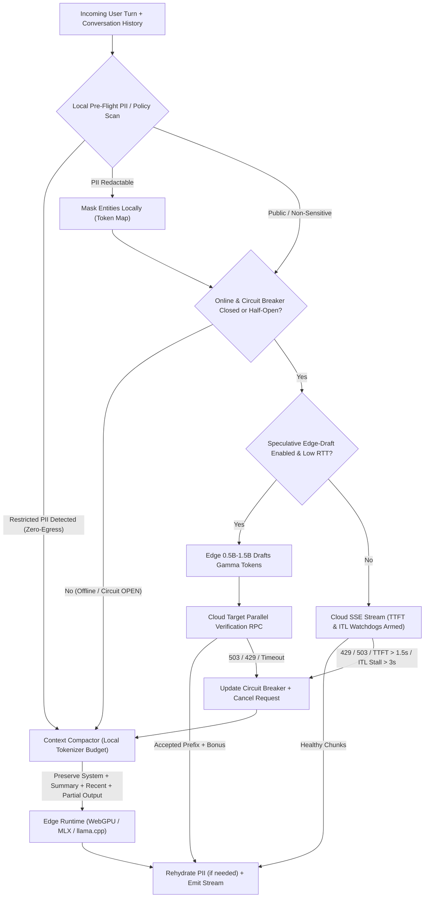
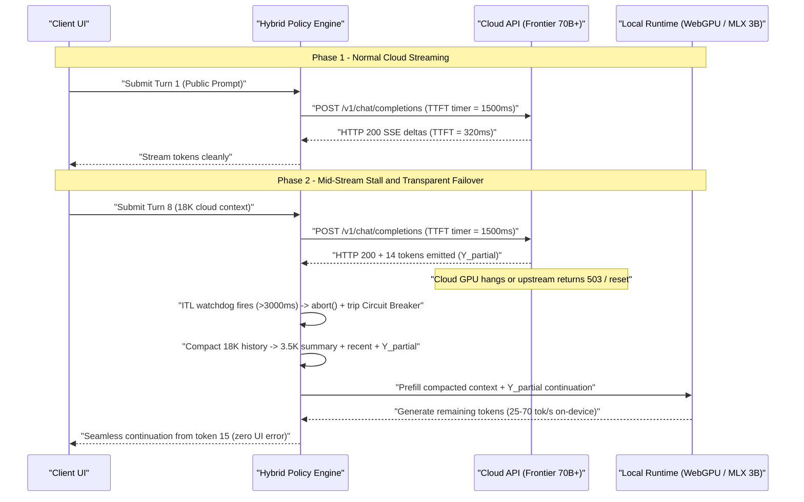

# 02 — Hybrid Cloud-Edge Architectures

[← Edge Runtimes & Unified Architecture](./01-edge-runtimes-and-unified-architecture.md) · [Stage 12 Overview](./README.md) · [Main Docs](../../README.md) · [Syllabus](../../syllabus.md) · [Next: Scientific Benchmarking Methodology →](./03-scientific-benchmarking-methodology.md)

---

Production AI applications often combine large cloud models with smaller models running directly on a user's laptop, phone, or browser so they stay fast, private, and available even when remote servers slow down or go offline. This guide covers the fault-detection, privacy, state-handoff, and collaborative-execution patterns that make hybrid cloud-edge systems reliable.

## Core Concepts & Terminology

Every technical term, networking mechanism, and inference concept used in this document is defined below in dependency order:

* **Frontier Model vs. Edge Model:** A **frontier model** is a massive LLM ($70\text{B–}405\text{B+}$ parameters) hosted in a cloud data center. An **edge model** is a compact, quantized LLM ($1\text{B–}4\text{B}$ parameters) running locally on a user's device via an **NPU (Neural Processing Unit**, a dedicated low-power AI chip), Apple Silicon **MLX**, **`llama.cpp`**, or **WebGPU** (a browser GPU compute API).
* **WAN, RTT, & TCP/TLS Handshake:** **WAN (Wide Area Network)** refers to the public internet connecting a client device to remote cloud servers. **RTT (Round-Trip Time, $T_{\text{RTT}}$)** is the time it takes a network packet to travel from client to server and back. **TCP** (transport protocol) and **TLS** (encryption protocol) perform a multi-packet **handshake** to establish a secure HTTPS connection before data flows.
* **HTTP Error Codes (`408`, `429`, `500`, `502`, `503`, `504`) & Token-Bucket Rate Limiting:** Standard web status codes indicating failure: `408` (Request Timeout), `429` (Too Many Requests), and `500/502/503/504` (server crash, bad gateway, service unavailable, or gateway timeout). Cloud APIs enforce quotas using **token-bucket rate limiting**, returning headers like `Retry-After` and `x-ratelimit-reset-tokens` when a tenant's budget is exhausted.
* **SSE (Server-Sent Events) & `AsyncIterable<StreamChunk>`:** **SSE** is a lightweight HTTP streaming protocol where the server pushes generated text chunks ("deltas") one by one over an open connection. In TypeScript/JavaScript, **`AsyncIterable` / `AsyncGenerator`** provides a uniform programming interface to consume streamed chunks asynchronously regardless of whether they come from the cloud or a local runtime.
* **TTFT & ITL:** **Time to First Token (TTFT)** is the elapsed time from sending a prompt until the first output token arrives. **Inter-Token Latency (ITL)** is the time gap between consecutive streamed tokens.
* **Gray Failure, Watchdog, & `AbortController`:** A **gray failure** is a silent stall where an HTTP connection stays open with no error code, yet stops sending tokens. A **watchdog** is a client-side timer (`TTFT Watchdog`, `ITL Stall Watchdog`) that detects these stalls and calls **`AbortController.abort()`**—a standard browser/Node.js signal that immediately cancels an in-flight `fetch()` request.
* **Circuit Breaker (`CLOSED`, `OPEN`, `HALF-OPEN`), Ring Buffer, Exponential Backoff + Jitter, & Thundering Herd:** A **Circuit Breaker** is a fault-tolerance state machine that stops a client from repeatedly waiting on a broken cloud endpoint:
  * **`CLOSED`:** Normal operation; recent request outcomes are tracked in a fixed-size **ring buffer** (circular array).
  * **`OPEN`:** Triggered when failures exceed a threshold; all requests immediately skip the cloud ($0\text{ ms}$ wait) and run locally for a cooldown period.
  * **`HALF-OPEN`:** After cooldown, one test ("canary") request or `/health` probe checks if the cloud has recovered.
  * **Exponential Backoff + Jitter:** Doubling the cooldown after each failed probe while adding small random timing variation (**jitter**) so thousands of clients do not reconnect simultaneously and cause a **thundering herd** overload.
* **Tokenizer, Vocabulary, BPE, UTF-8, `\uFFFD`, & `<|eot_id|>`:** A **tokenizer** splits text into numeric token IDs using a model-specific **vocabulary** and **BPE (Byte-Pair Encoding)** merge rules. Because cloud and edge models use incompatible vocabularies, handoffs must pass plain **UTF-8** text (stripping any broken trailing multibyte replacement character **`\uFFFD`**) rather than token IDs. **`<|eot_id|>`** is an end-of-turn marker; omitting it during **assistant prefill continuation** instructs the local model to continue the partial response seamlessly.
* **Context Window ($N_{\text{ctx}}$), RAG, KV Cache, GQA, FLOPs, & TFLOPS:** The **context window** is the maximum number of tokens a model can process at once. **RAG (Retrieval-Augmented Generation)** injects retrieved external documents into the prompt. The **KV Cache** stores attention Key/Value tensors for all context tokens; **GQA (Grouped-Query Attention)** shares Key/Value heads across Query heads to reduce KV memory. **FLOPs** measure total math operations, and **TFLOPS** measure trillions of FLOPs per second.
* **Context Compaction, IndexedDB, & SQLite:** **Context compaction** shrinks a long cloud history to fit a smaller local token budget by pruning tool schemas and summarizing older turns, storing summaries locally in **IndexedDB** (browser database) or **SQLite** (local file database).
* **PII, Data Sovereignty, Zero-Egress, & Compliance (`HIPAA`, `GDPR`, `SOC2`):** **PII (Personally Identifiable Information)** includes names, SSNs, medical records, and credentials. **Data sovereignty** and **zero-egress** policies ensure restricted data never leaves the local device, satisfying healthcare (**HIPAA**), EU privacy (**GDPR**), and enterprise security (**SOC2**) rules.
* **Pre-Flight PII Guard, Regex, Luhn Checksum, Shannon Entropy, NER, ONNX/WASM, & Pseudonymization:** A fast local scanner combining **Regex** (pattern matching), **Luhn checksums** (credit-card digit validation), **Shannon entropy** (measuring character randomness to spot API keys), and a tiny **NER (Named Entity Recognition)** classifier (e.g., BERT/DeBERTa) running via **ONNX** (Open Neural Network Exchange) and **WASM** (WebAssembly). **Pseudonymization (Redact-Burst-Rehydrate)** temporarily swaps PII for placeholders (`[PERSON_1]`) before cloud inference and restores the real text locally on return.
* **Speculative Decoding (Edge-Draft / Cloud-Verify), Rejection Sampling, PoP, & gRPC:** **Speculative decoding** pairs a fast local **draft model** that proposes $\gamma$ candidate tokens with a large cloud **target verifier** that checks all $\gamma + 1$ positions in one parallel forward pass. Standard **rejection sampling** mathematically guarantees the exact same output distribution as the cloud model alone. A **PoP (Point of Presence)** is a regional edge server close to the user that lowers $T_{\text{RTT}}$, and **gRPC** is a high-performance binary Remote Procedure Call protocol.

---

## 1. Motivation: Resilience, Privacy, and Latency Economics

Relying exclusively on remote frontier APIs creates three production vulnerabilities:

1. **Availability & Tail-Latency Failures:** Cloud inference clusters suffer GPU preemption, regional outages (`HTTP 502/503/504`), tenant token-bucket exhaustion (`HTTP 429`), and queuing stalls where TTFT spikes from $200\text{ ms}$ to $>10\text{ s}$. In offline or intermittent-connectivity environments (airplanes, field engineering, disconnected mobile clients), cloud APIs fail with $100\%$ error rates.
2. **Data Sovereignty & PII Leakage:** Sending unredacted medical records, credentials, source code, or financial identifiers over external WAN links violates strict compliance boundaries (HIPAA, GDPR, SOC2) or enterprise zero-egress policies.
3. **Cost & Bandwidth Asymmetry:** Trivial classification, formatting, and short-context tasks pay unnecessary cloud network RTT and per-token margins when a local $1\text{B–}4\text{B}$ quantized model already resides idle on the user's NPU, Apple Silicon GPU, or WebGPU device.

A **Hybrid Cloud-Edge Architecture** unifies cloud frontier models ($70\text{B–}405\text{B+}$) and compact on-device models ($1\text{B–}4\text{B}$, e.g., Llama-3.2-3B-Instruct, Qwen2.5-3B, Phi-3.5-mini) behind a single client-side **Inference Policy Engine**, turning the edge runtime from a toy into an automatic survival and privacy plane.

---

## 2. Fault Detection, Watchdogs, and Circuit Breakers


Naive failover catches only explicit `HTTP 500/503` responses after a multi-second TCP/TLS timeout. Production hybrid clients must detect **soft degradation** (silent stream stalls and SLA breaches) using layered timers and state machines—much like adding a per-token timeout watchdog around an `async for chunk in stream` loop in Python:

### 2.1 Four Concrete Failure Signals

| Failure Mode | Detection Mechanism | Typical Threshold | Action |
| :--- | :--- | :--- | :--- |
| **Hard Offline / Network Drop** | `navigator.onLine === false`, `ENETUNREACH`, DNS/TLS handshake failure | Immediate ($< 200\text{ ms}$) | Bypass cloud immediately; route directly to local runtime. |
| **Rate-Limit Exhaustion** | `HTTP 429 Too Many Requests` + `Retry-After` / `x-ratelimit-reset-tokens` | Immediate on response headers | Trip short-lived rate-limit cooldown; fail over to local model instead of blocking UX. |
| **Upstream Overload / Outage** | `HTTP 500, 502, 503, 504` or `HTTP 408` | Immediate on status code | Increment circuit-breaker failure counter; fail over current request locally. |
| **Streaming SLA Stall (Gray Failure)** | **TTFT Watchdog** ($T_{\text{first\_delta}} > T_{\text{TTFT\_max}}$) and **ITL Stall Watchdog** (gap between SSE chunks $> T_{\text{stall\_max}}$) | `TTFT_max = 1500–2500 ms`, `ITL_stall = 3000 ms` | `AbortController.abort()` the hanging cloud `fetch()` stream; hand off state to local runtime. |

### 2.2 Client-Side Circuit Breaker State Machine

Failing on TTFT timeout for *every* user request during a 10-minute cloud brownout would add $2\text{ s}$ of dead wait time to every turn. A **sliding-window Circuit Breaker** eliminates repeated timeout penalties:

* **`CLOSED` (Normal):** Requests attempt cloud execution. A ring buffer tracks the last $W = 20$ requests (or $60\text{ s}$ window). If failure rate (5xx + 429 + TTFT watchdog aborts) exceeds threshold $p_{\text{fail}} \ge 0.30$ (or $3$ consecutive failures), transition to `OPEN`.
* **`OPEN` (Edge Survival Mode):** All non-critical requests bypass the cloud immediately ($0\text{ ms}$ network wait) and execute on the local WebGPU/MLX runtime for a cooldown duration $T_{\text{cooldown}}$ (e.g., $30\text{ s}$ with exponential backoff + $\pm 20\%$ jitter).
* **`HALF-OPEN` (Probing):** After $T_{\text{cooldown}}$ expires, **one** canary request (or a lightweight non-blocking background `/health` probe) is allowed to hit the cloud. If it succeeds within TTFT SLA, transition back to `CLOSED`; if it fails, reset to `OPEN` with doubled cooldown (capped at $5\text{ min}$). Jitter prevents synchronized client fleets from creating a thundering herd upon cloud recovery.

---

## 3. Transparent Failover & State Preservation

To the UI and downstream agent logic, cloud and edge backends must implement an identical asynchronous streaming contract (`AsyncIterable<StreamChunk>` emitting normalized OpenAI-style deltas).

### 3.1 Pre-First-Token vs. Mid-Stream Failover

Failover splits into two distinct state-handoff cases:

1. **Pre-First-Token Failover (Zero Tokens Emitted):**
   * The cloud fails with `503`/`429` or trips the TTFT Watchdog before emitting any content token to the user.
   * **Handoff:** The client cancels the `AbortController`, compacts the conversation history for the local context budget, and dispatches the full prompt cleanly to the local WebGPU/MLX model. The user perceives only slightly higher TTFT ($\sim 1.8\text{ s}$ instead of $0.4\text{ s}$) and zero UI error.

2. **Mid-Stream Failover (Partial Prefix Already Rendered):**
   * Suppose the cloud streams $k = 42$ tokens (`"To configure the TLS listener in NGINX, first..."`) and then stalls for $>3\text{ s}$ (GPU node preemption or upstream proxy reset). You **cannot** clear the user's screen or restart from scratch without jarring UX corruption.
   * **Continuation Prefix Handoff:** The client captures the accumulated partial assistant string $Y_{\text{partial}}$ already displayed to the user, appends it as an **assistant prefill continuation** (or raw completion suffix in the chat template without closing `<|eot_id|>`), and runs local prefill over `[Compacted_Messages + Y_partial]`.
   * **Tokenizer Boundary Trap:** Because the cloud model (e.g., GPT-4o `o200k_base` or DeepSeek-V3) and the local 3B model (e.g., Llama-3 `tiktoken` 128K or Qwen2.5 151K) use **different vocabularies and BPE merge rules**, you must hand off **UTF-8 text**, never raw token IDs! Furthermore, if the cloud connection severed mid-UTF-8 multibyte character or mid-whitespace, strip incomplete trailing Unicode replacement bytes (`\uFFFD`) before retokenizing on the local WASM/MLX tokenizer. If $Y_{\text{partial}}$ ends mid-word (e.g., `"configur"`), feeding `"configur"` as prefix text forces the local tokenizer to tokenize `"configur"` and continue seamlessly (`"ation"`), preserving grammatical continuity.

```typescript
// Conceptual unified stream wrapper with TTFT/ITL watchdog + continuation handoff
async function* streamWithEdgeFailover(
  messages: ChatMessage[],
  localRuntime: EdgeRuntime,
  policy: HybridPolicy
): AsyncGenerator<string> {
  let emittedText = "";
  const abortCtrl = new AbortController();

  if (circuitBreaker.allowCloud() && navigator.onLine) {
    try {
      const cloudStream = fetchCloudSSE(messages, abortCtrl.signal, {
        ttftTimeoutMs: policy.ttftBudgetMs,   // e.g. 1500 ms
        itlStallTimeoutMs: policy.itlMaxMs,   // e.g. 3000 ms
      });
      for await (const delta of cloudStream) {
        emittedText += delta;
        yield delta;
      }
      circuitBreaker.recordSuccess();
      return;
    } catch (err) {
      abortCtrl.abort();
      circuitBreaker.recordFailure(err);
      // Fall through cleanly to local edge survival engine
    }
  }

  // Context adaptation for smaller local VRAM/context window
  const adapted = await compactContextForEdge(messages, emittedText, localRuntime);
  for await (const delta of localRuntime.generateStream(adapted)) {
    yield delta;
  }
}
```

### 3.2 Context Window Truncation & Rolling Summarization

A frontier cloud API routinely holds $64\text{K–}200\text{K}$ tokens of conversation history, retrieved RAG chunks, and tool schemas. On a consumer laptop or browser tab running a 3B Q4 model, attempting to prefill $64\text{K}$ tokens triggers two catastrophic failures:
* **KV Cache OOM:** Even with GQA ($n_{\text{kv\_heads}} = 8$, $d_{\text{head}} = 128$, $L = 28$ layers, FP16), KV footprint is:
  $$M_{\text{KV}} = 2 \times 28 \times 8 \times 128 \times 2\text{ B} \times N_{\text{ctx}} = 114{,}688\text{ B/token} \approx 112\text{ KB/token}$$
  At $N_{\text{ctx}} = 64{,}000$, KV alone consumes **$7.17\text{ GB}$**, shattering browser `maxBufferSize` ($1\text{–}4\text{ GB}$) and 8 GB laptop RAM! At $N_{\text{ctx}} = 4{,}096$, KV consumes only **$448\text{ MB}$**.
* **Prefill Latency Wall:** On WebGPU without hardware Tensor Cores ($\sim 3\text{–}8\text{ TFLOPS}$ effective FP16), prefilling $64\text{K}$ tokens on a 3B model requires $\sim 3.84 \times 10^{14}\text{ FLOPs} \implies 48\text{–}128\text{ seconds}$ TTFT!

Therefore, before handing off to the edge model, the **Context Compactor** enforces a strict local token budget $B_{\text{local}}$ (e.g., $4{,}096$ or $8{,}192$ tokens minus `max_new_tokens`), counted using the **local model's exact tokenizer** (since token counts diverge by $5\text{–}15\%$ across tokenizers):

1. **System & Tool-Schema Pruning:** Swap verbose cloud tool-calling JSON schemas and multi-page system prompts for a compact edge-tuned system instruction ($<300$ tokens) and only the active tool subset.
2. **Pinned Head + Rolling Tail Window:** Always preserve `System_Prompt` (turn 0) + `Most_Recent_Turns` ($T_{n-2}, T_{n-1}, T_n$) + `Y_partial`.
3. **Background Rolling Summarization:** While the cloud is healthy, or asynchronously via the local 1B/3B model between turns, compress older evicted turns $[T_1 \dots T_{n-3}]$ into a dense $250$-token `<conversation_summary>` block stored in client IndexedDB/SQLite. On failover, the edge model sees `[Compact_System, Summary, Recent_Turns, Y_partial]`—retaining semantic continuity within a $2\text{K–}4\text{K}$ budget.

---

## 4. Privacy-Preserving Local Routing

Failover is reactive; **privacy routing** is proactive. Before any prompt crosses the network interface, an on-device **Pre-Flight PII & Sensitivity Guard** inspects the payload in $<10\text{ ms}$:

1. **Tier 1 — Deterministic Pattern & Entropy Scan ($<1\text{ ms}$):** Regex + Luhn/checksum validators for credit cards, SSNs, JWTs, AWS/OpenAI/GitHub secret prefixes (`sk-`, `AKIA`, `ghp_`), Shannon entropy checks ($H > 4.5\text{ bits/char}$) for base64 secrets, and explicit user/workspace policy tags (`sensitivity: "restricted"`).
2. **Tier 2 — Compact On-Device NER Classifier ($5\text{–}15\text{ ms}$):** A quantized $20\text{–}60\text{ MB}$ BERT/DeBERTa-v3-xsmall ONNX/WASM token classifier identifying `PERSON`, `ORG`, `LOC`, `MEDICAL_CONDITION`, and `ACCOUNT_ID`.

Depending on enterprise policy, detected sensitivity triggers one of two paths:
* **Strict Local Pinning (Zero-Egress):** Any turn (or entire session once tainted) containing PII/credentials is pinned exclusively to the local MLX / `llama.cpp` / WebGPU runtime. Cloud telemetry is suppressed so raw prompts never touch remote logs.
* **Local Redact-Burst-Rehydrate (Pseudonymization):** When frontier reasoning is required on a document containing isolated PII entities, the client replaces entities locally with reversible placeholders (`"Draft a termination notice for [PERSON_1] at [EMAIL_1]"`), bursts the sanitized prompt to the cloud frontier model, and deterministically re-hydrates `[PERSON_1]` $\rightarrow$ `"Alice Vance"` locally as SSE chunks arrive. *(Edge-case warning: indirect quasi-identifiers—such as unique job titles + dates—cannot be caught by simple entity replacement; high-assurance workloads must use Strict Local Pinning.)*

---

## 5. Edge-Draft / Cloud-Verify Speculative Collaboration

Beyond fallback and privacy, edge and cloud models can collaborate **within a single generation** via **Distributed Speculative Decoding**:

* **Mechanism:** The client runs a fast $0.5\text{B–}1.5\text{B}$ draft model locally (e.g., Qwen2.5-0.5B at $>120\text{ tok/s}$ on Apple Silicon MLX) to generate $\gamma$ candidate tokens $(x_1, \dots, x_\gamma)$ along with draft probabilities $q(x_i \mid x_{<i})$. The client transmits `[prompt_delta, x_1 ... x_gamma, q_1 ... q_gamma]` to the cloud server running the $70\text{B–}405\text{B}$ target verifier.
* **Cloud Verification:** The cloud server evaluates all $\gamma + 1$ positions in a **single parallel forward pass** (verification prefill), computes target probabilities $p(x_i \mid x_{<i})$, runs standard lossless speculative rejection sampling (accepting $x_i$ with probability $\min(1, p_i / q_i)$, sampling from $\text{norm}(\max(0, p_i - q_i))$ at the first rejection), and returns the accepted prefix length $\alpha \in [0, \gamma]$ plus the bonus/correction token $x_{\alpha+1}$ in one HTTP/gRPC response.

### 5.1 The WAN Latency Inequality (When Collaboration Wins vs. Loses)

Unlike intra-node speculative decoding (where draft-to-verify communication is $<10\ \mu\text{s}$ over NVLink/HBM), edge-to-cloud speculation pays a **network round-trip time ($T_{\text{RTT}}$)** on every verification cycle:

$$T_{\text{spec\_cycle}} = \gamma \cdot T_{\text{edge\_tok}} + T_{\text{RTT}} + T_{\text{cloud\_verify}}(\gamma + 1)$$

Comparing against standard autoregressive cloud streaming generating $(\alpha + 1)$ tokens at cloud decode time $T_{\text{cloud\_tok}}$:

$$\text{Speedup} \iff \gamma \cdot T_{\text{edge\_tok}} + T_{\text{RTT}} + T_{\text{cloud\_verify}}(\gamma + 1) < (\alpha + 1) \cdot T_{\text{cloud\_tok}}$$

**Concrete Numbers:**
* **Bad Regime (High RTT, Fast Cloud):** If $T_{\text{RTT}} = 80\text{ ms}$, $\gamma = 4$, $\alpha = 3$ ($4$ tokens net), $T_{\text{edge\_tok}} = 8\text{ ms}$, $T_{\text{cloud\_verify}} = 35\text{ ms}$, and $T_{\text{cloud\_tok}} = 20\text{ ms}$ ($50\text{ tok/s}$):
  $$T_{\text{spec\_cycle}} = 32 + 80 + 35 = 147\text{ ms}\ \text{vs.}\ 4 \times 20 = 80\text{ ms}\quad (\mathbf{1.84\times\text{ slower!}})$$
* **Winning Regime (Low-RTT Regional Edge PoP + Heavy 405B Cloud + Larger $\gamma$ / Tree Draft):** If $T_{\text{RTT}} = 12\text{ ms}$, $\gamma = 10$ (or a token tree yielding $\alpha = 7$, $8$ tokens net), $T_{\text{edge\_tok}} = 5\text{ ms}$, $T_{\text{cloud\_verify}} = 55\text{ ms}$, and $T_{\text{cloud\_tok}} = 45\text{ ms}$ ($22\text{ tok/s}$ on 405B):
  $$T_{\text{spec\_cycle}} = 50 + 12 + 55 = 117\text{ ms}\ \text{vs.}\ 8 \times 45 = 360\text{ ms}\quad (\mathbf{3.08\times\text{ faster!}})$$

Even when raw wall-clock speedup is marginal, **cloud GPU decode occupancy drops by $(\alpha + 1)\times$** (turning 8 serial memory-bound decode steps into 1 compute-efficient verification step), cutting cloud server compute cost dramatically while letting the edge UI render optimistic draft tokens speculatively with visual rollback on rare rejections.

---

## 6. Hybrid Decision Engine Flowchart



---

## 7. Failover Execution Timeline: Cloud Stall to Local Edge Survival



---

## Navigation

* **Previous:** [← 01 — Edge Runtimes & Unified Architecture](./01-edge-runtimes-and-unified-architecture.md)
* **Up:** [Stage 12 Overview](./README.md) · [Main Docs](../../README.md) · [Syllabus](../../syllabus.md)
* **Next:** [03 — Scientific Benchmarking Methodology →](./03-scientific-benchmarking-methodology.md)
