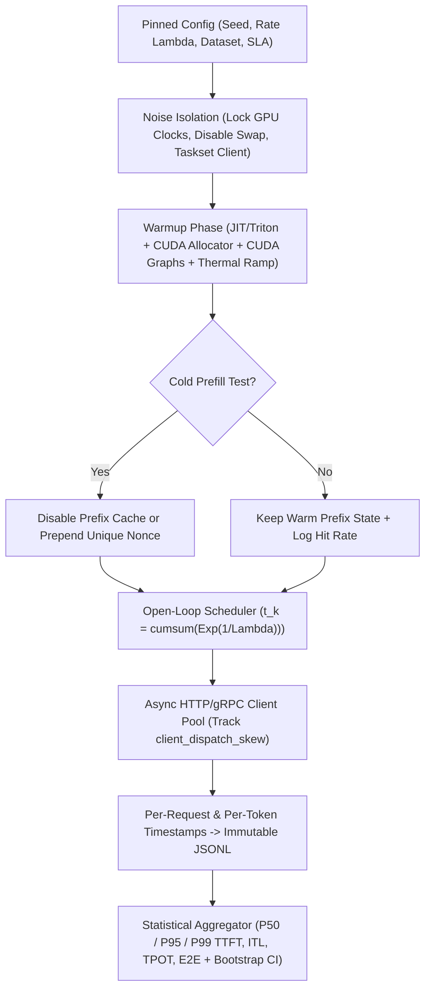
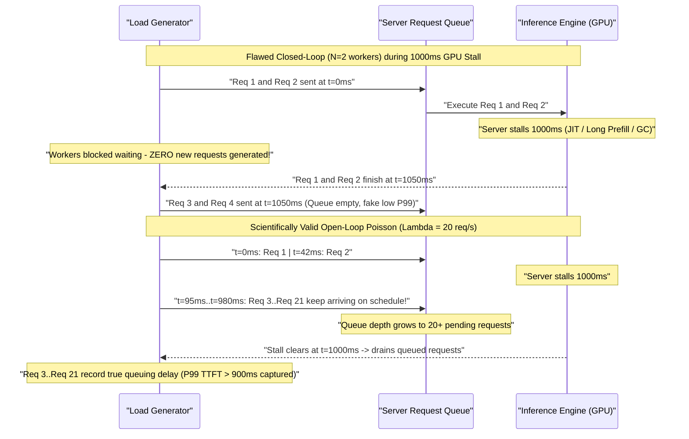

# 03 — Scientific Benchmarking Methodology

[← Hybrid Cloud-Edge Architectures](./02-hybrid-cloud-edge-architectures.md) · [Stage 12 Overview](./README.md) · [Main Docs](../../README.md) · [Syllabus](../../syllabus.md) · [Next: Pareto Frontier Analysis →](./04-pareto-frontier-analysis.md)

---

Measuring how fast an inference server runs under real production traffic is surprisingly easy to get wrong: simple test scripts often hide queuing delays, omit bursty arrivals, or accidentally measure one-time startup overhead. This guide establishes the statistical, hardware, and workload-isolation practices needed to produce trustworthy, reproducible LLM benchmarks.

## Core Concepts & Terminology

Every technical term, GPU mechanism, and statistical concept used in this document is defined below in dependency order:

* **Batch Size ($B$), Concurrency ($C$), & Continuous Batching:** **Batch size ($B$)** is the number of requests processed together in a single GPU forward pass; **concurrency ($C$)** is the number of active requests in flight at once. **Continuous batching** (used in serving engines like `vLLM`, `SGLang`, and `TensorRT-LLM`) adds new requests and removes finished ones at every single decode step rather than waiting for an entire batch to complete.
* **KV Cache, PagedAttention, & Chunked Prefill:** The **KV Cache** stores attention Key/Value tensors for active tokens in GPU High Bandwidth Memory (**HBM**). **PagedAttention** manages KV cache in fixed-size non-contiguous memory blocks ("pages"), preventing memory fragmentation and allowing **eviction/recomputation** when memory fills up. **Chunked Prefill** splits long prompt prefills into smaller token chunks interleaved with active decode steps so long prompts do not stall ongoing streams.
* **MFU & NCCL AllReduce:** **Model FLOPs Utilization (MFU)** is the fraction of a GPU's theoretical peak floating-point math speed actually achieved. **NCCL AllReduce** is NVIDIA's collective communication primitive that synchronizes partial tensor results across multiple GPUs.
* **JIT Compilation, Triton `@triton.autotune`, PTX/SASS, `torch.compile`, & FlashInfer:** **JIT (Just-In-Time) compilation** compiles GPU kernels (from Python/Triton into virtual **PTX** and native **SASS** machine code) the first time a new tensor shape appears. **`@triton.autotune`** benchmarks dozens of tile configurations (`BLOCK_M/N/K`, `num_warps`, `num_stages`) on the first run, causing multi-second stalls unless exercised during warmup.
* **`CUDACachingAllocator` & `cudaMalloc`:** **`cudaMalloc`** is the slow NVIDIA driver call that allocates physical GPU memory; PyTorch's **`CUDACachingAllocator`** keeps freed memory slabs in an internal pool so steady-state iterations reuse pointers without OS/driver locks.
* **CUDA Graphs (`cudaGraphCreate` / `cudaStreamBeginCapture`):** A CUDA feature that records a sequence of GPU kernel launches once and replays them as a single unit, eliminating the $5\text{–}15\ \mu\text{s}$ CPU launch overhead per kernel.
* **DVFS, P-States, & Persistence Mode:** **DVFS (Dynamic Voltage and Frequency Scaling)** automatically raises or lowers GPU clock speeds based on load and temperature (moving between **P-states**, or power/performance states). **Persistence mode (`nvidia-smi -pm 1`)** and clock locking (`-lgc`, `-lmc`) freeze GPU core and HBM frequencies to eliminate thermal/boost drift, while **`nvidia-smi dmon`** monitors throttling bits.
* **Prefix Caching (APC / RadixAttention) & Nonce:** **Automatic Prefix Caching (APC)** (or **RadixAttention** in SGLang) reuses cached KV blocks across requests that share identical prompt prefixes (e.g., system prompts). A **nonce** (e.g., a unique random **UUID**) is a one-time string prepended to a prompt to intentionally break prefix-cache hits when testing cold prefill.
* **Closed-Loop vs. Open-Loop Benchmarking & Coordinated Omission:** In a **closed-loop** test, a fixed pool of $N$ workers waits for each response to finish before sending the next request. In an **open-loop** test, requests are launched on a fixed wall-clock schedule regardless of whether prior requests are still running. **Coordinated Omission** (coined by Gil Tene) is the statistical bias where closed-loop workers pause during a server stall, failing to send new requests and thus hiding the real-world queue backlog and tail latency.
* **`t_scheduled`, `t_actual_send`, & `client_dispatch_skew`:** **`t_scheduled`** is the pre-computed wall-clock time a request *should* be sent in an open-loop test; **`t_actual_send`** is when the client actually sent it. Their difference, **`client_dispatch_skew`**, must stay tiny ($<5\text{ ms}$) so client event-loop lag does not disguise itself as server latency.
* **Poisson Process ($\lambda$), Exponential Distribution, & Coefficient of Variation ($CV$):** A **homogeneous Poisson process** models independent random arrivals at average rate $\lambda$ requests/second, where inter-arrival gaps $\Delta t_k$ follow an **Exponential distribution** ($\text{Exponential}(\lambda)$). The **Coefficient of Variation ($CV = \sigma / \mu$)** measures burstiness: $CV = 0$ is rigid constant spacing, $CV = 1.0$ is pure Poisson randomness, and $CV > 1$ is bursty traffic.
* **M/M/1 vs. M/D/1 Queues, Pollaczek–Khinchine, Gamma/Weibull, & MMPP:** In queuing theory, **M/D/1** models constant-rate arrivals ($CV = 0$) whereas **M/M/1** models random Poisson arrivals ($CV = 1$), which the **Pollaczek–Khinchine** formula shows have roughly $2\times$ higher queuing variance. **Gamma / Weibull** distributions (with shape $k < 1$) and **MMPP (Markov-Modulated Poisson Process)**—which alternates between calm ($\lambda_{\text{low}}$) and burst ($\lambda_{\text{high}}$) rates—model heavy-tailed production bursts ($CV > 1$).
* **NUMA, `taskset`, & Swap (`swapoff -a`):** **NUMA (Non-Uniform Memory Access)** is a multi-socket CPU memory layout; **`taskset`** pins the benchmark client to separate CPU cores/NUMA nodes so client JSON/SSE parsing does not steal CPU cycles from the inference server. **`swapoff -a`** disables disk-backed virtual memory (**swap**) so OS paging never stalls measurements.
* **EOS & `ignore_eos`:** **EOS (End-of-Sequence)** is the special stop token a model emits when finished generating. Setting **`ignore_eos=True`** forces the engine to generate an exact target token count so minor quantization differences do not skew total throughput.
* **Empirical Workload Datasets (`ShareGPT`, `LMSYS-Chat-1M`, `LongBench`, `RULER`, `Needle-in-a-Haystack`, `SWE-bench`, `BurstGPT`):** Standard real-world prompt/output length distributions covering general chat (`ShareGPT`/`LMSYS-Chat-1M`), long-context retrieval (`LongBench`/`RULER`/`Needle-in-a-Haystack`), and bursty coding/agentic traces (`SWE-bench`/`BurstGPT`).
* **Percentiles (`P50`, `P95`, `P99`, `P99.9`), eCDF, & Bootstrap CI:** **P99** is the latency value below which 99% of requests fall (exposing tail spikes hidden by averages). An **eCDF (Empirical Cumulative Distribution Function)** plots the full latency distribution, and a **Bootstrap CI (Confidence Interval)** estimates statistical uncertainty around each percentile via resampling.
* **TTFT, ITL, TPOT, & E2E Latency:** **TTFT (Time to First Token)** is total time until the first token arrives; **ITL (Inter-Token Latency)** is the gap between every individual consecutive token (exposing single-step stalls); **TPOT (Time Per Output Token)** is the average decode time per token across a request; and **E2E (End-to-End) Latency** is total time from scheduled send to final token.

---

## 1. Why Naive Synchronous Sequential Loops Produce Useless Benchmarks

The most common mistake in LLM evaluation is writing a blocking sequential benchmark script:

```python
# ANTI-PATTERN: Sequential closed-loop benchmark (concurrency = 1)
for prompt in prompts:
    t0 = time.perf_counter()
    resp = client.chat.completions.create(model="llama-3-70b", messages=prompt)
    latencies.append(time.perf_counter() - t0)
```

This naive loop invalidates almost every systems conclusion:
1. **Locks Batch Size to $B = 1$:** Modern serving engines (`vLLM`, `SGLang`, `TensorRT-LLM`) rely on continuous batching and Chunked Prefill to amortize HBM weight reads across dozens of concurrent requests. At $B = 1$, a $70\text{B}$ model runs at $\sim 1\text{–}3\%$ Model FLOPs Utilization (MFU), hiding scheduler overhead, KV block allocation pressure, and prefill-decode interference.
2. **Masks Queuing & Preemption:** With concurrency $C = 1$, the waiting queue is permanently empty ($Q = 0$). You never observe PagedAttention block exhaustion, KV cache eviction/recomputation, or NCCL AllReduce contention under multi-request load.
3. **Measures Unwarmed Cold Artifacts:** Including the first 1–5 requests mixes one-time Triton JIT compilation, CUDA context creation, and allocator warm-up into steady-state percentiles.

---

## 2. Proper GPU Warmup & State Stabilization

Before a single timed request is recorded, the serving engine must reach **thermal, memory, and compilation steady state**:

1. **JIT & Triton Kernel Autotuning:** Frameworks using `torch.compile`, Triton, or FlashInfer compile PTX/SASS lazily when encountering unseen sequence-length buckets or head dimensions. Triton autotuning (`@triton.autotune`) benchmarks dozens of `(BLOCK_M, BLOCK_N, BLOCK_K, num_warps, num_stages)` configs on the **first invocation**, stalling a single forward pass by $500\text{ ms–}15\text{ s}$. Warmup must exercise representative prompt lengths and batch sizes covering the target workload distribution.
2. **CUDA Caching Allocator Stabilization:** PyTorch's `CUDACachingAllocator` requests physical memory slabs from the NVIDIA driver via `cudaMalloc` only on demand and caches freed blocks in internal pools. Initial iterations pay OS/driver page-table mapping locks; warmup pre-populates the pool so steady-state iterations perform lock-free pointer reuse.
3. **CUDA Graph Capture:** Engines like vLLM and SGLang capture static decode graphs (`cudaGraphCreate` / `cudaStreamBeginCapture`) across discrete batch-size buckets (e.g., $B \in \{1, 2, 4, 8, 16, 32, 64, 128, 256, 512\}$) to eliminate CPU kernel-launch overhead ($\sim 5\text{–}15\ \mu\text{s}$ per kernel $\times$ hundreds of kernels per step). If warmup does not reach the peak batch size expected during the benchmark, graph capture (or un-graphed eager fallback) occurs mid-run and corrupts tail latency.
4. **DVFS Clock & Thermal Ramp:** Cold GPUs sit at idle P-states ($210\text{ MHz}$) and boost aggressively until reaching thermal equilibrium ($65\text{–}83^\circ\text{C}$). Running $30\text{–}60\text{ s}$ of sustained warmup stabilizes GPU core/memory clocks and fan curves.
5. **Prefix Cache Hygiene After Warmup:** Warmup requests often populate Automatic Prefix Caching (APC) or RadixAttention trees! If your benchmark evaluates **cold prefill**, you must either flush the prefix cache after warmup (or disable APC) or ensure timed requests carry unique cryptographic prefixes not seen during warmup.

---

## 3. Open-Loop vs. Closed-Loop Traffic & Coordinated Omission


Even experienced engineers fall into a subtler trap: **multi-worker closed-loop benchmarking**. In Python `asyncio`, a naive `for _ in range(N): await send_request()` loop waits for the server to finish before sending the next request, which artificially hides queuing delays whenever the server slows down:

### 3.1 Closed-Loop Benchmarking and Coordinated Omission

In a **closed-loop** load generator, $N$ fixed worker threads/coroutines each run:
`send request -> wait for full response -> (optional think time) -> send next request`.

This suffers from **Coordinated Omission** (a statistical distortion coined by Gil Tene):
* Suppose an open-production system receives $\lambda = 20\text{ req/s}$ ($1$ request every $50\text{ ms}$).
* At $t = 10.00\text{ s}$, the inference server experiences a $2{,}000\text{ ms}$ stall (e.g., a $64\text{K}$-token prefill monopolizing compute, Python GC pause, or KV preemption storm).
* **In real production (Open World):** External users do *not* pause during the server stall. Over those $2.0\text{ s}$, $20 \times 2.0 = \mathbf{40}$ new requests arrive and stack up in the queue! Request #1 waits $2000\text{ ms}$; Request #2 (arriving at $10.05\text{ s}$) waits $1950\text{ ms}$; Request #3 waits $1900\text{ ms}$; and all 40 requests suffer severe queuing delay that ripples even *after* the stall clears.
* **In a Closed-Loop Benchmark ($N = 8$ workers):** All 8 workers freeze inside `await response` at $t = 10.00\text{ s}$ and **stop sending new requests** during the $2\text{ s}$ stall! Only 8 requests record the stall instead of 40+, and zero queue backlog builds up. The benchmark **omits** the exact requests whose queuing delay defines P95/P99 latency in production!

### 3.2 Open-Loop Poisson & Bursty Arrival Processes

An **open-loop** load generator decouples **request arrival times** from **server completion times**. An independent scheduler pre-computes exact target send timestamps $\{t_0, t_1, t_2, \dots\}$ and spawns asynchronous tasks at those exact wall-clock instants regardless of how many prior requests are still in flight.

#### Homogeneous Poisson Process ($\lambda$ req/s)
For memoryless random independent arrivals at mean rate $\lambda$ requests/second, inter-arrival times $\Delta t_k = t_k - t_{k-1}$ follow an **Exponential distribution**:
$$\Delta t_k \sim \text{Exponential}(\lambda) \implies \Delta t_k = -\frac{\ln(1 - U_k)}{\lambda}, \quad U_k \sim \text{Uniform}(0, 1)$$
* Mean inter-arrival time: $\mathbb{E}[\Delta t] = 1/\lambda$, standard deviation $\sigma = 1/\lambda$, **Coefficient of Variation** $CV = \sigma / \mu = 1.0$.
* Fixed constant-rate pacing (`sleep(1 / lambda)`) has $CV = 0$ and artificially smooths micro-bursts, underestimating queuing variance by roughly $2\times$ (per Pollaczek–Khinchine M/D/1 vs. M/M/1 queue theory!).

#### Modeling Production Burstiness ($CV > 1$)
Real LLM API traffic is heavier-tailed and burstier than pure Poisson ($CV \approx 1.5\text{–}4.0$ due to agentic fan-outs and batch jobs):
* **Gamma / Weibull Inter-Arrivals:** Parameterize shape $k < 1$ to achieve controlled $CV = 1/\sqrt{k} > 1$ while keeping the exact same mean rate $\lambda$.
* **Markov-Modulated Poisson Process (MMPP):** Alternates between a baseline rate $\lambda_{\text{low}}$ and burst regimes $\lambda_{\text{high}}$ (e.g., $3\times$ mean rate for $10\text{ s}$ windows) to test autoscaling triggers and KV cache watermark hysteresis.
* **Timestamped Trace Replay:** Replay normalized arrival deltas from real traces (e.g., Azure LLM Inference Trace, BurstGPT).

```python
# Open-loop Poisson arrival scheduler (deterministic RNG seed)
rng = np.random.default_rng(seed=42)
inter_arrivals = rng.exponential(scale=1.0 / rate_rps, size=num_requests)
scheduled_offsets = np.cumsum(inter_arrivals)
t_start = time.perf_counter()

async def dispatch_at(offset: float, req_payload: dict):
    delay = (t_start + offset) - time.perf_counter()
    if delay > 0:
        await asyncio.sleep(delay)
    t_scheduled = t_start + offset  # Anchor latency to SCHEDULED time!
    await send_streaming_request(req_payload, t_scheduled)
```

> [!IMPORTANT]
> **Anchor Latency to `t_scheduled`, Not `t_actual_send`:** If the Python/Go client event loop lags slightly under extreme concurrency, computing `TTFT = t_first_token - t_actual_send` re-introduces client-side coordinated omission. Always record latency against `t_scheduled = t_start + offset` (while simultaneously logging `client_dispatch_skew = t_actual_send - t_scheduled` and asserting $\text{P99 skew} < 5\text{ ms}$ so client saturation never masquerades as server latency).

---

## 4. Realistic Dataset Distributions vs. Synthetic Tensors

Benchmarking solely with fixed `(input_len=512, output_len=128)` pairs misrepresents real engine behavior:
* **Synchronized Batch Exits:** Uniform output lengths cause entire batches to finish simultaneously, alternating artificially between pure prefill spikes and empty decode queues.
* **Hidden PagedAttention Fragmentation & Preemption:** Variable long outputs ($2\text{K–}8\text{K}$) mixed with short outputs ($20\text{–}100$) test dynamic KV block reclamation and chunked prefill token-budget slicing.
* **Control of `ignore_eos`:** If comparing FP16 vs. INT4/FP8 quantized models on natural EOS stopping, minor logit shifts can alter average output length by $\pm 15\%$ (one model might write 180 tokens while the other writes 210 tokens), skewing E2E latency and total throughput. Set `ignore_eos=True` with target output lengths drawn from an empirical distribution when isolating **pure systems throughput**, and test natural EOS separately when measuring **task-level token efficiency**.

**Standard Empirical Workload Profiles:**
1. **ShareGPT / LMSYS-Chat-1M:** General conversational distribution; heavily right-skewed prompts (median $\sim 150\text{–}300$ tokens, tail $>4\text{K}$) and variable outputs (median $\sim 200$, tail $>1.5\text{K}$).
2. **LongBench / RULER / Needle-in-a-Haystack:** Long-context RAG and summarization ($8\text{K–}128\text{K}$ input tokens, short $64\text{–}512$ outputs) stressing $O(N^2)$ attention prefill FLOPs, chunked prefill ITL interference, and KV memory capacity.
3. **Agentic / Coding Traces (SWE-bench / BurstGPT):** High prefix-cache overlap ($80\%+$ shared system + repo context) paired with bursty short tool-call outputs ($30\text{–}150$ tokens).

---

## 5. Noise Isolation Checklist

Before attributing a $5\%$ speedup to a kernel or flag, eliminate hardware and software confounding variables:

* **Prefix Cache Isolation:** When benchmarking **cold prefill TTFT**, explicitly disable prefix caching (`--no-enable-prefix-caching` in vLLM, `--disable-radix-cache` in SGLang) OR prepend a unique random 16-token nonce (`req_id` UUID) at index 0 of every prompt (breaking chained block hashes from block 0 onward). Conversely, when benchmarking **warm cache** workloads, report exact `prefix_cache_hit_rate` alongside TTFT.
* **Lock GPU Clocks & Persistence Mode:** Eliminate dynamic voltage and frequency scaling (DVFS) drift across runs:
  ```bash
  sudo nvidia-smi -pm 1                 # Enable persistence mode
  sudo nvidia-smi -lgc 1980,1980        # Lock SM clocks to stable sustainable frequency
  sudo nvidia-smi -lmc 2619,2619        # Lock HBM memory clocks (SKU-specific)
  ```
* **Thermal & Power Throttling Audit:** Continuously poll `nvidia-smi dmon -s pct -d 1` (power, clocks, temperature, throttle reason bits). Any sample showing `HW Thermal Slowdown` or `SW Power Cap` invalidates comparative throughput runs.
* **CPU / NUMA & Client Isolation:** Run the benchmark load generator on isolated CPU cores (`taskset`) on a separate NUMA node (or separate host over 25/100GbE) from the GPU inference server's Python scheduler and NCCL worker threads so client JSON/SSE parsing never steals scheduler CPU cycles.
* **OS Background Noise:** Disable cron jobs, log rotation, container auto-updates, and OS swap (`swapoff -a`) during measurement windows.

---

## 6. Rigorous Latency & Percentile Definitions

Averages ($\mu$) conceal tail-latency catastrophes. Production benchmarks report **P50 (median), P95, P99 (and P99.9 where $N \ge 5{,}000$)** along with **empirical CDFs (eCDFs)** over a sufficiently large sample ($N \ge 1{,}000$ requests after warmup).

Let a request arrive at scheduled time $t_{\text{sched}}$, receive its first non-empty token chunk at $t_1$, subsequent tokens at $t_2, \dots, t_{M}$ ($M = N_{\text{out}}$), and finish at $t_M$:

1. **TTFT (Time to First Token):**
   $$\text{TTFT} = t_1 - t_{\text{sched}}$$
   Encompasses client serialization + network ingress + **scheduler queue wait** + prompt prefill + first-token sampling + SSE return. Always distinguish *end-to-end client TTFT* from *engine-internal TTFT* (which excludes network & API gateway overhead).
2. **ITL (Inter-Token Latency):**
   $$\text{ITL}_i = t_i - t_{i-1}, \quad \forall i \in \{2, \dots, M\}$$
   Captures **every individual step jitter**. If a long chunked prefill stalls active decode requests for $180\text{ ms}$ once per $100$ tokens, **TPOT averages that stall away**, whereas **P99 ITL** exposes the exact $180\text{ ms}$ freeze that users experience as stuttering text!
3. **TPOT (Time Per Output Token):**
   $$\text{TPOT} = \frac{t_M - t_1}{M - 1} = \frac{1}{M-1}\sum_{i=2}^{M} \text{ITL}_i$$
   Measures average per-request decode cadence. Useful for SLA throughput sizing ($\text{User Token Rate} = 1/\text{TPOT}$), but strictly blind to intra-request micro-stalls. *(Edge case: requests with $M \le 1$ output token have undefined TPOT/ITL and must be filtered explicitly with counts logged, never silently coerced to zero.)*
4. **E2E Request Latency:**
   $$L_{\text{E2E}} = t_M - t_{\text{sched}} = \text{TTFT} + \sum_{i=2}^{M} \text{ITL}_i$$

---

## 7. Scientifically Valid Open-Loop Benchmark Harness Flowchart



---

## 8. Closed-Loop Coordinated Omission vs. Open-Loop Poisson Sequence



---

## Navigation

* **Previous:** [← 02 — Hybrid Cloud-Edge Architectures](./02-hybrid-cloud-edge-architectures.md)
* **Up:** [Stage 12 Overview](./README.md) · [Main Docs](../../README.md) · [Syllabus](../../syllabus.md)
* **Next:** [04 — Pareto Frontier Analysis →](./04-pareto-frontier-analysis.md)
