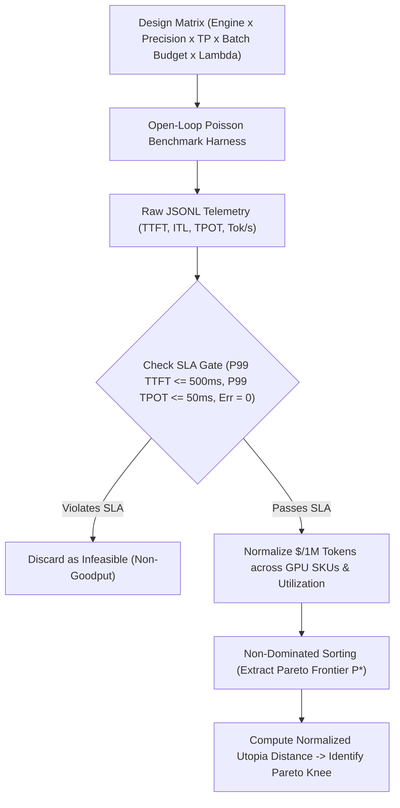
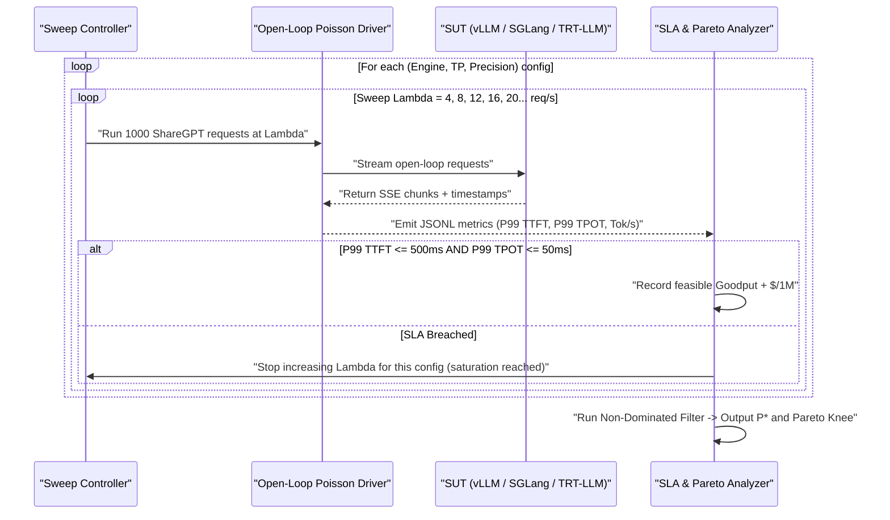
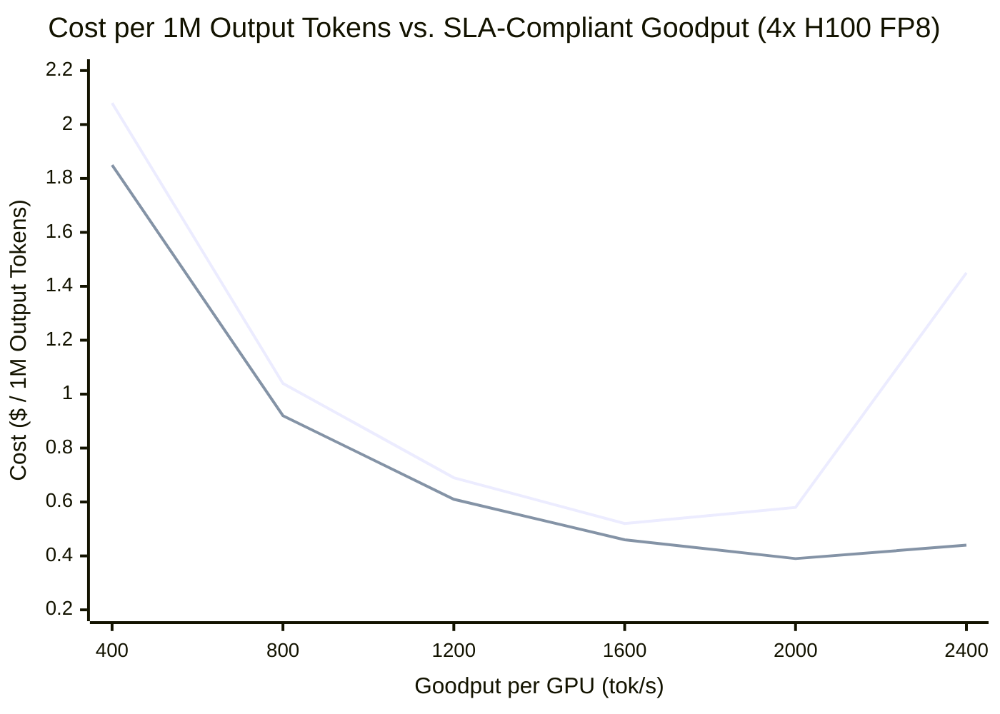

# 04 — Pareto Frontier Analysis

[← Scientific Benchmarking Methodology](./03-scientific-benchmarking-methodology.md) · [Stage 12 Overview](./README.md) · [Main Docs](../../README.md) · [Syllabus](../../syllabus.md) · [Next: Engineering Technical Communication →](./05-engineering-technical-communication.md)

---

## 1. Multi-Objective Optimization in LLM Inference

In production inference engineering, **there is no single scalar metric** that defines a "best" serving configuration. Every architectural decision simultaneously trades off at least four competing objectives (plus model quality when quantization varies):

1. **Cost per 1M Tokens ($\text{USD} / 10^6\text{ tok}$):** Minimizing unit compute cost.
2. **Time to First Token ($\text{TTFT}_{\text{P99}}$):** Minimizing initial responsiveness latency.
3. **Inter-Token Latency / Decode Cadence ($\text{ITL}_{\text{P99}}, \text{TPOT}_{\text{P99}}$):** Minimizing generation stutter and maximizing per-user reading speed.
4. **Total Throughput per GPU ($\Theta_{\text{GPU}}$, tok/s/GPU):** Maximizing hardware density and capital efficiency.

**Why Single-Metric Optimization Fails:**
* Minimizing **TTFT / TPOT** alone drives batch size $B \rightarrow 1$ and Tensor Parallelism $TP \rightarrow 8$: a single request gets $3\text{ ms}$ TPOT, but GPU MFU sits at $1\%$ and cost per 1M tokens explodes $10\text{–}30\times$.
* Maximizing **Raw Throughput** alone drives batch size $B \rightarrow B_{\max}$ and arrival rate $\lambda \rightarrow \lambda_{\text{sat}}$: the GPU saturates at $95\%$ bandwidth/compute, **but queuing delay pushes P99 TTFT to $8\text{–}30\text{ seconds}$ and decode contention pushes TPOT past $120\text{ ms}$**, destroying interactive user experience.

---

## 2. Goodput vs. Raw Throughput & Hard SLA Masking

To prevent illusory throughput numbers, production evaluation replaces raw throughput with **SLA-Constrained Goodput**.

### 2.1 Defining the Feasibility Mask ($\Omega_{\text{SLA}}$)

Before comparing engines or hardware SKUs, define an explicit **Service Level Agreement (SLA) constraint vector** matched to the application tier:

| Workload Tier | $\text{P99 TTFT}$ Bound | $\text{P99 TPOT}$ Bound | $\text{P99 ITL}$ Bound | Error / Timeout Rate |
| :--- | :--- | :--- | :--- | :--- |
| **Interactive Chat / IDE Copilot** | $\le 500\text{ ms}$ | $\le 50\text{ ms}$ ($\ge 20\text{ tok/s}$) | $\le 100\text{ ms}$ | $= 0.0\%$ |
| **Voice / Real-Time Agent** | $\le 250\text{ ms}$ | $\le 30\text{ ms}$ ($\ge 33\text{ tok/s}$) | $\le 60\text{ ms}$ | $= 0.0\%$ |
| **Async Batch / Offline Eval** | $\le 30{,}000\text{ ms}$ | $\le 200\text{ ms}$ ($\ge 5\text{ tok/s}$) | $\le 500\text{ ms}$ | $< 0.1\%$ |

**Goodput ($\Theta_{\text{good}}$)** is defined as the **maximum sustained output (or total) token rate per GPU achieved strictly within $\Omega_{\text{SLA}}$**:
$$\Theta_{\text{good}}(c) = \begin{cases} \Theta_{\text{total}}(c) / N_{\text{GPU}}(c) & \text{if } \text{P99\_TTFT}(c) \le \tau_{\text{TTFT}} \;\land\; \text{P99\_TPOT}(c) \le \tau_{\text{TPOT}} \;\land\; \text{Err}(c) = 0 \\ \text{INFEASIBLE (pruned)} & \text{otherwise} \end{cases}$$

Any configuration $c$ whose latency percentiles breach the SLA threshold is **masked out as infeasible**, regardless of how high its raw tok/s looks. In queuing terms, Little's Law ($L = \lambda W$) and M/G/1 response-time curves dictate that latency explodes hyperbolically ($\propto \frac{1}{1 - \rho}$) as utilization $\rho = \lambda / \mu \rightarrow 1$. Goodput typically peaks just before the inflection wall ($\rho \approx 0.70\text{–}0.85$).

---

## 3. Mathematical Formulation of the Pareto Frontier & Knee

Consider the feasible configuration space $\mathcal{C}_{\text{feas}} \subseteq \mathcal{C}$ passing $\Omega_{\text{SLA}}$. Let every configuration $c \in \mathcal{C}_{\text{feas}}$ map to an objective vector to minimize:
$$\mathbf{f}(c) = \big(\text{Cost\_per\_1M}(c),\; \text{P99\_TTFT}(c),\; \text{P99\_TPOT}(c),\; -\Theta_{\text{good}}(c)\big)$$
*(Equivalently, maximize $\Theta_{\text{good}}$ while minimizing Cost, TTFT, and TPOT; note that for a fixed GPU SKU and fixed $N_{\text{GPU}}$, $\text{Cost\_per\_1M}$ is inversely proportional to $\Theta_{\text{good}}$, reducing 4D to 3D—while across heterogeneous SKUs like L40S vs. H100 vs. B200, Cost and $\Theta_{\text{good}}$ remain independent axes!)*

### 3.1 Pareto Dominance & Non-Dominated Filtering

Configuration $A$ **strictly dominates** $B$ ($A \succ B$) if and only if:
$$\forall m \in \{1 \dots M\},\quad f_m(A) \le f_m(B) \quad \text{and} \quad \exists k \in \{1 \dots M\},\quad f_k(A) < f_k(B)$$

The **Pareto Frontier** $\mathcal{P}^*$ is the subset of all feasible configurations not dominated by any other feasible point:
$$\mathcal{P}^* = \{ c \in \mathcal{C}_{\text{feas}} \mid \nexists\, c' \in \mathcal{C}_{\text{feas}} \text{ such that } c' \succ c \}$$

```python
import numpy as np

def extract_pareto_frontier(points: np.ndarray) -> np.ndarray:
    """
    points: shape (N, M) where ALL M objectives are formatted for MINIMIZATION
            e.g. [cost_per_1m, p99_ttft_ms, p99_tpot_ms, -goodput_tok_s]
    Returns boolean mask of non-dominated Pareto-optimal points.
    """
    n = points.shape[0]
    is_pareto = np.ones(n, dtype=bool)
    for i in range(n):
        if not is_pareto[i]:
            continue
        # Point j dominates i if all objectives <= and at least one strictly <
        dominates_i = np.all(points <= points[i], axis=1) & np.any(points < points[i], axis=1)
        if np.any(dominates_i):
            is_pareto[i] = False
    return is_pareto
```

### 3.2 Identifying the Pareto-Optimal Knee

Along $\mathcal{P}^*$, engineers look for the **Pareto Knee**—the point of maximum marginal trade-off curvature where pushing throughput/cost slightly further incurs a disproportionate spike in tail latency:
* **Normalized Utopia-Point Method:** Normalize each objective $m$ across $\mathcal{P}^*$ to $[0, 1]$ via min-max scaling:
  $$\tilde{f}_m(c) = \frac{f_m(c) - f_m^{\min}}{f_m^{\max} - f_m^{\min}}$$
  The knee is the point minimizing Euclidean distance to the unattainable **Utopia Point** $\mathbf{0} = (0, 0, \dots, 0)$:
  $$c_{\text{knee}} = \arg\min_{c \in \mathcal{P}^*} \sqrt{\sum_{m=1}^{M} w_m \, \tilde{f}_m(c)^2}$$
* **Discrete Curvature / Angle Method (2D):** Sort $\mathcal{P}^*$ along Cost (or Goodput) and pick the interior point maximizing the acute reflex angle (or perpendicular distance to the secant line connecting the two extreme endpoints of $\mathcal{P}^*$).

---

## 4. Sweeping the Inference Design Space

Constructing a true frontier requires systematically sweeping five orthogonal control knobs using the **open-loop Poisson harness** from [Topic 03](./03-scientific-benchmarking-methodology.md):

| Control Dimension | Typical Sweep Grid | Primary Physics Impact |
| :--- | :--- | :--- |
| **Arrival Rate ($\lambda$)** | $\lambda \in [2, 4, 8, 12, 16, 20, \dots]\text{ req/s}$ | Traces the utilization knee ($\rho \rightarrow 1$) and finds exact $\lambda_{\max}$ inside $\Omega_{\text{SLA}}$. |
| **Scheduler / Batching** | `max_num_seqs` $\in \{32, 64, 128, 256\}$, `max_num_batched_tokens` $\in \{512, 2048, 8192\}$ | Tunes prefill-decode interference: smaller `max_num_batched_tokens` protects P99 ITL at the cost of prefill TTFT. |
| **Parallelism Topology** | $TP \in \{1, 2, 4, 8\}$, $DP \in \{1, 2, 4\}$, Disaggregated P/D | Higher $TP$ cuts single-request TTFT & TPOT via aggregate HBM bandwidth, but adds NVLink `AllReduce` overhead and lowers tok/s/GPU efficiency. |
| **Quantization Precision** | `BF16`, `FP8 (E4M3)`, `W4A16 (AWQ/GPTQ)`, `NVFP4` | Halving weight bytes shifts the entire frontier down-and-right ($2\times$ bandwidth efficiency + $2\times$ KV cache capacity), subject to an accuracy gate (e.g., $\le 1\%$ MMLU/HumanEval drop). |
| **Serving Engine** | `vLLM`, `SGLang`, `TensorRT-LLM` | Exposes scheduler overhead, Radix/APC efficiency, FlashInfer vs. FlashAttention-3 kernels, and CUDA Graph coverage. |

### Concrete Example: Why $TP=2$ Beats $TP=4$ on Cost, While $TP=4$ Wins Strict Latency

Consider **Llama-3.1-70B FP8** ($70\text{ GB}$ weights) running on $8 \times \text{H100-SXM}$ ($80\text{ GB}$ each, $\$3.00/\text{GPU-hr}$):
* **$TP = 1$:** Infeasible ($70\text{ GB}$ weights leave only $10\text{ GB}$ for KV + activations, crashing on concurrency).
* **$TP = 2$ ($2 \times \text{H100}$):** $35\text{ GB}$ weights/GPU $\rightarrow$ $45\text{ GB}$ KV cache/GPU! Minimal AllReduce overhead ($1$ NVLink hop). Achieves **$1{,}850\text{ tok/s}$ per GPU** ($3{,}700\text{ tok/s}$ total) at $\lambda_{\max}$ with $\text{P99 TTFT} = 440\text{ ms}$, $\text{P99 TPOT} = 38\text{ ms}$. **Cost = $\$0.45 / 1\text{M tokens}$** (Pareto-optimal for cost!).
* **$TP = 4$ ($4 \times \text{H100}$):** $17.5\text{ GB}$ weights/GPU. Aggregate bandwidth doubles ($13.4\text{ TB/s}$), cutting **P99 TTFT to $210\text{ ms}$ and P99 TPOT to $21\text{ ms}$**, but NVLink AllReduce occurs twice per layer across 4 GPUs, yielding **$1{,}420\text{ tok/s}$ per GPU** ($5{,}680\text{ tok/s}$ total). **Cost = $\$0.59 / 1\text{M tokens}$** (Pareto-optimal for strict low-latency SLAs!).
* **$TP = 8$ ($8 \times \text{H100}$):** AllReduce latency + smaller per-GPU GEMM tiles drop per-GPU throughput to **$980\text{ tok/s}$ per GPU** ($\text{Cost} = \$0.85/1\text{M}$) while barely improving TPOT ($18\text{ ms}$). If SLA requires $\text{TPOT} \le 25\text{ ms}$, $TP=8$ is feasible but **expensive**; if a configuration achieves worse latency *and* higher cost than $TP=4$, it is **strictly dominated** and excluded from $\mathcal{P}^*$.

---

## 5. Normalizing Cost per 1M Tokens Across GPU SKUs

Comparing raw tok/s between an L40S, an A100, an H100, and a B200 is meaningless without normalizing by hourly GPU price and effective production utilization.

### 5.1 Unit Economics Normalization Formula

Let $N_{\text{GPU}}$ be the tensor/pipeline-parallel GPU count per replica, $C_{\text{hourly}}$ be the standardized hourly cost per GPU (using a transparent pricing source: e.g., on-demand cloud list price or amortized 3-year TCO CapEx+OpEx), $\Theta_{\text{good}}$ be the SLA-compliant **aggregate replica goodput** (tokens/sec), and $U_{\text{prod}} \in (0, 1]$ be the realistic sustained diurnal utilization factor (typically $0.65\text{–}0.80$ after accounting for autoscaling headroom and off-peak valleys; $U_{\text{prod}} = 1.0$ for peak-capacity benchmark normalization):

$$\text{Cost per 1M Tokens} = \frac{N_{\text{GPU}} \cdot C_{\text{hourly}}}{3{,}600 \cdot U_{\text{prod}} \cdot \Theta_{\text{good}}} \times 10^6$$

**Cross-SKU Normalization Example (Llama-3.1-8B, Interactive SLA `P99 TTFT <= 500ms, P99 TPOT <= 50ms`, $U_{\text{prod}} = 1.0$):**

| GPU SKU | Hourly Rate ($C_{\text{hourly}}$) | Precision | SLA-Compliant Goodput ($\Theta_{\text{good}}$) | Cost / 1M Output Tokens | Pareto Status |
| :--- | :--- | :--- | :--- | :--- | :--- |
| **1x L40S (48 GB GDDR6)** | $\$1.14 / \text{hr}$ | FP8 | $1{,}350\text{ tok/s}$ | $\$0.235 / 1\text{M}$ | Dominated on latency & cost by H100 FP8 |
| **1x A100-80GB SXM** | $\$1.80 / \text{hr}$ | BF16 (no FP8 TC) | $1{,}600\text{ tok/s}$ | $\$0.313 / 1\text{M}$ | **Strictly Dominated** (slower & costlier) |
| **1x H100-80GB SXM** | $\$3.00 / \text{hr}$ | FP8 | $5{,}400\text{ tok/s}$ | **$\$0.154 / 1\text{M}$** | **Pareto Optimal** (cheapest & fastest!) |

Even though an H100 rents for **$2.63\times$ more per hour** than an L40S, its $3.35\text{ TB/s}$ HBM3 (vs. $864\text{ GB/s}$ GDDR6) and $1{,}979\text{ TFLOPS}$ FP8 Tensor Cores deliver **$4.0\times$ higher SLA-compliant goodput**, making the H100 **$34\%$ cheaper per million tokens**!

### 5.2 Input vs. Output Token Cost Attribution

On a shared-replica benchmark with prompt length $N_{\text{in}}$ and output length $N_{\text{out}}$, billing purely on total tokens ($\Theta_{\text{in}} + \Theta_{\text{out}}$) hides the massive compute asymmetry between prefill and decode:
* **Prefill** runs compute-bound at high MFU ($\sim 60\text{–}75\%$); **Decode** runs bandwidth-bound at low effective MFU ($\sim 5\text{–}20\%$ depending on batch size).
* For rigorous cross-workload comparison, either:
  1. Report cost at an explicit **canonical I:O ratio** (e.g., `3:1` chat or `10:1` RAG), OR
  2. Attribute GPU-seconds separately to prefill vs. decode (naturally exact in **Disaggregated Prefill/Decode** clusters, where $N_{\text{prefill\_GPUs}}$ prices input tokens and $N_{\text{decode\_GPUs}}$ prices output tokens independently—typically yielding a $3\times\text{–}8\times$ lower unit cost for input tokens than output tokens).

---

## 6. Parameter-Sweep & Pareto-Filtering Pipeline



---

## 7. Concurrency Sweep & Pareto Curve Visualization



Below is an illustrative **Cost per 1M Output Tokens vs. Goodput** comparison across swept arrival rates for two serving engines on `4x H100 FP8` (`vLLM` upper curve vs. `TensorRT-LLM` lower curve):



*Reading the curve:* As goodput rises from $400 \rightarrow 1{,}600\text{ tok/s/GPU}$, batch amortization drives unit cost down hyperbolically ($1/x$). Beyond **$1{,}600\text{ tok/s/GPU}$** on the upper engine (`vLLM`) and **$2{,}000\text{ tok/s/GPU}$** on the lower engine (`TensorRT-LLM`), queuing and prefill interference spike latency past the SLA gate—requiring extra replicas or throttling—bending cost sharply upward (`Pareto Knee` at $1{,}600$ and $2{,}000\text{ tok/s/GPU}$, respectively). Points to the right of the knee are **strictly dominated** (higher latency *and* higher effective cost).

---

## Navigation

* **Previous:** [← 03 — Scientific Benchmarking Methodology](./03-scientific-benchmarking-methodology.md)
* **Up:** [Stage 12 Overview](./README.md) · [Main Docs](../../README.md) · [Syllabus](../../syllabus.md)
* **Next:** [05 — Engineering Technical Communication →](./05-engineering-technical-communication.md)
