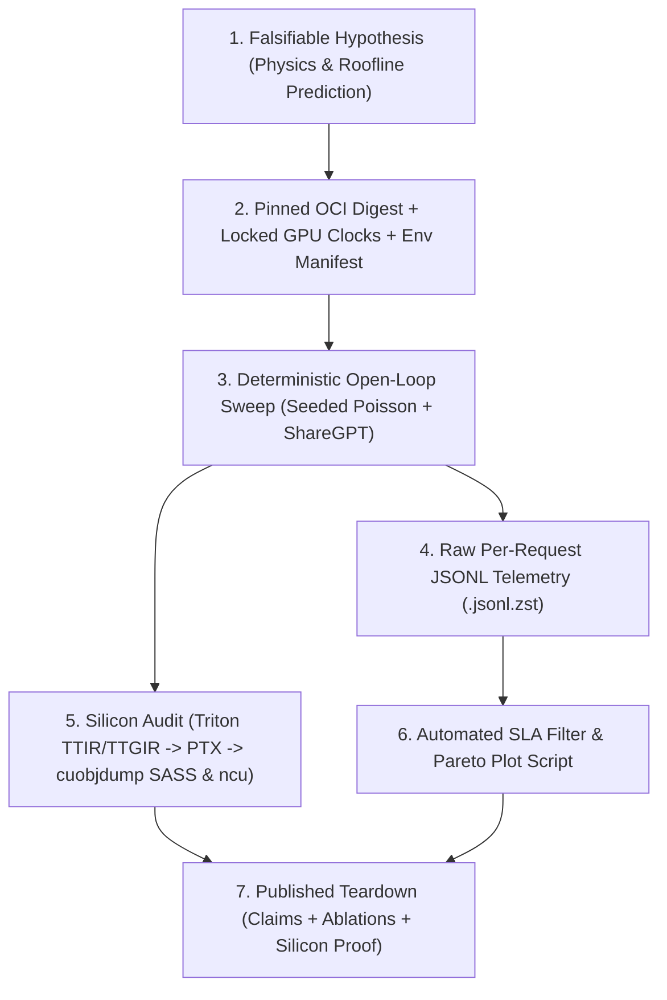
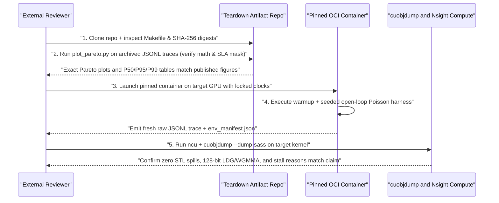

# 05 — Engineering Technical Communication

[← Pareto Frontier Analysis](./04-pareto-frontier-analysis.md) · [Stage 12 Overview](./README.md) · [Main Docs](../../README.md) · [Syllabus](../../syllabus.md)

---

## 1. Structuring Systems-Engineering Architectural Teardowns

A credible inference engineering teardown is **not** a marketing blog post displaying unlabelled bar charts ("Engine X is 2.4x faster!"). It is an empirical systems paper engineered so a skeptical staff engineer can verify the causal chain from **application SLA** down to **GPU instruction issue slots** and reproduce every number on independent hardware.

### The Canonical 6-Section Teardown Structure

| Section | Purpose & Mandatory Contents | Failure Mode Prevented |
| :--- | :--- | :--- |
| **1. Hypothesis & Falsifiable Claim** | State a quantitative, physics-grounded prediction upfront (e.g., *"Enabling FP8 KV cache + FlashInfer cuts Llama-3-70B decode TPOT by 28% at $B=64$, moving the P99-compliant Pareto knee from 1,450 to 1,920 tok/s/GPU"*). | Post-hoc cherry-picking and vague qualitative claims. |
| **2. Experimental Setup & Workload** | Exact model ID + weight SHA-256, quantization recipe, prompt/output token distributions (histograms/quantiles), open-loop Poisson $\lambda$ grid, `ignore_eos` setting, and explicit SLA bounds. | Comparing mismatched token budgets or synthetic fixed-length artifacts. |
| **3. Hardware & Software Invariants** | GPU SKU, VBIOS, driver version, CUDA/cuBLAS/NCCL versions, engine git commit SHA, locked SM/HBM clocks, `nvidia-smi topo -m` (PCIe/NVLink topology), NUMA binding, and container digest. | Attributing hardware/driver drift or DVFS boost to software changes. |
| **4. Empirical Measurements** | Complete percentile tables (`P50/P95/P99` for TTFT, ITL, TPOT, E2E), eCDF plots, SLA-masked Pareto curves, and step-by-step **ablation toggles** (isolating each flag/kernel independently). | Hiding tail latency behind means or bundling 5 changes into one unattributed delta. |
| **5. Root-Cause Silicon Analysis** | Connect macro latency deltas to Roofline bounds, Nsight Compute (`ncu`) hardware counters, memory bandwidth utilization, warp stall distributions, and IR/PTX/SASS inspection. | Treating engines as magical black boxes without proving *why* a change worked. |
| **6. Reproducibility Artifacts** | Pinned OCI container digests, deterministic seeds, one-command runner script, raw per-request JSONL traces, and automated figure-generation code. | Unverifiable screenshots and "works on my cluster" irreproducibility. |

---

## 2. Reading and Annotating the GPU Compiler Lowering Stack (IR → PTX → SASS)

To prove a kernel optimization genuinely eliminated redundant HBM round-trips, register spills, or shared-memory bank conflicts, systems engineers inspect all four lowering stages from high-level DSL down to native hardware machine code.

### 2.1 Stage 1 & 2: Triton TTIR and TTGIR

When writing or auditing Triton kernels (`TRITON_DUMP_IR=1` or inspecting `~/.triton/cache/<hash>/`), Triton emits two MLIR intermediate representations before LLVM:

1. **TTIR (Triton IR — `.ttir`):** Target-independent tensor-tile SSA form (`tt.load`, `tt.dot`, `arith.mulf`, `tt.store`). Verifies algebraic fusion: e.g., confirming that `RMSNorm` + `FP8 scale` + `cast` merged into one `tt.store` rather than materializing an intermediate FP16 tensor to global HBM.
2. **TTGIR (Triton GPU IR — `.ttgir`):** Target-aware physical layout assignment. Crucial annotations to audit:
   * `#triton_gpu.blocked<{sizePerThread = [1, 8], threadsPerWarp = [4, 8], warpsPerCTA = [4, 1]}>` — verifies coalesced 128-bit (`8 x fp16`) contiguous vector loads along the inner dimension.
   * `triton_gpu.async_copy_global_to_shared` / `tt_nvgpu.wgmma` — confirms asynchronous `cp.async` / Hopper TMA pipelining (`num_stages >= 3`) overlaps global memory latency with Tensor Core math.
   * **Red Flag — `triton_gpu.convert_layout`:** Excessive layout conversions routing through shared memory (`alloc_tensor`) indicate mismatched producer/consumer layouts that burn shared-memory bandwidth and barriers (`gpu.barrier`).

### 2.2 Stage 3: NVIDIA PTX (Virtual ISA — `.ptx`)

`ptxas` compiles LLVM IR into **PTX (Parallel Thread Execution)**—a typed, infinite-virtual-register assembly language portable across NVIDIA SM generations:

```ptx
// Example PTX excerpt: 128-bit vectorized non-coherent global load + Hopper MMA
ld.global.nc.v4.b32 {%r12, %r13, %r14, %r15}, [%rd4];   // 16-byte coalesced load
cp.async.cg.shared.global [%r20], [%rd8], 16;          // Async 16B copy bypass L1 -> SMEM
wgmma.mma_async.sync.aligned.m64n128k16.f32.f16.f16 ... // Hopper Warp-Group Tensor Core MMA
```

**What to Look For in PTX:**
* **Vectorization Width:** `ld.global.v4.b32` (128-bit) vs. scalar `ld.global.f16` (16-bit, wasting $8\times$ instruction issue slots!).
* **Predication & Divergent Branches:** `@%p1 bra BB_SLOW;` inside inner loops flags warp divergence; simple `@%p1 selp.b32` indicates branchless predication.
* **Memory Space Qualifiers:** Verify intentional `.shared`, `.global`, and absence of unintended `.local` loads/stores (`.local` means spilled registers!).

### 2.3 Stage 4: SASS (Native Streaming Assembler via `cuobjdump` / `ncu`)

PTX is **not** what executes on silicon—`ptxas` performs register allocation, instruction scheduling, and scoreboard barrier insertion to emit **SASS**, the actual binary micro-architecture ISA for `sm_80` (Ampere), `sm_89` (Ada), `sm_90a` (Hopper), or `sm_100a` (Blackwell).

Extract SASS directly from a compiled `.cubin` or PyTorch/Triton shared object:
```bash
# Dump SASS for all embedded cubins in a compiled extension or Triton cache
cuobjdump --dump-sass kernel.cubin > kernel.sass

# Or inspect live kernel SASS correlated with source lines + stall reasons via Nsight Compute
ncu --set full --kernel-name regex:flash_fwd -o profile_report python bench_step.py
```

**Reading and Annotating Real SASS Instructions:**

```text
/*01a0*/  LDG.E.128.CONSTANT R4, [R2.64] ;       /* Coalesced 128-bit global load into R4..R7 */
/*01b0*/  LDGSTS.E.BYPASS.128 [UR4], [R8.64] ;   /* Async global->shared bypassing L1 cache */
/*01c0*/  UTMALDG.2D [UR6], [UR8] ;              /* Hopper TMA 2D async tensor load to SMEM */
/*01d0*/  DEPBAR.LE SB0, 0x0 ;                   /* Wait on Scoreboard 0 until async load lands */
/*01e0*/  QGMMA.64x128x16.F32.F16.F16 R16, descA, descB ; /* Hopper Warp-Group Tensor Core MMA */
/*01f0*/  STS.128 [R12], R24 ;                   /* 128-bit Shared Memory store (check bank conflicts) */
/*0200*/  STL.64 [R1+0x10], R30 ;                /* RED FLAG: Local memory register spill! */
```

**Five High-Signal SASS & `ncu` Diagnostics for Teardowns:**
1. **Register Spilling (`STL` / `LDL`):** Indicates thread register pressure exceeded the 255-register hardware limit (or `--maxrregcount` cap), spilling variables into **off-chip HBM local memory** (cached in L1/L2, catastrophic under pressure). Fix: reduce tile size (`BLOCK_M/N`) or unroll depth.
2. **Occupancy vs. Register Count:** Printed in `cuobjdump --dump-resource-usage` (`REG:128 STACK:0 SHARED:49152`). On Hopper ($65{,}536$ 32-bit registers/SM), $128$ registers/thread caps active threads at $65{,}536 / 128 = 512$ threads/SM ($25\%$ theoretical occupancy), which may be insufficient to hide HBM latency during decode.
3. **Long Scoreboard Stalls (`stall_long_scoreboard` in `ncu`):** Warps stalled waiting at `DEPBAR` for global `LDG` / `UTMALDG` memory returns—the direct hardware signature of a **memory-bandwidth-bound decode kernel** or insufficient `num_stages` software pipelining.
4. **Shared-Memory Bank Conflicts (`l1tex__data_bank_conflicts_pipe_lsu_mem_shared`):** `LDS`/`STS` instructions replaying across 32 shared-memory banks; solved in TTGIR/CUDA via XOR swizzling of tile column indices.
5. **Dual-Issue & Pipe Saturation:** Checking `sm__pipe_tensor_cycles_active.avg.pct_of_peak_sustained_elapsed` in `ncu` proves whether prefill truly saturates Tensor Cores ($>75\%$) or stalls in `ALU`/`MIO` pipes on softmax/RoPE/dequantization unpacking.

---

## 3. Packaging 100% Reproducible Artifacts

An engineering teardown without reproducible artifacts decays within weeks as upstream containers and pip dependencies drift. Package every published benchmark as a **self-contained, immutable verification bundle**:

### 3.1 Artifact Checklist

1. **Pinned OCI Container Digest (Never `:latest`):**
   ```dockerfile
   # Pin exact SHA-256 manifest digest, not mutable tag
   FROM nvcr.io/nvidia/vllm@sha256:8f3c9e1a... AS runtime
   ```
2. **Automated Environment Manifest (`env_manifest.json`):** Captured automatically at startup before the warmup phase:
   * `nvidia-smi --query-gpu=name,vbios_version,driver_version,clocks.sm,clocks.mem,power.limit --format=csv`
   * `nvidia-smi topo -m` (NVLink/PCIe switch verification)
   * `pip freeze`, `git rev-parse HEAD`, `uname -a`, `lscpu`, and all engine CLI flags + environment variables (`NCCL_*`, `VLLM_ATTENTION_BACKEND`, `FLASHINFER_*`).
3. **Deterministic Seeds:** Pass explicit seeds to dataset samplers, open-loop Poisson inter-arrival generators, and request sampling (`temperature=0` or fixed seed) so independent runs replay identical arrival offsets and prompt sequences.
4. **Raw Immutable Per-Request JSONL Traces (`traces/<config_id>.jsonl.zst`):** Never publish only aggregated CSVs or PNG charts! Retaining raw per-request records lets third parties recompute any quantile, verify `client_dispatch_skew`, filter edge cases, or plot alternative SLA thresholds:
   ```json
   {
     "config_id": "vllm-0.6.4-llama70b-fp8-tp4-rps16",
     "req_id": 412,
     "seed": 42,
     "prompt_tokens": 1842,
     "output_tokens": 318,
     "t_scheduled_ns": 1732482012045120000,
     "t_dispatch_ns": 1732482012045410000,
     "t_first_token_ns": 1732482012289100000,
     "token_timestamps_ns": [1732482012289100000, 1732482012316400000, "..."],
     "status": "ok"
   }
   ```
5. **Declarative One-Command Plotting & Verification (`Makefile`):** `make reproduce` pulls the pinned digest, executes the warmup + open-loop sweep, writes `.jsonl.zst`, runs the Python/Polars aggregation script, and regenerates every SVG/PNG Pareto chart and eCDF published in the article.

---

## 4. Reproducible Teardown & Verification Workflow



---

## 5. External Reader Reproduction & Claim Validation Sequence



---

## Navigation

* **Previous:** [← 04 — Pareto Frontier Analysis](./04-pareto-frontier-analysis.md)
* **Up:** [Stage 12 Overview](./README.md) · [Main Docs](../../README.md) · [Syllabus](../../syllabus.md)
