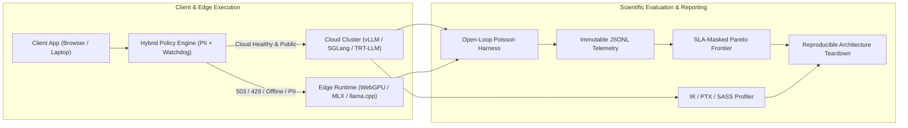

# Stage 12: Edge Inference & Portfolio

[Inference Engineering Docs](../../README.md) · [Complete Syllabus](../../syllabus.md) · **Stage 12**

---

## Overview

Stages 1 through 11 established the physics, kernels, distributed topologies, FinOps economics, and gateway routing architectures required to operate Large Language Models in data-center GPU clusters. **Stage 12** closes the loop along two converging systems-engineering axes:

1. **Client-Side Execution & Resilience (Edge & Hybrid Systems):** Pushing quantized LLM inference directly onto consumer silicon—CPUs, Apple Silicon Unified Memory (MLX), `llama.cpp` GGUF hybrid execution, and sandboxed browser GPUs (WebGPU/WGSL)—and engineering deterministic, privacy-preserving cloud-to-edge failover so applications survive upstream outages, rate-limit exhaustion, and offline transitions without losing conversational state.
2. **Scientific Rigor & Systems Communication (Benchmarking & Portfolio):** Evaluating inference engines without falling prey to closed-loop *coordinated omission*, constructing SLA-constrained multi-objective Pareto frontiers (Cost per 1M tokens vs. TTFT vs. ITL vs. Goodput), and publishing reproducible architectural teardowns grounded in Triton IR, PTX, and SASS hardware assembly analysis.

---

## Stage 12 Curriculum Index

| # | Topic | Core Systems Mechanics |
| :--- | :--- | :--- |
| 01 | [**Edge Runtimes & Unified Architecture**](./01-edge-runtimes-and-unified-architecture.md) | `llama.cpp` GGUF binary layout (`mmap`, alignment, K-quants `Q4_K_M`/`Q5_K_M`, IQ-quants, hybrid CPU/GPU `-ngl` offloading), Apple Silicon MLX (Unified Memory Architecture zero-copy `MTLBuffer`, lazy evaluation graphs, Metal `simdgroup` kernels), and browser WebGPU (WGSL compute shaders, WASM orchestration, `maxBufferSize` & tab memory constraints). |
| 02 | [**Hybrid Cloud-Edge Architectures**](./02-hybrid-cloud-edge-architectures.md) | Upstream fault detection (`429`/`503`, TTFT/ITL stream watchdogs, circuit breakers), seamless state handoff to 1B–4B local models, context window truncation/summarization under edge VRAM budgets, local PII routing/redaction, and edge-draft / cloud-verify speculative collaboration. |
| 03 | [**Scientific Benchmarking Methodology**](./03-scientific-benchmarking-methodology.md) | GPU warmup (Triton JIT, CUDA allocator pooling, CUDA Graph capture), open-loop Poisson/bursty arrival processes vs. closed-loop coordinated omission, realistic heavy-tailed datasets (ShareGPT, LongBench), thermal/DVFS/cache noise isolation, and P50/P95/P99 reporting across TTFT, ITL, TPOT, and E2E latency. |
| 04 | [**Pareto Frontier Analysis**](./04-pareto-frontier-analysis.md) | Multi-objective Pareto dominance over Cost/1M tokens, TTFT, ITL, and Goodput; hard SLA masking (`P99 TTFT <= 500 ms`, `P99 TPOT <= 50 ms`) vs. raw throughput traps; sweeping concurrency, TP degree, precision, and engines to locate the Pareto knee; normalizing unit economics across GPU SKUs. |
| 05 | [**Engineering Technical Communication**](./05-engineering-technical-communication.md) | Six-part architectural teardown structure, reading and annotating the compiler lowering stack (Triton TTIR/TTGIR, NVIDIA PTX, SASS via `cuobjdump`/`ncu`), and packaging 100% reproducible artifacts (pinned container digests, deterministic seeds, raw JSONL traces, automated plot pipelines). |

---

## End-to-End Stage 12 Architecture

---

## Navigation

* **Up:** [Main Documentation Index](../../README.md) | [Complete Syllabus](../../syllabus.md)
* **Previous Stage:** [← Stage 11: AI Gateway, Routing & Reliability](../stage-11/README.md)
* **Start Reading:** [01 — Edge Runtimes & Unified Architecture](./01-edge-runtimes-and-unified-architecture.md)
